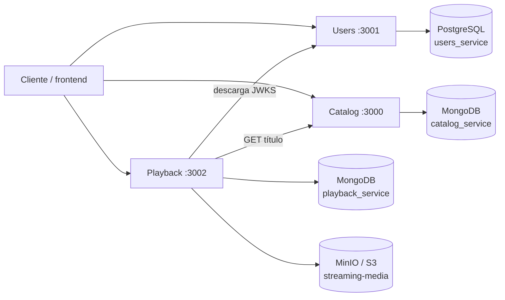

# Arquitectura de datos, relaciones y APIs

Documento técnico del estado actual del repositorio. Describe los tres microservicios, sus almacenes, las relaciones internas y entre servicios, y los contratos HTTP disponibles.

> Fuentes de verdad: el esquema Drizzle de Users, los validadores e índices MongoDB de Catalog y Playback, y los contratos OpenAPI de cada servicio. Este documento no sustituye esos contratos.

## 1. Vista general

| Servicio | URL local | Responsabilidad | Persistencia propia |
| --- | --- | --- | --- |
| Catalog Service | `http://127.0.0.1:3000` | Películas, series, ficha editorial, publicación y referencia al recurso multimedia | MongoDB, base `catalog_service` |
| Users Service | `http://127.0.0.1:3001` | Registro, autenticación, perfil, sesiones refresh, Mi Lista y LIKE/DISLIKE | PostgreSQL, base `users_service` |
| Playback Service | `http://127.0.0.1:3002` | Carga de videos, sesiones, progreso, historial y URLs firmadas | MongoDB, base `playback_service`, más MinIO/S3 para archivos |

Cada microservicio es dueño exclusivo de sus datos. No hay consultas directas desde un servicio hacia la base de otro ni claves foráneas entre bases.



## 2. Identificadores compartidos

Los servicios se relacionan mediante identificadores públicos, no mediante el `_id` de MongoDB ni el `id` interno de PostgreSQL.

| Prefijo | Ejemplo de formato | Dueño | Consumidores |
| --- | --- | --- | --- |
| `usr_` | `usr_<UUID v4>` | Users | JWT y documentos de Playback |
| `ttl_` | `ttl_<UUID v4>` | Catalog | Users (Mi Lista/preferencias) y Playback |
| `ast_` | `ast_<UUID v4>` | Playback | Catalog mediante `playbackReference.assetId` |
| `ses_` | `ses_<UUID v4>` | Playback | API de sesiones de Playback |
| `evt_` | `evt_<UUID v4>` | Playback | Outbox de eventos |

Consecuencias del diseño:

- `title_id`/`tituloId` en Users no tiene FK hacia Catalog. Users valida el formato, pero no comprueba que el título exista.
- `userId` y `tituloId` en Playback son referencias lógicas. MongoDB no impone integridad con Users o Catalog.
- Catalog guarda el `assetId` generado por Playback en `playbackReference`; tampoco existe una FK distribuida.
- Borrar o retirar información en un servicio no produce cascadas automáticas en los otros. La aplicación debe tolerar referencias huérfanas y estados retirados.

## 3. Users Service: PostgreSQL

### Conexión

- Motor: PostgreSQL 17.
- Base: `users_service`.
- Usuario Compose: `users`.
- Dentro de Compose: `postgres:5432`.
- Desde el host: `127.0.0.1:5433` por defecto.
- Variable principal: `DATABASE_URL`.
- ORM/migraciones: Drizzle; el contenedor `users-migrate` aplica las migraciones antes de iniciar la API.
- Volumen: `users_postgres_data`.

### Tablas

#### `users`

Raíz de usuario y credenciales.

| Campo | Tipo/forma | Descripción |
| --- | --- | --- |
| `id` | `bigserial`, PK | ID interno; nunca se comparte fuera del servicio |
| `user_id` | `varchar(40)`, único | ID público `usr_<UUID v4>` |
| `email` | `varchar(254)`, único | Normalizado con trim y minúsculas |
| `password_hash` | `text` | Hash Argon2id, nunca la contraseña |
| `status` | enum | `ACTIVE` o `INACTIVE` |
| `role` | enum | `USER` o `ADMIN` |
| `auth_version` | entero positivo | Invalida tokens tras cambios sensibles |
| `created_at`, `updated_at` | `timestamptz` | Auditoría |

#### `profiles`

Relación 1:1 con `users`.

| Campo | Tipo/forma | Descripción |
| --- | --- | --- |
| `user_id` | `bigint`, PK y FK | Apunta a `users.id`; borrado en cascada |
| `display_name` | `varchar(100)` | Nombre visible no vacío |
| `avatar_url` | `varchar(2048)`, nullable | Avatar |
| `preferred_language` | `varchar(5)` | Predeterminado `es`; admite forma como `es-PE` |

#### `refresh_tokens`

Sesiones refresh opacas y rotatorias.

| Campo | Descripción |
| --- | --- |
| `id` | UUID, PK |
| `user_id` | FK a `users.id`, cascade |
| `family_id` | Agrupa la cadena de rotación y permite revocarla |
| `token_hash` | SHA-256 hexadecimal único; el token original no se guarda |
| `expires_at`, `revoked_at`, `consumed_at`, `created_at` | Ciclo de vida de la sesión |

#### `watchlist_items`

Mi Lista. PK compuesta `(user_id, title_id)` para impedir duplicados.

| Campo | Descripción |
| --- | --- |
| `user_id` | FK a `users.id`, cascade |
| `title_id` | Referencia lógica `ttl_<UUID v4>` hacia Catalog, sin FK externa |
| `created_at` | Fecha de incorporación |

#### `content_preferences`

Señales explícitas. PK compuesta `(user_id, title_id)`.

| Campo | Descripción |
| --- | --- |
| `user_id` | FK a `users.id`, cascade |
| `title_id` | Referencia lógica a Catalog |
| `value` | enum `LIKE` o `DISLIKE` |
| `created_at`, `updated_at` | Auditoría |

#### `rate_limit_buckets`

Contadores compartidos de rate limiting entre réplicas: `key` (PK), `hits` y `expires_at`. Es infraestructura, no parte del agregado Usuario.

### Relaciones internas

```mermaid
erDiagram
    USERS ||--|| PROFILES : tiene
    USERS ||--o{ REFRESH_TOKENS : inicia
    USERS ||--o{ WATCHLIST_ITEMS : guarda
    USERS ||--o{ CONTENT_PREFERENCES : expresa

    USERS {
      bigint id PK
      varchar user_id UK
      varchar email UK
      text password_hash
      enum status
      enum role
    }
    PROFILES { bigint user_id PK_FK }
    REFRESH_TOKENS {
      uuid id PK
      bigint user_id FK
      uuid family_id
    }
    WATCHLIST_ITEMS {
      bigint user_id PK,FK
      varchar title_id PK
    }
    CONTENT_PREFERENCES {
      bigint user_id PK,FK
      varchar title_id PK
      enum value
    }
```

## 4. Catalog Service: MongoDB

### Conexión

- Motor: MongoDB 8.
- Base predeterminada: `catalog_service`.
- Dentro de Compose: `mongodb://mongo:27017`.
- Mongo no se publica al host en el Compose normal; `compose.dev.yml` puede exponerlo en `127.0.0.1:27017`.
- Variables: `MONGODB_URI`, `MONGODB_DATABASE`, tamaño de pool y timeouts.
- El proceso `catalog-init` crea o actualiza colecciones, validadores estrictos e índices.
- Volumen: `catalog_mongo_data`.

### Colección `catalog_titles`

Documento principal de películas y series.

| Campo | Descripción |
| --- | --- |
| `_id` | `ObjectId` interno |
| `schemaVersion` | Versión de documento; actualmente `1` |
| `tituloId` | ID público único `ttl_<UUID v4>` |
| `importKey` | Clave idempotente única de importación |
| `importFingerprint` | SHA-256 del contenido importado |
| `typeId` | `1=MOVIE`, `2=SERIES` |
| `ficha` | Datos editoriales embebidos |
| `publicationStatusId` | `1=REGISTRADO`, `2=PUBLICADO`, `3=RETIRADO` |
| `playbackReference` | Referencia técnica embebida o `null` |
| `createdAt`, `updatedAt` | Fechas BSON |
| `version` | Control de concurrencia optimista |

`ficha` contiene `title`, `synopsis`, `releaseYear`, `genres[]`, `languages[]`, `cast[]` y campos opcionales como `originalTitle`, `durationMinutes`, `ageRatingId`, `posterUrl`, `backdropUrl` y `director`.

Reglas relevantes:

- Una película requiere `durationMinutes` y un `playbackReference`.
- Una serie no lleva duración propia y su `playbackReference` es `null`.
- Los géneros, idiomas, tipos, estados y clasificaciones se guardan como IDs BSON `Int32`; los nombres se derivan al responder.
- El ciclo editorial permitido es `REGISTRADO → PUBLICADO → RETIRADO`; repetir el mismo estado es idempotente.

`playbackReference` contiene:

| Campo | Descripción |
| --- | --- |
| `providerId` | Actualmente `1=CDN` |
| `assetId` | Referencia lógica al `media_assets.assetId` de Playback |
| `manifestKey` | Clave/ruta técnica informativa |

Índices principales: únicos por `tituloId` e `importKey`; orden por actualización; filtro compuesto por estado/tipo; índices por año y género; índice de texto en título y título original.

### Colección `catalog_episodes`

Está creada y validada por el inicializador para el modelo futuro de episodios.

| Campo | Descripción |
| --- | --- |
| `episodeId` | ID público único |
| `seriesId` | Referencia lógica al `tituloId` de una serie |
| `seasonNumber`, `episodeNumber` | Posición; combinación única con `seriesId` |
| `ficha` | Título, sinopsis y duración del episodio |
| `playbackReference` | Referencia al recurso de Playback |
| campos comunes | Estado, fechas, versión y versión de esquema |

No existe todavía una API de episodios en este repositorio. La colección y sus índices están preparados, pero las operaciones HTTP actuales trabajan con `catalog_titles`.

## 5. Playback Service: MongoDB y MinIO

### Conexiones

- MongoDB 8, base predeterminada `playback_service`.
- El Mongo de Playback usa replica set `rs0`, necesario para transacciones.
- Dentro de Compose: `mongodb://mongodb:27017/?replicaSet=rs0`.
- Desde el host: `127.0.0.1:27019`.
- Volumen Mongo: `playback_mongo_data`.
- MinIO interno: `minio:9000`; desde el host API `:9000` y consola `:9001`.
- Bucket predeterminado: `streaming-media`.
- Volumen de objetos: `playback_minio_data`.

MongoDB guarda metadata y estado; MinIO guarda el archivo MP4 real. Las URLs de reproducción son firmadas y temporales (`PLAYBACK_URL_TTL`, 900 segundos por defecto).

### Colección `media_assets`

Metadata de videos cargados por administradores.

| Campo | Descripción |
| --- | --- |
| `assetId` | ID único `ast_<UUID v4>` |
| `objectKey`, `bucket` | Ubicación privada en MinIO/S3 |
| `contentType` | `video/mp4` |
| `originalFilename`, `sizeBytes` | Metadata de carga |
| `durationSeconds`, `codec`, `width`, `height` | Metadata técnica obtenida con ffprobe |
| `status` | `READY` o `DELETED` |
| `createdAt`, `updatedAt` | Auditoría |
| `referenceRevision` | Contador de usos/referencias |

La eliminación expuesta por la API es lógica: cambia el estado a `DELETED`. Se rechaza si el asset tiene sesiones `ACTIVE` o `PAUSED`.

### Colección `playback_sessions`

Una ejecución concreta del reproductor.

| Campo | Descripción |
| --- | --- |
| `sessionId` | ID único `ses_<UUID v4>` |
| `userId` | Referencia lógica a Users |
| `tituloId` | Referencia lógica a Catalog |
| `assetId` | Referencia lógica a `media_assets` dentro del servicio |
| `status` | `REQUESTED`, `ACTIVE`, `PAUSED`, `COMPLETED` o `FAILED` |
| `progress` | Posición, duración, porcentaje y fecha de actualización |
| `startedAt`, `lastActivityAt`, `completedAt` | Ciclo de vida |
| `supersededAt` | Marca una sesión sustituida por un reproductor más nuevo |
| `emittedMilestone` | Control de eventos de avance cada 25 % |

Solo una sesión puede ser la vigente para el progreso usuario/título. Al iniciar otra, una sesión abierta anterior queda superseded y ya no puede sobrescribir el progreso.

### Colección `playback_progress`

Vista consolidada con un documento por `(userId, tituloId)`.

| Campo | Descripción |
| --- | --- |
| `userId`, `tituloId` | Índice compuesto único |
| `assetId` | Asset reproducido |
| `progress` | Última posición consolidada |
| `status` | `IN_PROGRESS` o `COMPLETED` |
| `continueWatching` | `true` si no terminó y el avance es menor a 90 % |
| `lastSessionId`, `lastActivityAt` | Sesión y actividad más recientes |

Esta colección alimenta directamente “Continuar viendo” e historial, sin consultar todas las sesiones.

### Colección `outbox_events`

Outbox transaccional para `PLAYBACK_STARTED`, `PLAYBACK_PAUSED`, `PLAYBACK_COMPLETED` y `PLAYBACK_PROGRESS_UPDATED`. Cada evento conserva `eventId`, versión, fecha, usuario, título, datos de sesión y `deliveryStatus`.

Los eventos se insertan en la misma transacción Mongo que sesión/progreso. En el estado actual se crean como `PENDING`; no hay en este repositorio un worker que los publique a un broker o los cambie a `DELIVERED`.

### Colección `rate_limit_buckets`

Contadores con clave hash, cantidad y expiración. Tiene índice TTL para limpieza automática.

## 6. Relaciones entre servicios y flujo de reproducción

| Origen | Destino | Mecanismo | Propósito |
| --- | --- | --- | --- |
| Playback | Users | `GET /.well-known/jwks.json` | Descargar la clave pública y validar JWT RS256 |
| Playback | Catalog | `GET /api/v1/catalog/{tituloId}` | Confirmar existencia, estado `PUBLICADO` y obtener `assetId` |
| Catalog | Playback | Referencia lógica persistida | `playbackReference.assetId` identifica el asset |
| Users | Catalog | Referencia lógica persistida | Mi Lista y preferencias guardan `title_id` |
| Cliente | Todos | HTTP REST | Orquesta autenticación, catálogo y reproducción |

Flujo normal:

1. Un administrador obtiene un JWT en Users.
2. Carga un MP4 en Playback; Playback devuelve un `assetId`.
3. El título de Catalog se crea/importa con ese `assetId` dentro de `playbackReference` y se lleva a `PUBLICADO`.
4. Un usuario inicia sesión en Users y recibe un access token RS256.
5. Solicita a Playback una sesión para un `tituloId`.
6. Playback valida el JWT usando JWKS, consulta el título en Catalog, comprueba que está publicado y obtiene el `assetId`.
7. Playback verifica metadata Mongo + objeto MinIO, crea sesión/progreso/evento en una transacción y devuelve una URL firmada temporal.

Actualmente no existe un endpoint que conecte automáticamente el asset recién cargado con un título ya creado. Esa asociación se entrega en la carga masiva inicial de Catalog; el `PATCH` editorial no modifica `playbackReference`.

## 7. APIs HTTP

### Users Service

| Método | Ruta | Autenticación | Función |
| --- | --- | --- | --- |
| `POST` | `/api/v1/auth/register` | Pública | Crea usuario `USER/ACTIVE` y perfil |
| `POST` | `/api/v1/auth/login` | Pública | Devuelve access JWT y cookie refresh |
| `POST` | `/api/v1/auth/refresh` | Cookie + protección CSRF | Rota refresh y emite access token |
| `POST` | `/api/v1/auth/logout` | Cookie opcional + CSRF | Revoca la familia y borra cookie |
| `GET` | `/api/v1/users/me` | Bearer | Devuelve usuario y perfil actuales |
| `PATCH` | `/api/v1/users/me` | Bearer | Cambia nombre, avatar o idioma |
| `POST` | `/api/v1/users/me/change-password` | Bearer | Cambia clave y revoca sesiones |
| `GET` | `/api/v1/users/me/watchlist` | Bearer | Lista referencias paginadas |
| `POST` | `/api/v1/users/me/watchlist/{tituloId}` | Bearer | Agrega a Mi Lista |
| `DELETE` | `/api/v1/users/me/watchlist/{tituloId}` | Bearer | Elimina de Mi Lista |
| `GET` | `/api/v1/users/me/preferences` | Bearer | Lista LIKE/DISLIKE paginados |
| `PUT` | `/api/v1/users/me/preferences/{tituloId}` | Bearer | Crea o actualiza LIKE/DISLIKE |
| `DELETE` | `/api/v1/users/me/preferences/{tituloId}` | Bearer | Elimina la preferencia |
| `GET` | `/.well-known/jwks.json` | Pública | Publica únicamente la clave RSA pública |
| `GET` | `/api/health` | Pública | Comprueba PostgreSQL y configuración JWT |

Paginación de listas: `page=1`, `limit=20`, máximo 100. El refresh se almacena en cookie HttpOnly, SameSite Strict; el access token dura 900 s por defecto.

### Catalog Service

| Método | Ruta | Función |
| --- | --- | --- |
| `GET` | `/api/v1/catalog` | Lista títulos con paginación y filtros `type`, `status`, `genre`, `year`, `q` |
| `POST` | `/api/v1/catalog/bulk` | Inserción masiva idempotente, hasta 500 elementos por defecto |
| `GET` | `/api/v1/catalog/{tituloId}` | Ficha completa y referencia técnica |
| `PATCH` | `/api/v1/catalog/{tituloId}` | Modifica únicamente campos editoriales de `ficha` |
| `PATCH` | `/api/v1/catalog/{tituloId}/publication-status` | Ejecuta transición editorial |
| `GET` | `/api/health` | Comprueba MongoDB |

La API actual de Catalog no exige Bearer token. Si se expone fuera de una red confiable, hace falta agregar autorización o un gateway que proteja las escrituras.

### Playback Service

Todos los endpoints de negocio requieren Bearer JWT. Los endpoints de assets exigen además rol `ADMIN`.

| Método | Ruta | Rol/función |
| --- | --- | --- |
| `POST` | `/api/v1/media/assets` | ADMIN; carga multipart de MP4 H.264/AAC, 256 MiB por defecto |
| `GET` | `/api/v1/media/assets/{assetId}` | ADMIN; consulta metadata |
| `DELETE` | `/api/v1/media/assets/{assetId}` | ADMIN; eliminación lógica |
| `POST` | `/api/v1/playback/sessions` | Usuario; inicia con `{ "tituloId": "ttl_..." }` |
| `PATCH` | `/api/v1/playback/sessions/{sessionId}/progress` | Guarda `{ "positionSeconds": n }` |
| `POST` | `/api/v1/playback/sessions/{sessionId}/pause` | Pausa; posición opcional |
| `POST` | `/api/v1/playback/sessions/{sessionId}/resume` | Reanuda y entrega URL nueva |
| `POST` | `/api/v1/playback/sessions/{sessionId}/complete` | Completa y fija posición final |
| `POST` | `/api/v1/playback/sessions/{sessionId}/refresh-url` | Renueva URL firmada de sesión abierta |
| `GET` | `/api/v1/playback/me/continue-watching` | Progreso pendiente paginado |
| `GET` | `/api/v1/playback/me/history` | Última reproducción por título |
| `GET` | `/api/health` | Pública; comprueba MongoDB y object storage |

Playback valida algoritmo `RS256`, `issuer=users-service`, `audience=streaming-services`, expiración, `kid` y claims. Límite general: 240 peticiones/minuto por usuario; la carga tiene un límite adicional configurable de 10/hora.

## 8. Puesta en marcha y conectividad local

Cada carpeta tiene su propio `docker-compose.yml`; no existe un Compose raíz que levante todo el sistema. Orden recomendado:

1. Iniciar Catalog en `catalog-service`.
2. Generar `.env` e iniciar Users en `users-service`.
3. Generar `.env` e iniciar Playback en `playback-service`.
4. Verificar `GET /api/health` en los puertos 3000, 3001 y 3002.

El Compose de Playback usa estas conexiones entre proyectos separados:

```text
CATALOG_SERVICE_URL=http://host.docker.internal:3000
USERS_JWKS_URL=http://host.docker.internal:3001/.well-known/jwks.json
```

Por eso Catalog y Users deben publicar sus puertos en el host. En Linux se agrega `host.docker.internal:host-gateway`; Docker Desktop ya soporta este patrón.

No ejecutar `docker compose down -v` si se desea conservar datos: eliminaría los volúmenes del proyecto correspondiente.

## 9. Contratos y archivos de referencia

- Users: [`users-service/docs/openapi.yaml`](users-service/docs/openapi.yaml), [`schema.ts`](users-service/src/modules/users/infrastructure/persistence/schema.ts), [`docker-compose.yml`](users-service/docker-compose.yml).
- Catalog: [`catalog-service/docs/openapi.yaml`](catalog-service/docs/openapi.yaml), [`catalog-document.ts`](catalog-service/src/modules/catalog/infrastructure/persistence/mongodb/documents/catalog-document.ts), [`catalog-validators.ts`](catalog-service/src/modules/catalog/infrastructure/persistence/mongodb/validators/catalog-validators.ts), [`catalog-indexes.ts`](catalog-service/src/modules/catalog/infrastructure/persistence/mongodb/indexes/catalog-indexes.ts).
- Playback: [`playback-service/docs/openapi.yaml`](playback-service/docs/openapi.yaml), [`model.ts`](playback-service/src/modules/playback/domain/model.ts), [`mongo.ts`](playback-service/src/modules/playback/infrastructure/mongo.ts), [`docker-compose.yml`](playback-service/docker-compose.yml).

