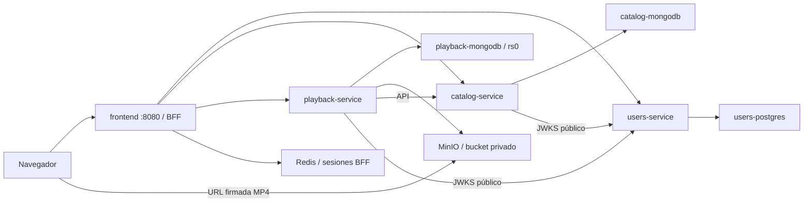

# NÉVARO · Plataforma de streaming

MVP académico con frontend Next.js, Users, Catalog y Playback. Registro/login, catálogo, Mi Lista, LIKE/DISLIKE, carga de MP4 por ADMIN, reproducción con URL firmada y progreso. Recommendations y Payments no están implementados.

## 1. Prerrequisitos

- Git.
- Docker Engine con Compose **v2.24 o posterior**, o Docker Desktop con contenedores Linux. En Windows, activar WSL 2 y arrancar Docker Desktop.
- Recomendado para builds locales: 4 CPU, 8 GB de RAM disponibles para Docker y 15 GB libres. El primer build de MinIO compila sus fuentes Go y puede tardar varios minutos; posteriores builds usan caché.
- Node.js **24** y npm para los comandos de conveniencia y tests. El stack puede levantarse solo con Docker, usando la alternativa de configuración abajo.
- Puertos libres: 8080–8083, 9000 y 9001. Se pueden cambiar en `.env` raíz.

Comprobar `docker info`, `docker compose version` y, si se usa npm, `node --version`.

## 2. Clonar y configurar ENV

```sh
git clone https://github.com/Anxiet1793/microservicios-streaming.git
cd microservicios-streaming
npm run stack:setup
```

No es necesario ejecutar npm install en la raíz: sus scripts usan solo módulos estándar de Node. Cada proyecto conserva su propio package.json/lockfile y sus instalaciones para desarrollo y pruebas.

`stack:setup` genera **`.env` raíz** a partir de [.env.example](.env.example): contraseñas aleatorias, secreto de sesión de 64 hex y un par RSA 2048. No imprime secretos y **no sobrescribe un `.env` existente**. No copiar credenciales personales ni utilizar una base externa. Los `.env` de los Compose individuales no se leen desde el Compose raíz.

Sin Node instalado, generar el mismo archivo desde Docker (funciona en PowerShell y bash):

```sh
docker run --rm --mount "type=bind,source=.,target=/workspace" -w /workspace node:24-bookworm-slim node scripts/setup-stack.mjs
```

También es posible copiar `.env.example` a `.env`, pero hay que sustituir **todos** los placeholders y aportar claves PKCS8/SPKI válidas; el generador evita ese trabajo. No basta copiar el ejemplo sin editar.

Variables principales:

| Variable                                                  | Propósito / valor local                                                                           |
| --------------------------------------------------------- | ------------------------------------------------------------------------------------------------- |
| COMPOSE_PROJECT_NAME                                      | `nevaro`; prefijo de contenedores, imágenes y volúmenes propios                                   |
| COMPOSE_PARALLEL_LIMIT / COMPOSE_BAKE                     | `1` / `false`; limita concurrencia de llamadas Docker (BuildKit puede paralelizar fases internas) |
| FRONTEND_PORT / USERS_PORT / CATALOG_PORT / PLAYBACK_PORT | 8080 / 8081 / 8082 / 8083                                                                         |
| MINIO_API_PORT / MINIO_CONSOLE_PORT                       | 9000 / 9001                                                                                       |
| APP_ORIGIN                                                | `http://localhost:8080`; origen exacto permitido para cookies/CSRF                                |
| MEDIA_ORIGIN                                              | `http://localhost:9000`; dirección que el **navegador** puede alcanzar para MP4                   |
| POSTGRES_PASSWORD                                         | Contraseña aleatoria de la base exclusiva de Users                                                |
| MINIO_ACCESS_KEY / MINIO_SECRET_KEY                       | Credenciales locales aleatorias del almacenamiento                                                |
| JWT_PRIVATE_KEY / JWT_PUBLIC_KEY                          | PEM entre comillas con saltos `\n`; solo Users recibe la privada                                  |
| JWT_KEY_ID / JWT_ISSUER / JWT_AUDIENCE                    | Identidad del firmante compartida como contrato, no su clave privada                              |
| SESSION_SECRET                                            | 64 caracteres hex; cifrado de sesiones del BFF en Redis                                           |
| ACCESS_TOKEN_TTL / REFRESH_TOKEN_TTL                      | 900 / 2592000 segundos                                                                            |
| DEMO_SEED_ENABLED                                         | `true`; cuentas demo y película sintética. `false` inicia el sistema vacío                        |
| SEED_PASSWORD                                             | Contraseña generada para las dos cuentas demo, solo desarrollo                                    |

Si se cambia un puerto, ajustar también APP_ORIGIN o MEDIA_ORIGIN correspondiente. MEDIA_ORIGIN forma parte de la CSP durante el build de frontend: ejecutar nuevamente `docker compose up --build`. Abrir el frontend usando el mismo host de APP_ORIGIN (localhost y 127.0.0.1 son orígenes diferentes). Las contraseñas generadas usan caracteres seguros para las URIs SQL.

## 3. Levantar todo desde la raíz

Después de configurar `.env`, el comando solicitado es:

```sh
docker compose up --build
```

Deja los logs en primer plano. Para trabajar en segundo plano y esperar readiness:

```sh
docker compose up --build -d --wait --wait-timeout 300
```

O con configuración inicial automática, arranque y smoke al finalizar:

```sh
npm run stack:up
```

No se ejecuta ninguna migración manual. Si un migrador o inicializador falla, sus dependientes no arrancan; revisar sus logs. Healthchecks activos en los cuatro servidores, PostgreSQL, los dos MongoDB, MinIO y Redis. Los procesos init/seed deben aparecer como **Exited (0)**, no como servidores healthy.

| Componente                  | URL desde el host                                                    |
| --------------------------- | -------------------------------------------------------------------- |
| Frontend                    | [http://localhost:8080](http://localhost:8080)                       |
| Users health                | [http://localhost:8081/api/health](http://localhost:8081/api/health) |
| Catalog health              | [http://localhost:8082/api/health](http://localhost:8082/api/health) |
| Playback health             | [http://localhost:8083/api/health](http://localhost:8083/api/health) |
| MinIO S3 / consola          | http://localhost:9000 / http://localhost:9001                        |
| PostgreSQL, MongoDB y Redis | Sin puertos publicados; acceso mediante docker compose exec          |

Todos los puertos publicados se enlazan a 127.0.0.1. Las URLs internas usan DNS de Compose y puertos de contenedor, nunca localhost ni direcciones de bases de otro servicio. La dirección pública de MinIO conserva el puerto que firma las URLs; no reemplazarla por `http://minio:9000` en el navegador.

## 4. Arquitectura e inicialización



El Compose raíz reutiliza los cinco Dockerfiles existentes (cuatro apps y MinIO). No modifica los Compose individuales ni sus nombres, imágenes o volúmenes; siguen disponibles entrando en cada proyecto. No hay container_name fijo ni volúmenes externos compartidos con esos entornos.

Redes: backplane interna para comunicación entre APIs; users-data, catalog-data y playback-data internas separan persistencia; sessions interna aísla Redis. edge permite publicar APIs/UI/MinIO en loopback. Las bases solo se conectan a la red de su propietario. Cada servicio sigue siendo dueño de sus datos.

Orden de arranque:

1. PostgreSQL → users-migrate → Users y users-seed.
2. Mongo Catalog → catalog-init (colecciones/validadores/índices) → Catalog, que espera Users healthy.
3. Mongo Playback arranca → playback-replica-init configura rs0 de forma idempotente y espera PRIMARY. Su dependencia usa service_started para evitar esperar un healthcheck de PRIMARY que él mismo debe habilitar.
4. Mongo Playback PRIMARY + MinIO ready → playback-init crea colecciones/índices y bucket **privado** → Playback espera Users y Catalog.
5. Cuentas demo + tres APIs healthy → stack-seed carga el video mediante Playback API y publica el título mediante Catalog API.
6. APIs + seed completo + Redis healthy → frontend.

No se ejecutan seeds durante el build, no se comparte PostgreSQL con Catalog/Playback, ni se accede a Mongo de otro contexto desde el seed de contenidos. Los inicializadores son repetibles y fallan con exit code distinto de cero si no pueden completar su trabajo.

## 5. Seeds y cuentas demo

Con DEMO_SEED_ENABLED=true se crean automáticamente:

- `admin@streaming.local` — ADMIN, panel de carga y edición en `/admin`.
- `demo@streaming.local` — USER.
- Una película publicada: **NÉVARO Demo · Viaje sintético**.
- Un MP4 H264 sintético de 12 segundos, 320×180, menor a 1 MiB. Se genera con ffmpeg de la imagen Playback; no descarga videos ni necesita ffmpeg instalado en el host.

La contraseña de ambas cuentas es **SEED_PASSWORD del `.env` raíz**, generada en cada instalación. Consultar ese archivo localmente; no compartirlo ni subirlo a Git. Las credenciales de consola MinIO están en MINIO_ACCESS_KEY/MINIO_SECRET_KEY del mismo archivo.

```sh
npm run stack:seed
```

Reejecuta los seeds sin cambiar contraseñas/roles existentes ni duplicar el asset/título en el caso normal. Un volumen de estado del seeder conserva IDs y permite reintentos entre APIs; no guarda JWT/passwords. Solo se monta en el contenedor seeder, que no sirve HTTP. Se conservan las ediciones administrativas y títulos retirados: el seed no vuelve a publicar contenido retirado.

No borrar/regenerar `.env` conservando volúmenes: cambiar la contraseña del ENV no cambia la de PostgreSQL existente ni la de cuentas ya creadas. Si se eliminan manualmente assets/títulos demo o su volumen de estado de forma independiente, revisar/reparar la inconsistencia; no se oculta subiendo videos duplicados. Para recuperar un entorno de demostración completamente vacío ver la sección de borrado explícito.

## 6. Smoke

En otra terminal, cuando el stack esté listo:

```sh
npm run smoke
```

Sin Node local:

```sh
docker compose run --rm --no-deps smoke
```

El script [scripts/smoke-test.mjs](scripts/smoke-test.mjs) comprueba health de Users/Catalog/Playback, frontend HTTP 200, registro y login reales, credenciales erróneas, JWT ausente/adulterado, escrituras de Catalog rechazadas para anónimo/USER, listado público, Playback autenticado y BFF/Redis/logout/revocación refresh. Si hay película reproducible crea una sesión, obtiene una URL firmada, lee un rango real de MP4 (206), guarda progreso y pausa.

Por defecto se exige una película seed reproducible; con DEMO_SEED_ENABLED=false y catálogo vacío solo se omite esa parte, indicando SKIP. El resto sigue siendo obligatorio. Cualquier fallo devuelve **exit code 1**. No imprime passwords, JWT, cookies ni URLs firmadas. Los destinos se limitan a loopback o nombres conocidos de Compose para impedir registros accidentales contra producción por variables heredadas. Cada ejecución crea una cuenta `smoke-<UUID>@example.test` y su progreso en **este entorno local**; no borra cuentas ajenas. El modo host valida los puertos publicados y la URL MinIO pública; el modo contenedor conecta por DNS interno conservando el Host firmado.

## 7. Tests y desarrollo

Herramientas de orquestación, sin dependencias externas:

```sh
npm test
```

Para trabajar en una aplicación, entrar a su carpeta y utilizar su README. Node 24, instalación y checks por proyecto:

```sh
npm ci
npm run format:check
npm run lint
npm run typecheck
npm run test:coverage
npm run build
```

Los backends requieren Docker para sus integraciones aisladas; `npm run docs:check` valida OpenAPI. Frontend usa Testing Library/Vitest y Playwright:

```sh
cd frontend
npm ci
npx playwright install chromium
npm run test:e2e
```

El runner E2E crea su propio stack y no usa los datos del Compose raíz. Ver [CI](docs/quality/CI_PIPELINE.md), [auditoría de seguridad](docs/quality/SECURITY_REVIEW.md), [dependencias pendientes](docs/quality/DEPENDENCY_AUDIT.md) y [verificación del stack raíz](docs/quality/STACK_RESULTS.md). Este Compose es de desarrollo: HTTP, credenciales ENV locales, un replica set de un nodo y sin HA; no es una configuración de producción.

### Colección API Bruno

La colección versionada [api/bruno](api/bruno/README.md) cubre los 33 endpoints de los tres backends en las once carpetas solicitadas. Captura automáticamente tokens e IDs en memoria. Incluye un MP4 sintético pequeño, esquemas de respuesta y errores/permisos.

Con el stack levantado:

```sh
npm run api:install
npm run api:check
npm run api:health
npm run api:demo
```

El demo encadena ADMIN → upload → importar/publicar → registro/login USER → detalle → Mi Lista → LIKE/DISLIKE → Playback → progreso/pausa → continuar/reanudar → completar → historial. Usa SEED_PASSWORD del `.env` raíz para ADMIN y crea su propia cuenta y contenido en cada ejecución. Los reportes saneados se guardan en `api/bruno/reports/`.

`npm run api:setup` prepara un entorno **Local** privado para abrir la carpeta en Bruno Desktop. `npm run api:demo:cleanup` ejecuta además retirada y borrado del asset de esa ejecución; no borra otras películas ni cuentas. Ver [guía y orden de ejecución](api/bruno/README.md) y [resultados reales](docs/quality/API_COLLECTION_RESULTS.md).

## 8. Logs, detener y persistencia

```sh
npm run stack:logs
docker compose ps --all
docker compose logs --tail 100 users-migrate catalog-init playback-replica-init playback-init stack-seed
npm run stack:down
```

`stack:down` equivale a docker compose down: conserva los seis volúmenes (Users SQL, Catalog Mongo, Playback Mongo, MinIO, Redis y estado seed). Volver a ejecutar docker compose up --build reutiliza los datos y repite migraciones/init/seed idempotentes.

**Borrar todos los datos locales de este proyecto**, únicamente si se desea empezar de cero:

```sh
docker compose down --volumes
```

No se ejecuta ese borrado desde stack:down ni automáticamente después de un fallo.

Si un puerto está ocupado, cambiarlo en `.env` y ajustar los orígenes; no detener otros stacks para liberar puertos automáticamente. Si MinIO tarda en su primer build, observar el progreso de Go. Si falla un init/seed, revisar el servicio concreto y su configuración antes de reiniciar. Para comprobar la sintaxis sin imprimir secretos, utilizar `docker compose config --quiet`; la variante sin --quiet muestra los ENV resueltos y debe tratarse como información sensible.
