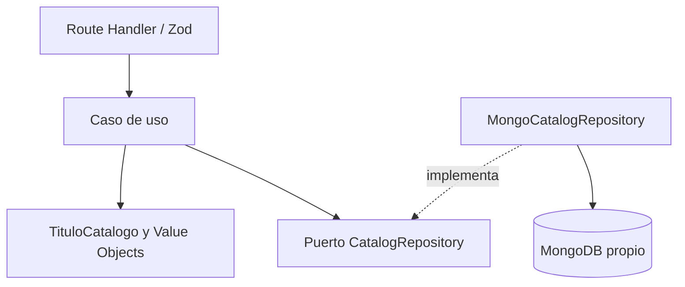
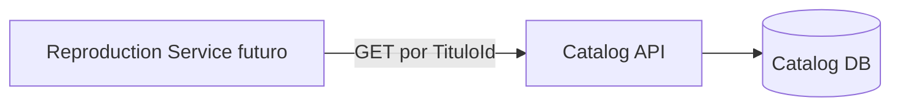

# Catalog Service

Microservicio del contexto **Catálogo** para una plataforma de streaming académica. Administra películas, series, sus fichas editoriales y el ciclo `REGISTRADO → PUBLICADO → RETIRADO`. Expone una API REST interna con Next.js App Router, TypeScript, Zod y el driver oficial de MongoDB.

El servicio está implementado como API; no incluye interfaz gráfica. No administra usuarios, pagos, recomendaciones, sesiones ni progreso de reproducción.

## Inicio rápido con Docker

Requisitos: Docker Engine/Docker Desktop en ejecución, contenedores Linux y Docker Compose v2. No requiere Node.js instalado en el equipo para esta modalidad.

Desde esta carpeta:

```powershell
docker compose up --build -d --wait
curl.exe http://127.0.0.1:3000/api/health
```

Compose inicia MongoDB, espera a que responda, ejecuta `catalog-init` para crear colecciones/validadores/índices y después inicia la API. El inicializador termina con código 0; es el comportamiento esperado. API en `http://127.0.0.1:3000`, MongoDB accesible solo en la red interna de Compose. Los datos persisten en un volumen. No se requiere `.env` en modo Docker local.

```powershell
docker compose logs -f catalog-service
docker compose down
```

`down` conserva los datos. El puerto se puede cambiar con `CATALOG_PORT` (por ejemplo, `$env:CATALOG_PORT="3001"`). No combinar el Compose local con `compose.atlas.yml`.

## Desarrollo con Node.js

Requisitos: **Node.js 24.x**, npm y MongoDB 8.0 local o Atlas. El lockfile fija dependencias. TypeScript 6.0.3 mantiene compatibilidad con el parser de ESLint usado por el proyecto.

```powershell
node --version
npm ci
# Crear .env solo si todavía no existe; después ajustar su configuración.
if (-not (Test-Path .env)) { Copy-Item .env.example .env }
docker compose -f docker-compose.yml -f compose.dev.yml up -d --wait mongo
npm run db:init
npm run dev
```

El override `compose.dev.yml` publica MongoDB únicamente en `127.0.0.1:27017`. No lo uses para Atlas. Si la API Docker ya ocupa 3000, detén ese servicio con `docker compose stop catalog-service` antes de iniciar Next en el host.

Build y ejecución de producción en el host:

```powershell
npm run build
npm start
```

Next carga `.env` al iniciar. El script de inicialización lo carga explícitamente. Los scripts de verificación no utilizan la base configurada por el usuario.

## Variables de entorno

| Variable                              | Predeterminado                      | Límites / propósito                                                                                     |
| ------------------------------------- | ----------------------------------- | ------------------------------------------------------------------------------------------------------- |
| `MONGODB_URI`                         | Obligatoria en ejecución Node/Atlas | `mongodb://` o `mongodb+srv://`; nunca registrarla en logs. Compose local fija `mongodb://mongo:27017`. |
| `MONGODB_DATABASE`                    | `catalog_service`                   | Nombre de base propio del servicio, 1–63 letras, números, `_` o `-`.                                    |
| `MONGODB_MAX_POOL_SIZE`               | `10`                                | 1–100 conexiones.                                                                                       |
| `MONGODB_SERVER_SELECTION_TIMEOUT_MS` | `5000`                              | 100–120000 ms.                                                                                          |
| `MONGODB_QUERY_TIMEOUT_MS`            | `5000`                              | 100–120000 ms.                                                                                          |
| `BULK_MAX_ITEMS`                      | `500`                               | 1–1000 elementos.                                                                                       |
| `REQUEST_MAX_BYTES`                   | `5242880`                           | 1024–10485760 bytes; se cuentan bytes reales del stream.                                                |
| `CATALOG_PORT`                        | `3000`                              | Puerto publicado por Compose en loopback.                                                               |
| `CATALOG_IMAGE_TAG`                   | `local`                             | Tag de la imagen que construye Compose.                                                                 |

Ver [.env.example](.env.example). No incorporar credenciales al repositorio. El build no necesita conexión ni credenciales MongoDB.

## MongoDB Atlas

Usar una base dedicada a Catálogo, un usuario de base de datos con permisos para inicializar sus colecciones/índices/validadores y permitir la IP de salida del equipo en la configuración de red de Atlas. Copiar la URI del clúster y codificar caracteres especiales de sus credenciales según el formato URI.

```powershell
if (-not (Test-Path .env.atlas)) { Copy-Item .env.example .env.atlas }
# Editar .env.atlas con la URI real; no dejar los marcadores <...>.
docker compose --env-file .env.atlas -f compose.atlas.yml up --build -d --wait
```

Este Compose es independiente: solo ejecuta el inicializador y la aplicación, sin un contenedor MongoDB. También se puede configurar la URI Atlas en `.env` y ejecutar `npm run db:init` y `npm run dev` en el host. La configuración Atlas se valida estructuralmente en las comprobaciones; no se prueba contra un clúster remoto ni se requieren credenciales para los tests.

## API y ejemplos

Contrato completo: [docs/openapi.yaml](docs/openapi.yaml), importable en herramientas compatibles con OpenAPI 3.0.3. Los JSON usan **IDs numéricos** para categorías; los nombres se agregan únicamente a la respuesta.

| Método  | Ruta                                            | Resultado                                                 |
| ------- | ----------------------------------------------- | --------------------------------------------------------- |
| `POST`  | `/api/v1/catalog/bulk`                          | Carga masiva INSERT con resultados por índice de entrada. |
| `GET`   | `/api/v1/catalog`                               | Listado paginado con filtros.                             |
| `GET`   | `/api/v1/catalog/{tituloId}`                    | Detalle y referencia técnica.                             |
| `PATCH` | `/api/v1/catalog/{tituloId}`                    | Edición parcial de `ficha`.                               |
| `PATCH` | `/api/v1/catalog/{tituloId}/publication-status` | Cambio de estado editorial.                               |
| `GET`   | `/api/health`                                   | Comprueba MongoDB; 200 o 503.                             |

Carga de las tres películas y dos series ficticias incluidas:

```powershell
curl.exe -X POST "http://127.0.0.1:3000/api/v1/catalog/bulk" -H "Authorization: Bearer $env:ACCESS_TOKEN" -H "Content-Type: application/json" --data-binary "@examples/catalog.bulk.json"
curl.exe "http://127.0.0.1:3000/api/v1/catalog?page=1&limit=20&type=1&status=1&genre=1"
```

Obtener un ID real del listado y consultar/modificar su título:

```powershell
$catalogPage = Invoke-RestMethod "http://127.0.0.1:3000/api/v1/catalog?limit=1"
$catalogTitleId = $catalogPage.data[0].tituloId
Invoke-RestMethod "http://127.0.0.1:3000/api/v1/catalog/$catalogTitleId"
Invoke-RestMethod -Method Patch -Uri "http://127.0.0.1:3000/api/v1/catalog/$catalogTitleId" -ContentType "application/json" -Body '{"ficha":{"title":"Título revisado","posterUrl":null}}'
Invoke-RestMethod -Method Patch -Uri "http://127.0.0.1:3000/api/v1/catalog/$catalogTitleId/publication-status" -ContentType "application/json" -Body '{"publicationStatusId":2}'
```

En bash usar `curl` en lugar de `curl.exe`. Las referencias multimedia del ejemplo son ilustrativas, no archivos alojados.

`type`: 1=MOVIE, 2=SERIES. `status`: 1=REGISTRADO, 2=PUBLICADO, 3=RETIRADO. Los filtros son `page`, `limit`, `type`, `status`, `genre`, `year`, `q`. Tamaño predeterminado 20, máximo 100, offset máximo 10000; `q` busca palabras, no subcadenas. Todos los diccionarios se documentan en OpenAPI y se definen en [models.ts](src/modules/catalog/domain/models.ts).

`importKey` es obligatoria, estable y sensible a mayúsculas. Repetir la misma clave con el mismo contenido inicial devuelve `duplicate` con el ID existente; un contenido distinto devuelve `IMPORT_KEY_CONFLICT`. Las ediciones editoriales posteriores no se sobrescriben al reimportar. No se deduplican obras con claves distintas por nombre/año.

Estados HTTP del bulk: `201` inserciones sin fallos; `200` solo duplicados; `207` éxitos y rechazos; `400` entrada inválida; `409` solo conflictos; `500` fallos confirmados sin aceptados; `503` base no disponible o resultado indeterminado. Siempre revisar `summary`, `results` y `errors`. Ante indeterminación, reintentar con las mismas claves.

Errores generales: `{ "error": { "code": "...", "message": "...", "requestId": "..." } }`. También se usan `404`, `405` (con `Allow`), `413`, `415` y `422`. Las respuestas tienen `x-request-id`, `Cache-Control: no-store` y `X-Content-Type-Options: nosniff`. GET admite HEAD y las rutas incluyen OPTIONS.

## Arquitectura y persistencia

DDD y arquitectura hexagonal: `TituloCatalogo` es el agregado; `FichaContenido`, `EstadoPublicacion`, `TituloId` y `ReferenciaReproduccion` son value objects. Dominio no importa Next, MongoDB ni Zod. Aplicación depende de puertos de repositorio, reloj e identificadores. Infraestructura implementa esos puertos y HTTP valida/adapta los DTO.





Reproducción consumirá la API; **no accederá directamente a Catalog DB**. Debe revisar estado PUBLICADO y referencia técnica. El estado consultado no equivale a autorización perpetua. Las series no tienen referencia propia; los episodios son una extensión futura dentro de Catálogo.

Colecciones creadas por `db:init`: `catalog_titles` (películas/series con ficha embebida) y `catalog_episodes` (estructura e índices preparados, sin endpoints ni casos de uso de episodios). Separar episodios evita crecimiento ilimitado del documento de serie. Los agregados usan un presupuesto de 100 KiB, menor al límite BSON de 16 MiB.

Se persisten categorías como BSON Int32 y nombres derivados solo en la API. `tituloId` usa `ttl_` + UUID v4, independiente del `_id` de MongoDB. PATCH usa `$set`/`$unset` y compara versión/estado en una escritura atómica; una carrera devuelve `409 CONCURRENT_MODIFICATION`. No usa reemplazos ni transacciones multidocumento.

Índices propios (además de `_id` por colección):

| Colección | Índice / campos                                             | Motivo                                  |
| --------- | ----------------------------------------------------------- | --------------------------------------- |
| titles    | UNIQUE `tituloId`                                           | Identidad pública.                      |
| titles    | UNIQUE `importKey`                                          | Idempotencia incluso bajo concurrencia. |
| titles    | `updatedAt:-1, tituloId:1`                                  | Listado general estable.                |
| titles    | `publicationStatusId:1, typeId:1, updatedAt:-1, tituloId:1` | Listado por estado y tipo.              |
| titles    | `ficha.releaseYear:1`                                       | Filtro por año.                         |
| titles    | `ficha.genres:1`                                            | Filtro multikey por género.             |
| titles    | TEXT `ficha.title, ficha.originalTitle`                     | Búsqueda por palabras, idioma none.     |
| episodes  | UNIQUE `episodeId`                                          | Identidad de episodio.                  |
| episodes  | UNIQUE `seriesId, seasonNumber, episodeNumber`              | Posición y listado por serie/temporada. |

Inicialización repetible: `npm run db:init`, o `docker compose run --rm catalog-init` con MongoDB ya iniciado. Si hay índices incompatibles/datos duplicados, falla sin reconstrucción destructiva. Cambios incompatibles de esquema requieren migración explícita. Diseño ampliado en [docs/architecture.md](docs/architecture.md) y [docs/phase-03-mongodb-design.md](docs/phase-03-mongodb-design.md).

## Pruebas y validación

```powershell
npm test                  # unitarios + API de Route Handlers + contratos, sin DB
npm run test:unit
npm run test:api
npm run test:contract
npm run test:integration  # Vitest con MongoDB real temporal; requiere Docker
npm run test:coverage     # todas las suites Vitest con Mongo temporal
npm run test:smoke        # alias de verify:phase7, imagen/Compose exclusivos
npm run check             # tipos, lint, npm test, OpenAPI y builds
npm run test:e2e          # build y API HTTP con Next de producción/MongoDB temporal
npm run verify:phase4     # regresión amplia de persistencia, fallos y concurrencia
npm run verify:phase5     # regresión de casos de uso
npm run verify:phase7     # imagen Docker y Compose aislados, requiere Docker
```

`npm test` no abre conexiones a MongoDB. Los tests de integración crean sus propios contenedores y no leen la URI del usuario. E2E usa un puerto disponible en loopback. La verificación Docker crea un proyecto/volumen propios y los elimina al finalizar. No ejecutar estas verificaciones contra una base productiva. Los resultados ejecutados y límites de verificación están en [docs/verification.md](docs/verification.md).

Coverage V8 incluye todo `src/**/*.ts`; umbrales: 70 % global y 80 % Domain/Application para líneas, sentencias, ramas y funciones. HTML/LCOV/JSON y resultados quedan en `coverage/`, ignorado por Git. Vitest API llama handlers reales y controla el repositorio; `test:e2e` verifica Next por HTTP con Mongo real. [Resultados backend actuales](../docs/quality/BACKEND_TEST_RESULTS.md). Las escrituras requieren ADMIN validado por RS256/JWKS; las lecturas son públicas en este MVP.

## Estructura

```text
catalog-service/
├── src/
│   ├── app/api/                  # Route Handlers: health y catálogo
│   ├── bootstrap/                # Composición e inyección de puertos
│   ├── modules/catalog/
│   │   ├── domain/               # Agregado, value objects, reglas y contratos
│   │   ├── application/          # DTO, mappers, puertos y cinco casos de uso
│   │   ├── infrastructure/       # MongoDB, reloj y UUID
│   │   └── interfaces/http/      # Zod, handlers y presenters
│   └── shared/infrastructure/    # Configuración, HTTP, conexión y logging
├── tests/{unit,api,contract,integration,helpers}/
├── scripts/                      # Inicialización y verificaciones
├── examples/catalog.bulk.json
├── docs/                         # OpenAPI, arquitectura y verificación
├── Dockerfile
├── docker-compose.yml            # API + inicializador + MongoDB local
├── compose.dev.yml               # Puerto MongoDB para Next en el host
├── compose.atlas.yml             # API + inicializador, base externa
├── .env.example
├── eslint.config.mjs
├── vitest.config.ts / vitest.integration.config.ts
└── package.json / package-lock.json
```

## Alcance operativo

Las lecturas del catálogo son públicas (incluidos estados editoriales y referencias opacas de assets); no autorizan reproducción. POST bulk y ambos PATCH exigen un Bearer ADMIN emitido por Users, verificado con RS256/JWKS sin consultar su base de datos. La revocación se propaga al vencer el access token. Los Compose publican la API en loopback. Antes de exponerla públicamente se requiere TLS y rate limiting en el gateway; no se ha probado Atlas con credenciales reales.

## Hardening de calidad y seguridad

ESLint cubre TS/TSX; TypeScript conserva strict; Prettier comparte la configuración raíz.

```powershell
npm run format:check
npm run lint
npm run typecheck
npm audit --audit-level=high
```

`npm run format` aplica el formato. Los gates de CI también escanean secretos y auditan dependencias. Consulte [Security Review](../docs/quality/SECURITY_REVIEW.md) y [Dependency Audit](../docs/quality/DEPENDENCY_AUDIT.md), incluidos los pendientes de rotación de secretos y avisos MEDIUM. No versionar `.env` ni claves privadas.

Para escrituras directas, obtener un access token ADMIN de Users y enviarlo como `Authorization: Bearer <accessToken>`. `USERS_JWKS_URL` es una URL confiable de configuración: por defecto Node usa localhost:3001 y Compose host.docker.internal:3001; el override integrado del frontend utiliza la red de Users. `JWT_ISSUER=users-service` y `JWT_AUDIENCE=streaming-services` deben coincidir con el firmante. GET permanece público; ningún servicio accede a PostgreSQL de Users para verificar tokens. En Atlas, copiar `.env.example` y editar únicamente el ENV ignorado; nunca guardar credenciales en ejemplos.
