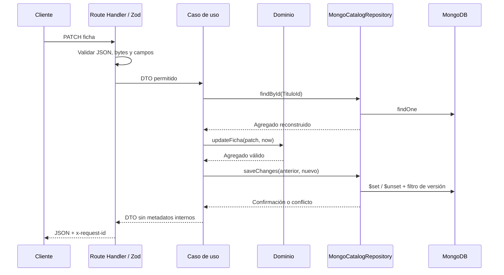

# Decisiones arquitectónicas del servicio

Este documento describe el estado final del alcance inicial. Los documentos `phase-03` a `phase-06` conservan el razonamiento y verificaciones de cada fase; sus notas de trabajo pendiente son históricas.

## Límites del contexto y agregado

Catálogo posee su base. El agregado `TituloCatalogo` mantiene identidad, tipo, ficha, referencia técnica y estado editorial. Sus cambios devuelven una instancia nueva validada. La ficha, el estado y la referencia no tienen repositorios ni colecciones independientes: pertenecen al agregado.

Se excluyen sesiones, progreso, perfiles de usuarios, recomendaciones y pagos. No hay consultas a bases de otros servicios. Un futuro consumidor obtiene el detalle por REST y traduce el DTO a su propio modelo.

## Dependencias y flujo

Dominio y aplicación dependen de interfaces propias; el bootstrap construye los adaptadores. Reloj e IDs se inyectan para tests deterministas. La conexión MongoDB reutiliza un pool y se obtiene de forma diferida, por lo que importar módulos o compilar no exige credenciales.

## Documentos, cardinalidad y contratos

Películas y series comparten `catalog_titles`. Una película exige duración y referencia; una serie carece de ambas. La ficha embebida se lee y actualiza junto al título. No se embebe un array creciente de episodios: `catalog_episodes` está preparada con `seriesId` y posición única por temporada. Su API y su política de publicación permanecen fuera de este alcance.

UUID v4 con prefijo `ttl_` evita que ObjectId sea parte del contrato. Los diccionarios de categorías usan IDs estables y nombres derivados; no se renumeran ni se reutilizan. La validación HTTP, las invariantes del dominio y el JSON Schema de MongoDB son complementarios. MongoDB persiste Int32 explícitos para categorías.

## Importación e idempotencia

Se elige INSERT con `bulkWrite({ordered:false})`, sin UPSERT: reintentar una importación no debe sobrescribir ediciones ni publicar títulos. `importKey` identifica el registro en el origen. Su índice UNIQUE resuelve carreras; un fingerprint SHA-256 de la entrada normalizada distingue reintentos de conflictos.

El fingerprint inicial no se recalcula al editar. Se ordenan conjuntos de categorías, se conservan listas significativas como reparto y se excluyen identidad generada/fechas/estado. Los repetidos equivalentes del lote comparten resultado confirmado; los grupos contradictorios se rechazan. La reconciliación de claves duplicadas consulta un conjunto, no un registro por llamada.

No es una transacción: pueden existir éxitos y rechazos en un lote. Tras un problema de confirmación se informa `indeterminate`, sin afirmar que no hubo escritura. El cliente reintenta con las mismas claves. Claves diferentes pueden representar la misma obra: no se impone unicidad por título, año o assetId.

## PATCH y concurrencia

Las actualizaciones construyen paths desde una lista cerrada. Un PATCH editorial no puede cambiar identidad, tipo, estado, referencia ni createdAt. `null` limpia opcionales; campos ausentes se conservan. Se valida la ficha resultante y solo se escriben diferencias. Un no-op no incrementa versión ni fecha.

El filtro incluye versión y estado previos. Solo una modificación basada en esa versión puede confirmarse; las otras reciben 409. Esta protección cubre la carrera entre lectura y escritura del caso de uso. No detecta una pantalla antigua del cliente: eso requeriría añadir ETag/If-Match o versión al contrato. No se necesitan transacciones multidocumento para los endpoints actuales.

## Consultas, límites y errores

Listado con proyección reducida, máximo 100 filas, offset máximo 10000 y orden actualizado/identidad. Detalle entrega ficha y referencia sin `_id`, fingerprint, importKey o versiones. El conteo separado puede variar respecto a los resultados durante escrituras concurrentes.

Índices únicos protegen identidad/importación; índices de estado-tipo, año, género y texto corresponden a consultas concretas. No se añade un índice para cada combinación. Las comprobaciones existentes de planes de consulta usan pocos registros; no constituyen una prueba de rendimiento ni dimensionamiento de producción.

Los operadores MongoDB no se aceptan desde HTTP. Zod usa objetos estrictos. El lector mide bytes reales y rechaza JSON inválido/compresión. Los errores centralizados ocultan stacks y mensajes internos. Cada petición escribe un log JSON con ruta plantilla, método, estado, duración y requestId; no registra cuerpos ni credenciales.

## Empaquetado y verificación

Docker usa etapas de dependencias/build/runtime, instalación con lockfile, salida standalone y usuario no root. MongoDB local es un servicio separado con volumen y healthcheck. El inicializador debe terminar correctamente antes de arrancar la API. Atlas usa un Compose independiente sin contenedor de base de datos.

Vitest separa unitarios de integración. Los tests unitarios cubren invariantes, orquestación, presentación y rechazo de entradas. Integración usa MongoDB real desechable; E2E ejecuta Next en producción. La prueba Compose construye y arranca la imagen real, verifica carga/reintento, salud, usuario no root y reinicialización.

Herramientas de verificación: [Vitest](https://vitest.dev/guide/) y [configuración recomendada de typescript-eslint](https://typescript-eslint.io/packages/typescript-eslint/). Contrato de referencia en [openapi.yaml](openapi.yaml).
