# Dossier de evidencia técnica — NÉVARO

**Fecha de evaluación: 21 de octubre de 2026, America/Lima.**

Se ejecutaron las suites y builds existentes, el E2E aislado, el Compose raíz, smoke y demo API. **379/379 pruebas de aplicación y 12/12 E2E aprobadas**, sin fallos ni omitidos. La demo adicional aprobó **59 peticiones y 227 tests Bruno**; no se suman sus comprobaciones al total de Vitest. No se desarrollaron funcionalidades ni se modificó código de negocio para obtener estos resultados.

## 1. Sistema evaluado

Plataforma académica de streaming con frontend/BFF y tres microservicios. Se evaluó el **working tree local con cambios anteriores sin commit**, cuyo HEAD base es `a20fc9a6bf5af7d68ce1066b6c1b5166d08e94b6`. Ese SHA por sí solo no representa todos los archivos probados. El [manifiesto de fuentes](evidence/ep-20261021/source-manifest.json) identifica por SHA256 los archivos de aplicación, pruebas y configuración evaluados; la [comprobación posterior](evidence/ep-20261021/source-verification.json) comparó 299 archivos y no encontró cambios entre la ejecución de suites y la verificación final del stack.

Entorno medido: Windows, **Node 24.21.0**, **npm 12.2.0**, Docker Linux **29.8.2**, Compose **5.6.0**, Vitest **5.0.3** y Playwright **1.64.1**, navegador Chromium. Fuentes: [resumen de ejecución](evidence/ep-20261021/test-summary.json), [E2E](evidence/ep-20261021/e2e-results.json) y logs de comandos.

Las suites/builds/E2E se ejecutaron aproximadamente entre 00:36 y 00:42 de Lima; Docker/smoke/demo se completaron al retomar el trabajo por la tarde del mismo día. Los timestamps exactos se conservan en UTC en [commands.json](evidence/ep-20261021/commands.json). Los resultados de informes anteriores no sustituyen las ejecuciones de este dossier. El [índice de evidencias](evidence/ep-20261021/README.md) explica los archivos y su verificación de integridad.

## 2. Servicios

| Proyecto         | Stack inspeccionado                                                        | Responsabilidad                                             | Persistencia propia                  | Acceso local del Compose raíz |
| ---------------- | -------------------------------------------------------------------------- | ----------------------------------------------------------- | ------------------------------------ | ----------------------------- |
| frontend         | Next.js 16.4.2, React 19.3.0, TypeScript, TanStack Query                   | UI, BFF, sesión de navegador                                | Redis para sesión/cifrado/refresh    | http://localhost:8080         |
| users-service    | Next.js Route Handlers, TypeScript, Drizzle, Argon2id, jose                | Identidad, perfil, roles, refresh, watchlist y preferencias | PostgreSQL                           | http://localhost:8081         |
| catalog-service  | Next.js Route Handlers, TypeScript, MongoDB driver, jose                   | Importación, ficha, búsqueda y publicación                  | MongoDB Catalog                      | http://localhost:8082         |
| playback-service | Next.js Route Handlers, TypeScript, MongoDB driver, MinIO, Busboy, ffprobe | Assets, sesiones, progreso, continuar e historial           | MongoDB Playback replica set y MinIO | http://localhost:8083         |

Las versiones de aplicaciones proceden de sus `package.json` y de los builds. Los puertos se comprobaron en [docker-health.json](evidence/ep-20261021/docker-health.json). No hay servicio Recommendations ni Payments evaluado. Watchlist/preferencias almacenan referencias `tituloId`; Catalog/Playback verifican identidad mediante JWT RS256/JWKS, sin consultar PostgreSQL de Users.

## 3. Pruebas automatizadas

Comando ejecutado **dentro de cada proyecto**:

```sh
npm run test:coverage
```

| Proyecto         |   Total |  Passed | Failed | Omitidas | Exit code | Log de ejecución                                           | Registro de casos                                         |
| ---------------- | ------: | ------: | -----: | -------: | --------: | ---------------------------------------------------------- | --------------------------------------------------------- |
| frontend         |      65 |      65 |      0 |        0 |         0 | [log](evidence/ep-20261021/frontend-quality-3.log)         | [casos](evidence/ep-20261021/frontend-tests.json)         |
| users-service    |      96 |      96 |      0 |        0 |         0 | [log](evidence/ep-20261021/users-service-quality-3.log)    | [casos](evidence/ep-20261021/users-service-tests.json)    |
| catalog-service  |     103 |     103 |      0 |        0 |         0 | [log](evidence/ep-20261021/catalog-service-quality-3.log)  | [casos](evidence/ep-20261021/catalog-service-tests.json)  |
| playback-service |     115 |     115 |      0 |        0 |         0 | [log](evidence/ep-20261021/playback-service-quality-3.log) | [casos](evidence/ep-20261021/playback-service-tests.json) |
| **Total Vitest** | **379** | **379** |  **0** |    **0** |           |                                                            |                                                           |

Desglose obtenido de los archivos efectivamente ejecutados, sin contar estas categorías como suites adicionales:

| Proyecto         | Unit | Component | API | Contract | Integration |
| ---------------- | ---: | --------: | --: | -------: | ----------: |
| frontend         |   16 |        49 |   — |        — |           — |
| users-service    |   43 |         — |  31 |        2 |          20 |
| catalog-service  |   51 |         — |  42 |        3 |           7 |
| playback-service |   45 |         — |  20 |       37 |          13 |

Las suites API usan handlers reales con algunos puertos controlados; no todas sus pruebas abren bases de datos. Las integraciones indicadas sí levantan infraestructura desechable. Los [JSON normalizados](evidence/ep-20261021/test-summary.json) conservan nombres, estados, duración, agrupación y hashes de los reportes originales. Se guardaron también JUnit: [frontend](evidence/ep-20261021/frontend-junit.xml), [Users](evidence/ep-20261021/users-service-junit.xml), [Catalog](evidence/ep-20261021/catalog-service-junit.xml) y [Playback](evidence/ep-20261021/playback-service-junit.xml).

## 4. Casos negativos

Los siguientes controles tienen casos aprobados en las ejecuciones anteriores o en la demo de este dossier. No representan un pentest exhaustivo.

| Superficie             | Negativos comprobados                                                                                                            | Evidencia                                                                                                    |
| ---------------------- | -------------------------------------------------------------------------------------------------------------------------------- | ------------------------------------------------------------------------------------------------------------ |
| Auth Users             | Email/password inválidos, intento de asignar rol, email duplicado, password errónea, usuario ausente/inactivo, identidad ausente | [Users: API/unit/integration](evidence/ep-20261021/users-service-tests.json)                                 |
| Refresh/sesión         | Vencimiento, replay, refresh simultáneos, logout, versión anterior de credenciales, aislamiento de familias                      | [Users: integración PostgreSQL](evidence/ep-20261021/users-service-tests.json)                               |
| Autorización Catalog   | Anónimo y USER no escriben; claims malformados, rol como array, issuer/audience incompatibles y JWKS inválido                    | [Catalog: autorización](evidence/ep-20261021/catalog-service-tests.json)                                     |
| Catalog                | ID inexistente, query con operador NoSQL, importKey conflictivo, publicación inválida y escritura con versión obsoleta           | [Catalog](evidence/ep-20261021/catalog-service-tests.json), [demo](evidence/ep-20261021/demo-results.json)   |
| Watchlist/preferencias | Duplicados, valor fuera de LIKE/DISLIKE, aislamiento entre usuarios y concurrencia                                               | [Users](evidence/ep-20261021/users-service-tests.json), [demo](evidence/ep-20261021/demo-results.json)       |
| Playback/assets        | Sin identidad, USER en recursos ADMIN, progreso negativo, MIME falso, asset con sesión abierta y conflictos de estado            | [Playback](evidence/ep-20261021/playback-service-tests.json), [demo](evidence/ep-20261021/demo-results.json) |
| Frontend               | Rollback optimista, errores de autenticación, sesión vencida, enlaces de retorno inseguros, errores de video/upload              | [componentes/unit](evidence/ep-20261021/frontend-tests.json)                                                 |
| Dependencias caídas    | Catalog/Playback indisponibles muestran error y se recuperan; logout ante Redis caído; rechazo de escrituras cross-site          | [E2E ejecutado](evidence/ep-20261021/e2e-results.json)                                                       |

La demo API observó y exigió los códigos **400, 401, 403, 404, 409 y 415** en sus casos negativos. Un status de error esperado cuenta como test aprobado cuando coincide con el contrato; no como un fallo de ejecución.

## 5. Integración

Se ejecutaron **40 pruebas de integración** dentro del total Vitest: Users 20, Catalog 7 y Playback 13.

| Integración                          | Entorno real utilizado                                         | Comportamientos comprobados                                                                                                                            |
| ------------------------------------ | -------------------------------------------------------------- | ------------------------------------------------------------------------------------------------------------------------------------------------------ |
| Users → PostgreSQL                   | Contenedor propio `users-test-*`, puerto loopback efímero      | Migraciones repetibles, transacción usuario/perfil y rollback, UNIQUE/concurrencia, hashes, refresh/familias, cuotas, aislamiento y cambio de password |
| Catalog → MongoDB                    | Contenedor propio `catalog-vitest-*`                           | Validadores/índices, agregado e identidad, reintento idempotente, bulk concurrente, versión obsoleta, búsqueda/proyección                              |
| Playback → MongoDB/MinIO             | Recursos `playback-vitest-*` y temporales propios; replica set | Persistencia, transiciones/concurrencia, almacenamiento privado, firma/lectura/borrado y consistencia de recursos                                      |
| Frontend/BFF → APIs → DB/Redis/MinIO | Stack `nevaro-e2e-*` creado por el runner E2E                  | Flujos de navegador, autenticación entre servicios, video real, recuperación y aislamiento                                                             |

Los tests backend no leen URLs productivas desde `.env` para sus bases desechables. El runner E2E genera credenciales, claves RSA, MP4 y puertos propios; no detiene servicios del Compose raíz. La [comprobación final](evidence/ep-20261021/docker-health.json) no encontró contenedores temporales de tests pendientes.

## 6. E2E

Comando ejecutado dentro de `frontend`, usando Node 24:

```sh
# Bash
CI=true npm run test:e2e
# PowerShell equivalente
$env:CI = 'true'
npm run test:e2e
```

Resultado real: **12 passed, 0 unexpected, 0 skipped, 0 flaky**, sin retries y sin errores globales. Playwright reportó **64,425 s**; el comando completo, incluidos builds Docker, arranque, fixtures y limpieza, tardó **120,139 s**, exit code **0**.

| Caso      | Recorrido ejecutado                                                     | Resultado |
| --------- | ----------------------------------------------------------------------- | --------- |
| E2E-01    | Register → Login → Home, sesión conservada en servidor                  | PASS      |
| E2E-02    | Catálogo filtrado → detalle → Mi Lista → eliminar                       | PASS      |
| E2E-03    | LIKE → DISLIKE y persistencia al navegar                                | PASS      |
| E2E-04    | MP4 HTML5 real → seek → pause → home → retomar → complete               | PASS      |
| E2E-05    | ADMIN upload → verificar asset → publicar/editar título                 | PASS      |
| E2E-06    | JWT vencido → refresh concurrente único → navegación                    | PASS      |
| E2E-07    | Catalog caído → error controlado → recuperación                         | PASS      |
| E2E-08    | Playback caído → UI utilizable → recuperación                           | PASS      |
| Adicional | USER bloqueado en administración, cross-site rechazado y sesión vencida | PASS      |
| Adicional | Renovar URL de media conservando posición pausada                       | PASS      |
| Adicional | Perfil, revocación por password, cuentas aisladas y responsive          | PASS      |
| Adicional | Logout limpia sesión del navegador con Redis indisponible               | PASS      |

Fuentes: [log completo](evidence/ep-20261021/frontend-e2e-1.log), [casos/tiempos/resultados](evidence/ep-20261021/e2e-results.json), [JUnit](evidence/ep-20261021/e2e-junit.xml). El HTML local queda en `frontend/playwright-report/index.html`; no se copia su bundle a Git. Se ejecutó el sanitizer existente sobre reportes/trazas. No hubo ZIPs de fallo, porque todos los casos pasaron y la configuración retiene trazas únicamente al fallar. No se presentan screenshots de éxito como si se hubieran generado.

## 7. Coverage

Métrica V8 leída de los nuevos `coverage/coverage-summary.json`, no estimada a partir del número de tests:

| Proyecto         | Líneas | Statements | Branches | Functions | Reporte completo                                            |
| ---------------- | -----: | ---------: | -------: | --------: | ----------------------------------------------------------- |
| frontend         | 81,22% |     79,60% |   72,16% |    69,38% | [JSON](evidence/ep-20261021/frontend-coverage.json)         |
| users-service    | 95,28% |     93,45% |   91,05% |    88,96% | [JSON](evidence/ep-20261021/users-service-coverage.json)    |
| catalog-service  | 88,14% |     86,83% |   82,80% |    91,11% | [JSON](evidence/ep-20261021/catalog-service-coverage.json)  |
| playback-service | 86,89% |     84,32% |   78,22% |    86,91% | [JSON](evidence/ep-20261021/playback-service-coverage.json) |

Alcance: frontend incluye componentes, features, cliente API y modelos seleccionados en `frontend/vitest.config.ts`. **No mide todo el BFF/server ni todas las rutas Next.** Los backends incluyen `src/**/*.ts` en sus configuraciones de cobertura. No se instrumentó cobertura de navegador E2E ni se calcula un promedio global que mezcle denominadores distintos.

Pasaron los thresholds configurados: frontend líneas/statements 75%, branches/functions 65%; backends global 70% en las cuatro métricas y 80% en domain/application. Hay ramas y funciones sin cubrir; un threshold aprobado no prueba ausencia de errores ni cobertura de todas las entradas posibles. Los reportes conservan el detalle por archivo y numeradores/denominadores.

## 8. CI

Pipeline versionado: [ci.yml](../.github/workflows/ci.yml), con [quality.yml](../.github/workflows/quality.yml) reutilizable. Inspección de las etapas efectivamente configuradas:

```mermaid
flowchart LR
  A[Checkout] --> B[Node 24 y npm 12]
  B --> C[npm ci con lockfile y cache npm]
  C --> D[Formato, secretos y audit]
  D --> E[Lint]
  E --> F[Typecheck]
  F --> G[Tests con cobertura e integraciones]
  G --> H[OpenAPI y build]
  H --> I[Cuatro jobs aprobados]
  I --> J[E2E aislado Playwright]
  J --> K[Compose raíz y smoke]
  K --> L[Demo Bruno y artifacts saneados]
```



Hay jobs frontend, users, catalog y playback; E2E depende de los cuatro. El reusable instala con `npm ci --no-audit --no-fund`, ejecuta audit por separado, lint con `--max-warnings=0`, typecheck, coverage, OpenAPI backend y build/initializers. PostgreSQL, MongoDB/replica set, MinIO y Redis de pruebas se crean por los runners existentes; no se usa infraestructura productiva.

Triggers: PR abierto/actualizado/reabierto/listo, pushes que afecten las rutas declaradas y ejecución manual. Incluye concurrency para cancelar runs anteriores del mismo PR/ref, permisos de lectura y artifacts de cobertura/E2E/Bruno con saneamiento. No utiliza `|| true` para convertir fallos en éxito. Un push exclusivamente a este dossier fuera de las rutas filtradas puede no disparar CI; los PR sí están configurados.

Se validó sintaxis de ambos YAML con actionlint 1.7.9. En Windows no se ejecutaron sus analizadores externos opcionales shellcheck/pyflakes. La consulta real `gh run list --repo Anxiet1793/microservicios-streaming --limit 10 ...` devolvió una lista vacía con exit code 0: [respuesta y fecha](evidence/ep-20261021/remote-ci.json). **No hay run remoto verificado que permita afirmar que GitHub Actions pasó.** El equivalente local no verifica caché/artifacts/permisos del runner remoto. No se publicó un commit ni se disparó un workflow remoto durante esta recolección.

## 9. Análisis estático

En cada proyecto se ejecutaron `npm run lint` y `npm run typecheck`; el segundo ejecuta `next typegen && tsc --noEmit`. Los cuatro tsconfig tienen `strict`, `noUncheckedIndexedAccess`, `noUnusedLocals` y `noUnusedParameters`. Los glob frontend incluyen TSX de producción y tests.

| Proyecto         | Lint                                                                | Typecheck                                                           | OpenAPI                                                             |
| ---------------- | ------------------------------------------------------------------- | ------------------------------------------------------------------- | ------------------------------------------------------------------- |
| frontend         | [PASS, exit 0](evidence/ep-20261021/frontend-quality-1.log)         | [PASS, exit 0](evidence/ep-20261021/frontend-quality-2.log)         | No tiene `docs:check` propio                                        |
| users-service    | [PASS, exit 0](evidence/ep-20261021/users-service-quality-1.log)    | [PASS, exit 0](evidence/ep-20261021/users-service-quality-2.log)    | [PASS, exit 0](evidence/ep-20261021/users-service-quality-4.log)    |
| catalog-service  | [PASS, exit 0](evidence/ep-20261021/catalog-service-quality-1.log)  | [PASS, exit 0](evidence/ep-20261021/catalog-service-quality-2.log)  | [PASS, exit 0](evidence/ep-20261021/catalog-service-quality-4.log)  |
| playback-service | [PASS, exit 0](evidence/ep-20261021/playback-service-quality-1.log) | [PASS, exit 0](evidence/ep-20261021/playback-service-quality-2.log) | [PASS, exit 0](evidence/ep-20261021/playback-service-quality-4.log) |

Además se ejecutó `python scripts/security/scan_secrets.py`: [sin hallazgos actuales](evidence/ep-20261021/secret-scan.json). El scanner tiene alcance por patrones y no certifica el historial ni revocación externa de credenciales.

Se repitió `npm audit --prefix <proyecto> --audit-level=high --json`: frontend y Catalog no reportaron vulnerabilidades; Users y Playback reportaron cuatro MODERATE cada uno, cero HIGH/CRITICAL. Los cuatro comandos devolvieron 0 con ese umbral. Reportes: [frontend](evidence/ep-20261021/frontend-audit.json), [Users](evidence/ep-20261021/users-service-audit.json), [Catalog](evidence/ep-20261021/catalog-service-audit.json), [Playback](evidence/ep-20261021/playback-service-audit.json). No se actualizaron dependencias durante esta recolección.

## 10. Build

`npm run build` ejecutado dentro de los cuatro proyectos con Next.js 16.4.2/Turbopack:

| Proyecto         | Resultado | Exit code | Duración del comando | Evidencia                                                |
| ---------------- | --------- | --------: | -------------------: | -------------------------------------------------------- |
| frontend         | PASS      |         0 |             16,296 s | [log](evidence/ep-20261021/frontend-build-1.log)         |
| users-service    | PASS      |         0 |             17,404 s | [log](evidence/ep-20261021/users-service-build-1.log)    |
| catalog-service  | PASS      |         0 |             13,779 s | [log](evidence/ep-20261021/catalog-service-build-1.log)  |
| playback-service | PASS      |         0 |             14,881 s | [log](evidence/ep-20261021/playback-service-build-1.log) |

También aprobaron los bundles existentes de migración/seed de Users (`npm run build:scripts`), inicializador Catalog (`npm run build:init`) e inicializador Playback (`npm run build:scripts`): [Users](evidence/ep-20261021/users-service-build-2.log), [Catalog](evidence/ep-20261021/catalog-service-build-2.log), [Playback](evidence/ep-20261021/playback-service-build-2.log). Los tiempos son de este host y su caché; no son benchmarks ni builds fríos de clon limpio.

## 11. Docker

Comando ejecutado desde la raíz:

```sh
docker compose up --build --detach --wait --wait-timeout 300
```

Resultado: exit code **0**, duración **11,566 s**, reconstrucción/verificación con caché disponible y volúmenes locales conservados. [Log](evidence/ep-20261021/root-stack-1.log). No se vaciaron volúmenes ni se detuvieron otros proyectos.

La inspección final `docker compose ps --all --format json` registró **nueve servicios running/healthy**: frontend, users-service, users-postgres, catalog-service, catalog-mongodb, playback-service, playback-mongodb, minio y redis. Los **seis inicializadores** users-migrate, users-seed, catalog-init, playback-replica-init, playback-init y stack-seed terminaron con exit code 0. [Estados, imágenes y puertos](evidence/ep-20261021/docker-health.json).

Comprobaciones HTTP independientes después del arranque:

| Servicio | Petición real                        | Resultado      |
| -------- | ------------------------------------ | -------------- |
| Users    | GET http://localhost:8081/api/health | 200, status ok |
| Catalog  | GET http://localhost:8082/api/health | 200, status ok |
| Playback | GET http://localhost:8083/api/health | 200, status ok |
| Frontend | GET http://localhost:8080/login      | 200, HTML      |

`npm run smoke` aprobó sus **diez comprobaciones**, con `playbackWithMedia=true`: [log](evidence/ep-20261021/root-stack-2.log). Incluyó registro/login, JWT/permisos, catálogo, Playback, lectura Range MP4 con HTTP 206, progreso/pausa y sesión BFF/Redis/refresh. Un healthcheck aislado no habría demostrado todas esas integraciones.

Incidencia del entorno: al retomar el trabajo Docker Desktop no estaba ejecutándose y el named pipe del motor Linux no estaba disponible. Se inició mediante `docker desktop start`; después el daemon respondió y el arranque/smoke/demo anteriores pasaron. No se ocultó el incidente como si fuera una prueba funcional aprobada ni se modificó la aplicación para corregirlo. El stack raíz queda levantado para revisión.

## 12. Demo

Se ejecutó la colección existente contra el stack raíz:

```sh
npm run api:demo:cleanup
```

**59/59 peticiones, 227/227 tests, cero fallos/errores/omitidos, exit code 0.** [Resultados por petición](evidence/ep-20261021/demo-results.json), [JUnit](evidence/ep-20261021/demo-junit.xml), [log](evidence/ep-20261021/root-stack-3.log). Las comprobaciones viven en el bloque `tests` de Bruno; su contador de assertions declarativas es cero y no se confunde con tests ausentes.

| Paso pedido       | Evidencia observada por las aserciones ejecutadas                              |
| ----------------- | ------------------------------------------------------------------------------ |
| Login             | ADMIN y USER autenticados; JWT/cookies capturados solo en memoria              |
| Catalog           | Asset subido, título propio importado/publicado y detalle/listado consultados  |
| Watchlist         | Alta 201, listado con tituloId y duplicado rechazado 409                       |
| Like              | LIKE, cambio a DISLIKE y retorno a LIKE persistidos                            |
| Playback          | Sesión 201 con título/asset coherentes y estado ACTIVE                         |
| Pause             | Progreso a 3 s y transición a PAUSED                                           |
| Continue Watching | El título aparece con posición 3 s                                             |
| Resume            | Estado ACTIVE conservando posición 3 s; renovación de URL                      |
| Complete          | Estado COMPLETED, porcentaje 100, exclusión de continuar e historial completed |

El E2E-04 confirmó además el recorrido con video HTML5 real en Chromium; Bruno valida el contrato API. Los datos son reproducibles: cuenta nueva y contenido sintético por ejecución, sin cuentas personales. El modo cleanup retira su título y elimina su asset después de completar la sesión; conserva cuenta/historial y registro retirado al no existir endpoints de borrado para ellos. No elimina la película seed ni datos ajenos. Contraseñas, JWT, cookies, claves y URLs firmadas no se incluyen en el dossier.

## 13. Limitaciones conocidas

- Evidencia de un working tree local y una ejecución por suite en este corte. No acredita un commit remoto publicado, un pipeline remoto aprobado ni un ensayo repetido de estabilidad prolongada. Los hashes permiten identificar las fuentes concretas.
- Solo Chromium y el alcance responsive de los casos existentes. Pendientes Firefox/WebKit, campaña de accesibilidad con teclado/lector y navegadores/dispositivos reales.
- Cobertura frontend parcial por configuración y sin instrumentación E2E del BFF. Permanecen ramas sin cubrir; no se afirma cobertura total ni seguridad demostrada por porcentajes.
- No se ejecutaron pruebas de carga sostenida, backup/restore, alta disponibilidad, pentesting externo, escaneo de imágenes/SBOM o builds fríos de todos los proyectos. Los healthchecks y tiempos locales no son un SLA.
- Persisten avisos MODERATE de dependencias transitivas en Users/Playback según los audits de este corte; no se hicieron actualizaciones para este dossier.
- La [revisión de seguridad previa](quality/SECURITY_REVIEW.md) mantiene pendiente la revocación externa de una credencial histórica. Este dossier no la probó ni puede confirmar su rotación; el scanner actual sin hallazgos no invalida ese pendiente.
- Según esa revisión, siguen pendientes rate limiting de Catalog antes de exposición pública, CSP con nonce, rotación JWKS con solapamiento y endurecimiento productivo TLS/ingreso/credenciales/almacenamiento. JWT y URLs presignadas conservan su validez hasta la expiración prevista; logout no demuestra revocación instantánea en todos los servicios ni de una URL previamente emitida.
- Docker raíz es desarrollo local, con persistencia reutilizada. Las suites de integración/E2E sí usan recursos desechables. Se utilizaron dependencias instaladas existentes para los comandos host; no se afirma haber ejecutado `npm ci` de los cuatro proyectos desde un clon nuevo en esta recolección.
- Los documentos de auditoría/planeamiento anteriores son antecedentes y pueden describir carencias ya corregidas. Las cifras de este dossier se basan en las ejecuciones adjuntas y no en copiar sus totales históricos.

## 14. Pendientes Semana 9-16

**Propuesta de seguimiento**, no evidencia de trabajo completado ni calendario ya aprobado. Se deriva de las limitaciones anteriores y no implementa nuevos bounded contexts.

| Semana | Pendiente                                                                                        | Evidencia de cierre esperada                                                                              |
| ------ | ------------------------------------------------------------------------------------------------ | --------------------------------------------------------------------------------------------------------- |
| 9      | Confirmar revocación de la credencial histórica, publicar cambios revisados y ejecutar CI remoto | Constancia de revocación sin secretos y URL de run remoto vinculado al commit evaluado                    |
| 10     | Revisar avisos MODERATE, rotación JWKS y límites de tráfico Catalog                              | Audit actualizado, prueba de claves solapadas/retirada y casos de cuota reproducibles                     |
| 11     | Ampliar cobertura del BFF/player y revisar CSP/orígenes                                          | Reportes por módulo y regresiones de ramas/fallos; pruebas de CSP con nonce si se adopta                  |
| 12     | Ensayar backup/restore de PostgreSQL, MongoDB y objetos con IDs consistentes                     | Restore aislado, validación de índices/relaciones y log de smoke posterior                                |
| 13     | Medir carga, latencia, memoria, cuotas y recuperación bajo volumen definido                      | Reporte con escenario, dataset, percentiles y criterios acordados; sin inferir cifras de este dossier     |
| 14     | Ejecutar Firefox/WebKit y campaña de accesibilidad                                               | Matriz navegador/dispositivo, pruebas de teclado/lector, incidencias y cierres                            |
| 15     | Preparar endurecimiento de despliegue e imágenes                                                 | TLS, aislamiento/credenciales, SBOM/escaneo, permisos S3 mínimos y runbook verificables                   |
| 16     | Repetir aceptación desde clon limpio y preparar cierre académico                                 | Instalación con lockfiles, builds, suites, demo, links de CI y dossier actualizado ligado al commit final |

### Reproducir la evaluación

Node 24 y Docker Linux disponibles. Desde cada carpeta de aplicación:

```sh
npm ci
npm run lint
npm run typecheck
npm run test:coverage
npm run build
```

En cada backend ejecutar además `npm run docs:check` y su bundle de inicialización indicado en la sección Build. Desde `frontend`, ejecutar el E2E con CI=true como arriba. Desde raíz:

```sh
docker compose up --build --detach --wait --wait-timeout 300
npm run smoke
npm run api:install
npm run api:demo:cleanup
```

El resumen de comandos realmente ejecutados, sus timestamps, códigos de salida y hashes de logs está en [commands.json](evidence/ep-20261021/commands.json). La instalación `npm ci` figura aquí como paso de reproducción para otra máquina, no como una ejecución host adicional afirmada en este corte.
