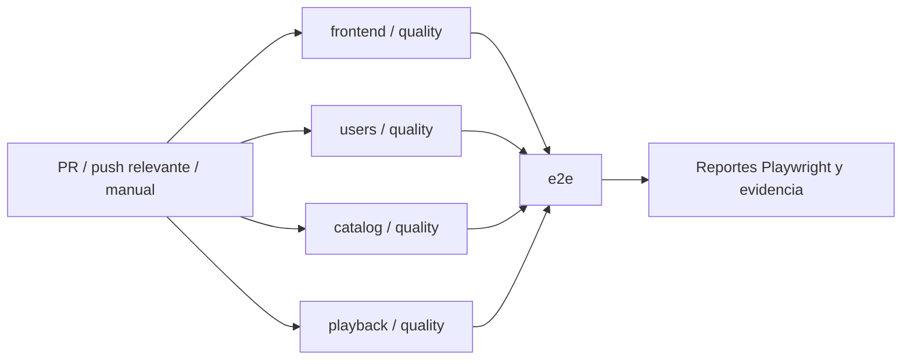

# CI de la plataforma streaming

Implementación: 20 de octubre de 2026, America/Lima. Repositorio detectado: GitHub (`Anxiet1793/microservicios-streaming`). No existían workflows antes de esta implementación.

## Workflows y triggers

- `.github/workflows/ci.yml`: entrada `Streaming CI`.
- `.github/workflows/quality.yml`: workflow reutilizable, llamado por los cuatro proyectos; no se dispara por separado.

Todo PR ejecuta el pipeline en apertura, sincronización, reapertura y cambio a listo para revisión. No se omiten drafts ni PR de documentación: así los checks requeridos no quedan pendientes por filtros de paths. Se valida el commit de integración del PR que checkout obtiene por defecto. No se utiliza `pull_request_target`.

Los pushes a cualquier rama ejecutan CI cuando cambian los cuatro proyectos, `.github/**`, `scripts/**`, `docs/quality/**` o los archivos raíz de Compose, package.json/lock, .env.example, README, Prettier, Git attributes e ignore. También existe workflow_dispatch para ejecución manual.

`concurrency` agrupa por evento y número de PR o ref; `cancel-in-progress: true` cancela ejecuciones antiguas del mismo PR o rama. El grupo distingue push de PR para que no se cancelen mutuamente. Un commit en una rama con PR puede producir ambos tipos de ejecución.

## Gates de hardening

Antes de lint/typecheck, los cuatro jobs ejecutan `npm run format:check`, `python3 scripts/security/scan_secrets.py` y `npm audit --audit-level=high`. El scanner no imprime valores; la auditoría completa admite los MEDIUM documentados en DEPENDENCY_AUDIT.md y falla con HIGH/CRITICAL. No se utiliza `audit fix` en CI. El árbol actual debe estar limpio de hallazgos del scanner; el historial se revisa localmente por separado, porque retirar un secreto no sustituye su revocación.

Los tiempos y conteos en CI_LOCAL_RESULTS.json corresponden a la ejecución anterior a este hardening. La evidencia de estos cambios está en SECURITY_REVIEW.md y HARDENING_RESULTS.json. No hay un run remoto verificado.

## Stack raíz integrado

La entrada CI ahora incluye cambios de `docker-compose.yml`, `package.json`/lock raíz, `.env.example`, README raíz y cualquier `scripts/**`. Dentro del mismo job E2E se prueban las herramientas raíz con `node --test scripts/tests/*.test.mjs`, se generan secretos efímeros con setup-stack y se valida Compose con `--quiet`. Después de Playwright se levanta el Compose raíz con build/healthchecks y se ejecuta smoke-test contra sus puertos publicados, incluido un rango MP4 firmado real.

El job conserva `.verification/stack-*.log` durante siete días y limpia solamente el proyecto raíz de ese runner con `down --volumes --remove-orphans`, incluso si falla el smoke. Los servidores del job son desechables y los secretos generados no se suben como artifacts. Esto agrega un arranque adicional usando la caché de las mismas imágenes/Dockerfiles, sin duplicar otro job MinIO. La evidencia local del Compose raíz está en STACK_RESULTS.md / STACK_LOCAL_RESULTS.json; no hay un run remoto verificado para esta ampliación.

## Jobs, dependencias y orden



Los cuatro jobs de calidad corren en runners independientes `ubuntu-24.04`, con Node **24.21.0** y npm **12.2.0**. `e2e` tiene `needs: [frontend, users, catalog, playback]`: si cualquiera falla, E2E no se ejecuta. No hay un job agregador que pueda esconder esos fallos.

Para protección de rama, exigir los cuatro checks `<proyecto> / quality` y `e2e`. No exigir únicamente E2E: un job omitido por una dependencia fallida no equivale a haber pasado sus pruebas. La configuración de protección de rama se realiza en GitHub; no se modificó remotamente en esta entrega.

| Job      | Validaciones en orden                                                                                                               | Infraestructura exclusiva de prueba                                               |
| -------- | ----------------------------------------------------------------------------------------------------------------------------------- | --------------------------------------------------------------------------------- |
| frontend | `npm ci`, lint, typecheck, Vitest Unit/Component + coverage, build                                                                  | JSDOM; sin base de datos                                                          |
| users    | `npm ci`, lint, typecheck, Docker, Vitest Unit/API/Contract/Integration + coverage, OpenAPI, build, herramientas de migración/seed  | PostgreSQL 17 creado y destruido por la suite                                     |
| catalog  | `npm ci`, lint, typecheck, Docker, Vitest Unit/API/Contract/Integration + coverage, OpenAPI, build, inicializador                   | MongoDB 8 creado y destruido por la suite                                         |
| playback | `npm ci`, lint, typecheck, Docker, build MinIO, Vitest Unit/API/Contract/Integration + coverage, OpenAPI, build, inicializador      | MongoDB 8 replica set `rs0`, MinIO privado, ambos propios de la suite             |
| e2e      | `npm ci`, Docker/Compose, instalar Chromium con dependencias, comprobar sanitizer, `npm run test:e2e`, sanear ZIPs, subir artifacts | Cuatro aplicaciones, PostgreSQL, dos MongoDB, MinIO y Redis exclusivos del ensayo |

`npm run test:coverage` del backend incluye **todas** las carpetas `unit`, `api`, `contract`, `integration`; no es una cobertura de unit tests que omita las integraciones. Se ejecuta la suite completa una sola vez por job, sin duplicar el arranque de las bases para volver a medir coverage. En frontend incluye los proyectos Vitest `unit` y `components`.

No se añaden `services:` redundantes de GitHub: las suites ya crean sus contenedores Docker con nombres y puertos aleatorios. Conectar esas suites a servicios externos requeriría modificar su aislamiento y permitir URLs ajenas. Se reutiliza el mecanismo ya verificado.

Playback tiene contratos que importan el firmador real de Users y el mapper real de Catalog. En un checkout limpio, esas importaciones resuelven `jose`/`zod` desde los proyectos productores. Por ello ese job ejecuta además `npm ci --prefix users-service` y `npm ci --prefix catalog-service` antes de typecheck/tests, y su clave de caché incluye los tres lockfiles. No se confía en `node_modules` que casualmente existan en el equipo local. Es una dependencia de pruebas, sin acoplar los runtimes ni compartir bases.

## E2E y secretos

El runner existente `frontend/scripts/test-e2e.ts` compila las imágenes desde el mismo checkout, secuencialmente. Ejecuta migraciones Drizzle e inicializadores Mongo/MinIO, genera claves RSA de firma, contraseña PostgreSQL, credenciales MinIO, secreto AES de Redis y contraseñas demo aleatorias. No necesita Secrets de GitHub ni cuentas personales.

Se crean `demo@streaming.local`/USER y `admin@streaming.local`/ADMIN, cuentas adicionales por flujo, dos títulos de catálogo y un MP4 sintético de doce segundos. No se leen `.env` locales ni URLs de bases productivas. El navegador recibe únicamente la sesión opaca del BFF; JWT/refresh permanecen en el servidor.

MinIO se construye con `playback-service/docker/minio.Dockerfile`, que fija el commit fuente y las imágenes base por digest. El job Playback lo construye antes de sus tests de almacenamiento; E2E lo construye en su propio runner. No se depende de una imagen `playback-minio:2025-10-15` que solo exista en el equipo del desarrollador.

La limpieza normal y tras fallos está en `finally` de cada suite/runner. Los runners de GitHub son hospedados y desechables; si se cancela el proceso antes de su `finally`, se descarta su VM. Esta configuración no está diseñada para runners self-hosted persistentes sin añadir una política de limpieza propia.

## Caché y cadena de suministro

Las acciones checkout, setup-node y upload-artifact están fijadas a SHA completos, verificados contra sus repositorios oficiales al implementar. El token solo tiene `contents: read` y checkout usa `persist-credentials: false`. No hay despliegues, pushes ni permisos de escritura.

Se usa `setup-node` con `cache: npm` y `cache-dependency-path` del lockfile de cada proyecto. Se cachean descargas de npm; **no** `node_modules`, `.next`, `dist`, bases, imágenes Docker, archivos ENV, coverage ni reportes. Cada job ejecuta `npm ci --no-audit --no-fund` con el lockfile. `--no-audit` evita una consulta variable de advisories durante instalación; no convierte fallos de instalación en éxito ni equivale a una auditoría de vulnerabilidades.

Las imágenes de aplicaciones se reconstruyen en E2E; no se transfieren builds o imágenes de otro commit mediante caché. La caché Docker local normal de un runner puede reutilizar capas dentro de ese mismo job, pero no se configuró un caché remoto.

## Coverage y gates

| Proyecto / alcance                       | Lines | Statements | Branches | Functions |
| ---------------------------------------- | ----: | ---------: | -------: | --------: |
| Frontend: UI/features/cliente/utilidades |   75% |        75% |      65% |       65% |
| Backend: global por servicio             |   70% |        70% |      70% |       70% |
| Backend: Domain y Application            |   80% |        80% |      80% |       80% |

Se conservan los gates backend existentes, previamente alcanzados. Los iniciales de frontend tienen margen respecto de las mediciones previas: 81,01% líneas, 79,60% statements, 72,16% branches, 69,38% functions. No se impone un 100% irreal ni se excluyen archivos sin cobertura para mejorar artificialmente el indicador. No se suma cobertura E2E a V8.

Todo comando de instalación, lint, typecheck, tests, coverage, OpenAPI, build e inicializadores conserva su código de salida. No existen `continue-on-error`, `|| true`, tests ignorados para obtener éxito ni un `exit 0` que tape errores. `always()` se limita a recopilar/sanear evidencia; un upload exitoso no cambia un job previamente fallido.

## Artifacts y diagnóstico de fallos

| Artifact                       | Cuándo                                 | Contenido                                                   | Retención |
| ------------------------------ | -------------------------------------- | ----------------------------------------------------------- | --------- |
| `quality-<proyecto>-<attempt>` | Éxito o fallo, si llegaron a generarse | Coverage HTML/JSON/LCOV, resultados Vitest JSON y JUnit XML | 14 días   |
| `playwright-report-<attempt>`  | Éxito o fallo, tras sanitizer correcto | Reporte HTML y adjuntos                                     | 7 días    |
| `e2e-results-<attempt>`        | Éxito o fallo, tras sanitizer correcto | JSON/JUnit, screenshots de fallo y traces de fallo          | 7 días    |

Si el fallo ocurre antes de iniciar tests no puede haber reportes de tests; upload avisa de archivos ausentes y el job conserva el fallo original en sus logs. No se suben el workspace completo, `.env`, manifiestos Compose temporales, claves, datos de bases ni logs Docker crudos.

Playwright mantiene un worker y **cero retries**, rechaza `test.only` en CI y tiene límite global de quince minutos de tests. Los jobs de calidad limitan a treinta minutos; E2E a cuarenta y cinco, incluyendo builds e instalación.

En CI, `trace: retain-on-failure` conserva evidencia únicamente si falla un caso. Se desactivan snapshots DOM y fuentes para minimizar datos capturados; screenshots solo al fallar, videos apagados. Fuera de CI los traces siguen apagados. El reporter existente redacta contraseñas efímeras de los títulos/errores del HTML.

`scripts/ci/sanitize-traces.py` procesa tanto `frontend/test-results` como copias ZIP de `frontend/playwright-report`: redacta contraseñas efímeras, identificadores de sesión hexadecimales y JWT, conservando imágenes y errores funcionales. No extrae archivos del ZIP. Si un ZIP está corrupto, falla y no se suben los artifacts E2E: no se entrega evidencia sin sanear. Sus tres pruebas comprueban redacción/preservación, rechazo de ZIP corrupto y ejecución sin traces.

Para investigar: revisar el primer step fallido; descargar el artifact del proyecto; abrir `coverage/index.html` o `coverage/junit.xml`; para navegador ejecutar `npx playwright show-report <carpeta-del-reporte>` o `npx playwright show-trace <trace.zip>`.

## Tiempos orientativos

Estimaciones para runners hospedados, pendientes de medir remotamente: frontend/Users/Catalog 1–4 min cada uno; Playback 5–15 min con build MinIO frío; E2E 8–20 min con imágenes frías. Los cuatro primeros corren en paralelo; la duración total depende del más lento más E2E, aproximadamente 13–35 min. Red, colas, pulls y compilación Go de MinIO pueden variar considerablemente.

El MP4 es pequeño y los tests Playwright funcionales solos tardaron aproximadamente 67–71 segundos en la fase anterior. Esto no incluye levantar el stack ni es una medida de GitHub Actions. Las mediciones de esta implementación se registran al finalizar las verificaciones locales.

## Reproducir localmente

Requisitos: Node 24.21.0, npm 12.2.0, Docker Linux/Compose y Python 3 para sanear traces. No ejecutar con Node 22 del sistema. Instalar los cuatro proyectos antes de los contratos cruzados.

```bash
set -euo pipefail
npm install --global npm@12.2.0
for project in frontend users-service catalog-service playback-service; do
  (cd "$project" && npm ci --no-audit --no-fund)
done
docker build -f playback-service/docker/minio.Dockerfile \
  -t playback-minio:2025-10-15 playback-service
for project in frontend users-service catalog-service playback-service; do
  (
    set -e
    cd "$project"
    npm run lint
    npm run typecheck
    npm run test:coverage
    if [ "$project" != frontend ]; then npm run docs:check; fi
    npm run build
    case "$project" in
      catalog-service) npm run build:init ;;
      users-service|playback-service) npm run build:scripts ;;
    esac
  )
done
python3 scripts/ci/test_sanitize_traces.py
cd frontend
npx --no-install playwright install --with-deps chromium
CI=true npm run test:e2e
```

Después de E2E, incluso si falla y antes de compartir artifacts:

```bash
python3 ../scripts/ci/sanitize-traces.py test-results
python3 ../scripts/ci/sanitize-traces.py playwright-report
```

En PowerShell usar `$env:CI = 'true'`, ejecutar los mismos comandos dentro de cada carpeta y comprobar `$LASTEXITCODE` tras cada comando. Los scripts de tests ya soportan Windows. La equivalencia local verifica comandos y dependencias reales, no permisos del token, disponibilidad del runner Ubuntu, caché o upload remoto de GitHub.

## Evidencia de esta entrega

Validación estática: actionlint **1.7.9** descargado del release oficial y verificado mediante SHA256; ambos workflows aceptados. Se deshabilitaron solo analizadores externos shellcheck/pyflakes ausentes en Windows; se validaron sintaxis, expresiones, `needs`, eventos, inputs del reusable y referencias de acciones. Sanitizer: tres pruebas aprobadas.

Ejecución equivalente local con **Windows, Node 24.21.0, npm 12.2.0, `CI=true` y Docker Linux**. Las cuatro instalaciones `npm ci --no-audit --no-fund` devolvieron 0. No se usó `--ignore-scripts` ni se sustituyeron bases reales por mocks. npm 12 informó de scripts de instalación bloqueados por su política; los binarios precompilados disponibles permitieron ejecutar correctamente Argon2/esbuild y los builds. No se aprobaron scripts adicionales globalmente.

| Proyecto         | Tests aprobados | Cobertura líneas | Lint/tipos/build | Instalación limpia | Checks sin instalación |
| ---------------- | --------------: | ---------------: | ---------------- | -----------------: | ---------------------: |
| frontend         |           65/65 |           81,01% | PASS             |           208,25 s |                58,95 s |
| users-service    |           96/96 |           96,01% | PASS             |           188,16 s |                79,54 s |
| catalog-service  |           78/78 |           88,92% | PASS             |           175,07 s |                75,68 s |
| playback-service |         109/109 |           90,71% | PASS             |           181,08 s |                46,43 s |

Total: **348/348** pruebas de aplicación aprobadas; todos los thresholds pasaron. Los checks backend incluyen OpenAPI e inicializadores; se analizaron los cuatro JUnit XML correctamente. MinIO se reconstruyó correctamente usando capas locales existentes. Los tiempos locales de instalación reflejan este equipo Windows y no son tiempos medidos de GitHub.

Sanitizer: **3/3** pruebas aprobadas. Además, una sonda de navegador temporal e independiente generó un ZIP real con trace activado: **1/1** aprobado, archivo válido y contraseña efímera ausente tras sanearlo. La sonda reside en `.verification`, no forma parte de los doce E2E de aplicación ni se agregó como un test artificial al CI.

E2E de aplicación con `CI=true`: **12/12 PASS**, `unexpected=0`, `skipped=0`, `flaky=0`, cero retries, código de salida 0. Pruebas Playwright: **77,46 s**. Runner completo, incluyendo builds Docker con caché local, startup, seed, pruebas y limpieza: **174,68 s**. El HTML final no contiene contraseñas generadas; los JSON/JUnit están presentes y son válidos. Los ZIPs de fallo retenidos son cero porque pasaron todos los casos; la sonda independiente verificó el saneamiento de un trace real.

Se verificó por etiquetas/nombre que no quedaron contenedores, red ni imágenes de aplicaciones del stack E2E. Los reportes locales permanecen en `frontend/playwright-report`, `frontend/test-results` y `coverage` de cada proyecto. Los comandos, códigos de salida, tiempos, versiones, métricas y ausencia de run remoto están guardados en [CI_LOCAL_RESULTS.json](CI_LOCAL_RESULTS.json). El JSON identifica que se comprobó el working tree con cambios locales, no un commit remoto publicado.

Archivos nuevos de esta implementación:

```text
.github/workflows/ci.yml
.github/workflows/quality.yml
scripts/ci/.gitignore
scripts/ci/sanitize-traces.py
scripts/ci/test_sanitize_traces.py
docs/quality/CI_PIPELINE.md
docs/quality/CI_LOCAL_RESULTS.json
```

Configuración ajustada: `frontend/vitest.config.ts` (gates y reporters), `frontend/playwright.config.ts` (CI traces, forbidOnly y timeout), los tres `vitest.coverage.config.ts` del backend (JUnit) y `frontend/README.md`. No se cambiaron endpoints ni reglas de producción.

No se afirma éxito remoto: no se creó ni verificó un run de estos workflows en GitHub Actions. La validación local no ejecuta el motor GitHub Actions, `ubuntu-24.04`, el caché remoto ni upload-artifact. Para obtener evidencia remota se deben publicar los cambios y consultar el run disparado por el PR/push; no se incluyó un badge de éxito no verificado.

## Colección API agregada el 21 de octubre de 2026

El job E2E también instala `api/bruno` con su lockfile, ejecuta su auditoría con umbral MODERATE y `npm run api:check` antes de levantar el stack. El caché npm incluye `api/bruno/package-lock.json`; los cambios en `api/**` disparan el workflow.

Después del smoke del Compose raíz ejecuta `npm run api:demo:cleanup`: 59 peticiones secuenciales reales, incluidas registro/login, publicación, upload, reproducción y permisos. Los servicios siguen activos hasta terminar Bruno. La retirada del título y eliminación del asset solo afectan datos creados por esa ejecución; al finalizar el job, Compose elimina sus volúmenes desechables de CI.

Artifacts `bruno-api-<attempt>`: JSON, JUnit, resumen y salida saneados de `api/bruno/reports/`, siete días. No se suben `.runtime`, entornos privados, cuerpos ni headers. Una petición fallida, omitida o reporte incompleto falla el job. Tiempo local medido: unos 13 segundos para el demo con limpieza, adicional a instalación/build/startup. No se ha verificado un run remoto de esta ampliación. Evidencia local: [API_COLLECTION_RESULTS.md](API_COLLECTION_RESULTS.md).

## Referencias oficiales

- [Seguridad y SHA inmutables en GitHub Actions](https://docs.github.com/en/actions/reference/security/secure-use).
- [Caché npm de setup-node](https://github.com/actions/setup-node#caching-global-packages-data).
- [Concurrency y cancelación](https://docs.github.com/en/actions/how-tos/write-workflows/choose-when-workflows-run/control-workflow-concurrency).
- [Artifacts y retención](https://github.com/actions/upload-artifact#retention-period).
- [CI y reportes de Playwright](https://playwright.dev/docs/ci-intro).
