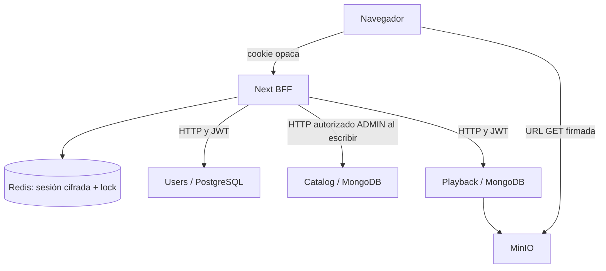

# Decisiones de implementación

El plan 0.9 era documental. Se contrastó con los paquetes, controladores, validadores, los tres OpenAPI, Compose y ejecución local. No existe repositorio Git inicializado en este workspace, por lo que no se inventa SHA de commit. `docs/contracts.md` identifica los contratos utilizados; el lockfile fija dependencias.

## Estructura

```text
frontend/
  src/app/(public)/                 login, register
  src/app/(viewer)/                 home, explore, search, title, bibliotecas, profile
  src/app/(player)/watch/           reproducción inmersiva
  src/app/(admin)/admin/            contenido, upload, editor
  src/app/api/bff/[...path]/        allowlist autenticada
  src/components/                  shell, primitives, imágenes y providers
  src/features/                    auth, catalog, library, playback, profile, admin
  src/lib/api/                     cliente browser y contratos generados
  src/lib/server/                  adaptadores HTTP, sesión, permisos y composición
  src/styles/                      tokens y estilos globales
  src/types/generated/             Users/Catalog/Playback OpenAPI
  tests/unit/                      cola y navegación
  tests/e2e/                       recorridos reales de navegador
  docker/                          aislamiento de Catalog e integración de Playback
```

## BFF y datos



Frontend no consulta bases de microservicios. Redis conserva únicamente el estado técnico BFF cifrado, con TTL derivado del refresh. Las claves de sesión son SHA-256 del identificador opaco. Lock NX con expiración, nonce y liberación comparada; save comprueba propiedad del lock y existencia de sesión, para no resucitar sesiones eliminadas. Una respuesta de refresh perdida no se reintenta ciegamente.

RSC usa adaptadores server-only directamente. Las islas interactivas usan TanStack Query hacia BFF mismo origen; keys privadas contienen userId y se limpian al salir. No hay QueryClient global server ni cache persistida. Catálogo se solicita paginado; las composiciones de referencias tienen concurrencia máxima cuatro y conservan errores por ficha. Para comprobar un título se recorren hasta diez páginas de cien referencias; si no se completan, la UI permanece desconocida y no infiere neutral/ausencia.

No hay un algoritmo local de recomendaciones. Los datos de Mi Lista y gustos pertenecen a Users; progreso e historial a Playback. Series no tienen episodios disponibles.

## Seguridad

Cookies propias HttpOnly/SameSite Strict y Secure en HTTPS. Validación de sesión mediante Users por operación y de ADMIN en cada escritura Catalog/asset. CSRF: header no simple, Origin exacto y rechazo Fetch Metadata cross-site. Se conservan las protecciones upstream. Catalog sin puerto publicado en modo integrado; no basta ocultar el menú.

CSP restringe scripts al propio sitio con inline requerido por Next, media al origen configurado, sin frames/objetos, base-uri y form-action propios. Imágenes HTTP/HTTPS se cargan en navegador sin proxy que pueda hacer SSRF. Referrer-Policy no-referrer evita filtrar direcciones firmadas como referencia. No hay claves privadas/JWT en bundles cliente. Endurecimiento futuro: CSP con nonces por petición y allowlist de proveedores de imágenes según despliegue.

Todas las respuestas BFF son no-store. Logs JSON contienen método, status, requestId y duración; no cuerpos, tokens, correos, cookies o URLs. Límites JSON 64 KiB, multipart transmitido con límite 256 MiB más overhead; timeout upload 120 s. No hay retry genérico de mutaciones. GET puede renovar autenticación una vez tras 401; 403 no provoca refresh.

## Rendering, marca y accesibilidad

Layouts de servidor, componentes cliente por feature; el player/admin se cargan en sus rutas. Tokens tinta/ámbar/marfil, Manrope local y Lucide, marca centralizada. Sin previews ni reproducción automática. Pósteres 2:3 y progreso 16:9, espacio reservado para imágenes y fallback ante error. Consultas/filtros en URL, búsqueda con debounce 300 ms y navegación cancelable de Next.

Landmarks, skip link, foco visible, labels, targets de 44 px, aria-pressed y diálogo nativo para publicación/retirada. Reduced motion y reflow móvil. Objetivo AA sin certificación; el MP4 propio no incluye pistas de subtítulos y no se simulan selectores. El player usa sliders nativos nombrados y botones accesibles. Las medidas de Core Web Vitals requieren una campaña específica; no se declara p75 real desde tests locales.

## Brechas del plan

- G00/G02/G05: contratos recibidos en workspace; cookie users_refresh, CSRF server-to-server y expiresIn comprobados.
- G08: resuelto en despliegue integrado con Catalog privado y BFF ADMIN; autorización interna de Catalog sigue siendo evolución recomendable.
- G09: transporte real y Range verificados con Playback; navegador cubierto por Playwright.
- G01: sigue sin reasignación; se publica título nuevo tras upload.
- G03/G04: episodios y Recommendations quedan futuros.
- G06: paginación acotada y composición; no se inventó batch ni lectura por título.

Fuentes técnicas: [Next autenticación](https://nextjs.org/docs/app/guides/authentication), [cookies](https://nextjs.org/docs/app/api-reference/functions/cookies), [Query retries](https://tanstack.com/query/latest/docs/framework/react/guides/query-retries), [Redis locks](https://redis.io/docs/latest/develop/use/patterns/distributed-locks/). Las decisiones concretas se validan en este proyecto, no se derivan endpoints desde esas fuentes.
