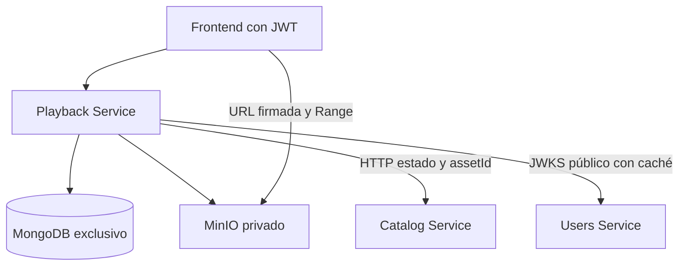
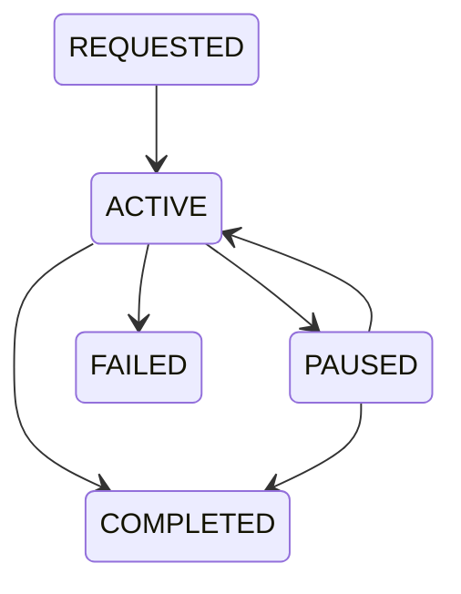
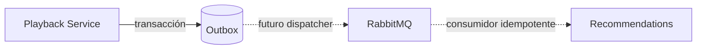
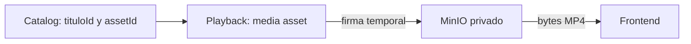

# Arquitectura

## Inspección y bounded context

Existían Catalog y Users, paquetes independientes Node 24/Next App Router/TypeScript estricto/Zod/Docker/Vitest. Catalog usa MongoDB, tituloId y publicationStatusId numérico. Users usa PostgreSQL/Drizzle y JWT RS256 con JWKS público. Playback reutiliza convenciones y contratos HTTP, no código ni bases.

Playback posee recursos técnicos, sesiones, progreso e historial. No posee fichas, usuarios, passwords, perfiles, Mi Lista, likes, pagos ni recomendaciones. Solo almacena referencias externas userId/tituloId y su propio assetId.



## DDD y hexagonal

PlaybackSession aplica propiedad, transiciones y progreso. Progress calcula porcentaje con duración obtenida en servidor, redondeado a dos decimales. Tolera 2 segundos al final y normaliza a duración; rechaza valores negativos/no finitos/fuera de rango. Domain no depende de librerías externas.

Application define MediaAssetRepository, PlaybackSessionRepository, PlaybackProgressRepository, OutboxRepository, UnitOfWork, EventPublisher, MediaStorage, CatalogGateway y Runtime. Los doce casos de uso son clases separadas en un archivo por el tamaño del MVP. HTTP valida/autentica/presenta. Mongo*, MinioMediaStorage, HttpCatalogGateway y JwksAuthenticator implementan los puertos. Composition root: src/bootstrap/container.ts.

IDs ast_/ses_/evt_ + UUIDv4 siguen la convención existente usr_/ttl_; se generan sin coordinación y son independientes del _id interno de MongoDB.



Al abrir otra sesión del mismo usuario/título, el dominio marca la anterior con supersededAt y bloquea posteriores operaciones, conservando su último estado. No introduce transiciones adicionales a FAILED. Sesiones completadas nunca se reactivan; reproducir nuevamente inicia en cero. Inicio copia progreso anterior solo si coincide asset y no estaba completado. Repetir pausa/finalización o una posición idéntica es idempotente; resume requiere PAUSED.

## MongoDB y modelo

MongoDB satisface el requisito y encaja con documentos de sesión/progreso/eventos. PostgreSQL también sería viable. El replica set de un nodo habilita transacciones, **no alta disponibilidad**. Datos BSON Date, sin videos/base64 ni metadata editorial.

| Colección | Campos propios |
|---|---|
| media_assets | assetId, objectKey, bucket, contentType, originalFilename, sizeBytes, durationSeconds, codec, width, height, status, createdAt, updatedAt, referenceRevision |
| playback_sessions | sessionId, userId, tituloId, assetId, status, progress, startedAt, lastActivityAt, completedAt, supersededAt, emittedMilestone |
| playback_progress | userId, tituloId, assetId, progress, status, continueWatching, lastSessionId, lastActivityAt |
| outbox_events | eventId, eventType, version, occurredAt, userId, tituloId, data, deliveryStatus |
| rate_limit_buckets | key SHA-256, count, expiresAt; colección técnica |

Progress: positionSeconds, durationSeconds, percentage, updatedAt. `scripts/init.ts` crea colecciones, validadores JSON Schema, índices y bucket idempotentemente. Nunca borra datos. Futuros cambios de esquema requieren migración revisada; no es un sistema general de migraciones versionadas.

| Índice | Justificación |
|---|---|
| media_assets `{assetId:1}` UNIQUE | Referencia pública |
| playback_sessions `{sessionId:1}` UNIQUE | Identidad |
| playback_sessions `{assetId:1,status:1}` | Bloquear eliminación de assets en uso |
| playback_progress `{userId:1,tituloId:1}` UNIQUE | Progreso único por usuario/título |
| playback_progress `{userId:1,lastActivityAt:-1,tituloId:1}` | Historial y orden estable |
| playback_progress `{userId:1,continueWatching:1,lastActivityAt:-1,tituloId:1}` | Continuar viendo sin COLLSCAN |
| outbox_events `{eventId:1}` UNIQUE | Identidad de evento |
| outbox_events `{deliveryStatus:1,occurredAt:1}` | Futuro despacho |
| rate_limit_buckets `{key:1}` UNIQUE | Contador entre instancias |
| rate_limit_buckets `{expiresAt:1}` TTL 0 | Limpieza de ventanas |

No hay índices de sesiones sin consultas que los necesiten. El historial público muestra la última reproducción por título, no cada sesión. Conserva sesiones internamente. Paginación offset, máximo 100 elementos/página y página 10000; evolucionar a cursores cuando el volumen lo requiera.

## Consistencia y eventos

Sesión/progreso/evento se escriben en una transacción snapshot y writeConcern majority. El driver reintenta conflictos transitorios; no se hace HTTP ni S3 dentro del callback. Escrituras en referenceRevision coordinan inicio/reanudación con borrado. Dos completions concurrentes reevalúan estado y producen un evento. Una petición de sesión reemplazada recibe SESSION_SUPERSEDED y no sobrescribe el progreso nuevo.

El frontend debe serializar sus actualizaciones. No hay secuencia cliente: retroceder es válido y la última escritura aceptada puede ser menor. Guardar la misma posición no actualiza timestamps; no es heartbeat. Continue-watching usa un booleano materializado transaccionalmente: sesión no completada y porcentaje <90. No devuelve títulos/posters.



Eventos PLAYBACK_STARTED, PLAYBACK_PAUSED, PLAYBACK_COMPLETED y PLAYBACK_PROGRESS_UPDATED. Este último solo supera nuevos tramos de 25% por sesión, no cada ping. OutboxEventPublisher almacena PENDING. No hay dispatcher/RabbitMQ/Kafka/Recomendaciones. Un futuro dispatcher necesitará leases, backoff, dead-letter, confirmaciones y consumidores idempotentes por eventId (entrega al menos una vez).

```json
{
  "eventId": "evt_<UUIDv4>", "eventType": "PLAYBACK_COMPLETED", "version": 1,
  "occurredAt": "2026-10-04T12:00:00Z", "userId": "usr_<UUIDv4>", "tituloId": "ttl_<UUIDv4>",
  "data": { "sessionId": "ses_<UUIDv4>", "completionPercentage": 100, "watchTimeSeconds": null },
  "deliveryStatus": "PENDING"
}
```

watchTimeSeconds es desconocido: mover el cursor o llamar complete no prueba visualización real. El evento indica finalización solicitada por el cliente, no una métrica antifraude. No se inventa tiempo visto por diferencia de posiciones.

## MinIO, MP4 y duración

MediaStorage abstrae upload/delete/exists/createPlaybackUrl, reemplazable por S3. MP4 vive exclusivamente en bucket privado. Busboy consume Request.body y escribe a disco temporal con backpressure; límite total/archivo, un solo file, timeout 120 s. No se usa request.formData ni buffer completo del video. Temporal se limpia en finally. ffprobe tiene timeout 20 s y protocolo file; verifica contenedor MP4, H.264/AAC, duración y resolución. No hay transcoding. Después se carga el archivo como stream a MinIO y persiste READY.

ObjectKey: videos/YYYY/MM/ast_UUID.mp4. Filename es metadata saneada; jamás determina ruta. Fallo al persistir intenta eliminar objeto. Mongo y S3 no comparten transacción: un corte del proceso puede dejar huérfanos. Producción requiere reconciliación y límites de disco/concurrencia en proxy; el MVP limita tamaño y frecuencia por usuario.

MinIO se construye desde fuente oficial fijada y conserva AGPL en la imagen. Go y runtime fijados por digest. [Revisión oficial](https://github.com/minio/minio/tree/9e49d5e7a648f00e26f2246f4dc28e6b07f8c84a), [SDK](https://github.com/minio/minio-js/blob/master/docs/API.md), [transacciones Mongo](https://www.mongodb.com/docs/drivers/node/current/crud/transactions/). El repositorio comunitario está archivado: esta decisión permite la demo académica reproducible; antes de producción evaluar almacenamiento mantenido y revisar obligaciones de licencia.

Firma GET 900 s por defecto con endpoint público, nunca minio:9000. No se cambia el host después del firmado. El navegador solicita Range directamente para buscar posiciones. Inicio verifica existencia; renovación verifica propietario/estado abierto/asset READY. URL y JWT caducan independientemente: una URL emitida sigue válida hasta vencimiento aunque venza el access token. No hay revocación inmediata de URLs.

DELETE lógico no elimina bytes; rechaza sesiones ACTIVE/PAUSED. Una sesión abandonada puede bloquearlo hasta ser sustituida/completada; definir expiración de sesiones en futura tarea. Si no hay sesiones abiertas, un título publicado podría quedar apuntando a un asset eliminado: nuevas reproducciones fallan 404. Coordinar retirada editorial antes del borrado. Nunca se borran objetos activos silenciosamente.

## Relación con Catalog



HttpCatalogGateway solo usa GET /api/v1/catalog/:tituloId, AbortSignal 4 s, sin redirects ni retries agresivos. Mapea 404/caídas a errores propios. El contrato real usa publicationStatusId=2; extrae estado/assetId y no persiste ficha. Se comprueba publicación al iniciar; retirar después no interrumpe URLs/sesiones existentes. Futura retirada inmediata necesitará política de revalidación/eventos.

**Compatibilidad:** Catalog exige `{providerId:1,assetId,manifestKey}` al crear películas y hace inmutable la referencia. La demo usa `manifestKey: "asset:ast_<UUID>"`, identificador opaco legado, no URL/ruta/bucket MinIO. Playback ignora manifestKey/providerId. Crea el título vía API después del upload y lo publica. No existe endpoint actual para reasignar un título ya creado: agregarlo corresponde a Catalog, con contrato y autorización propios. No se accede a sus colecciones para saltar la restricción.

## Seguridad y operación

JWKS público de Users: caché 10 min, cooldown 30 s, timeout 4 s. Verifica RS256, issuer/audience/exp/iat/sub/jti, typ JWT, userId=sub y role USER/ADMIN. No usa clave privada. Cambios de rol/baja/password en Users no revocan inmediatamente estos JWT stateless; permanecen válidos hasta exp (15 min habitual). Futuro control mediante eventos/lista de revocación.

Zod estricto rechaza userId, porcentaje, duración y operadores NoSQL en bodies. Filtros Mongo construidos por código. CORS solo APP_ORIGIN; autenticación Bearer, no cookies. Sin Origin (curl) puede usar JWT. Upload ADMIN 10/hora configurable, API autenticada 240/minuto/usuario; contadores Mongo sin confiar en X-Forwarded-For. Ventanas fijas, Retry-After conservador 60 s.

Logs JSON: action, requestId, status, durationMs. No cuerpos, Authorization, passwords, cookies, errores completos de proveedores ni URLs firmadas. Respuestas sin stack y no-store. Health prueba Mongo y bucket propios, no necesita Catalog/Users disponibles.

Compose es local: Mongo sin auth limitado a red interna/loopback y MinIO con credencial generada. Producción requiere TLS, Mongo autenticado, IAM limitado al bucket, secretos gestionados, proxy con cuotas de concurrencia/carga y monitorización. No exponer este Compose públicamente sin esos cambios.

## Evolución

MP4 -> procesamiento asíncrono/transcoding HLS -> variantes/CDN detrás de MediaStorage, preservando assetId. Añadir PROCESSING/FAILED, dispatcher outbox y retención de eventos. Sin Kubernetes, DRM, event sourcing ni Recommendations ahora. Watchlist/likes permanecen en Users.
