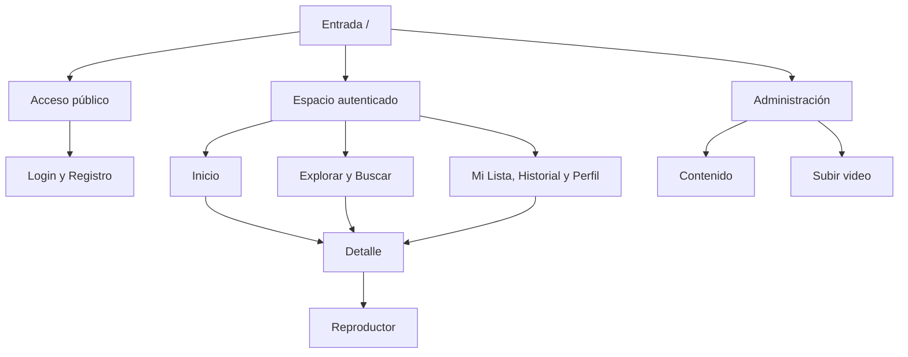
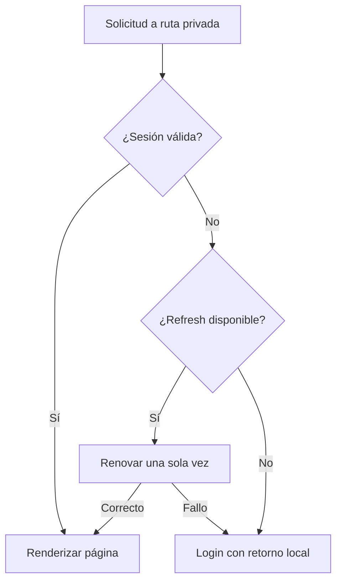
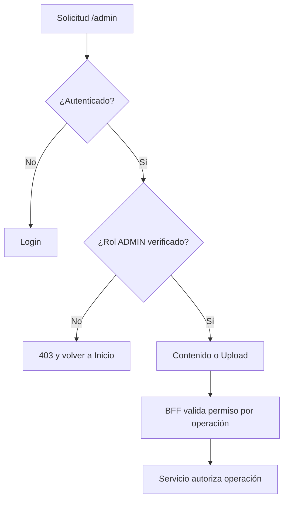
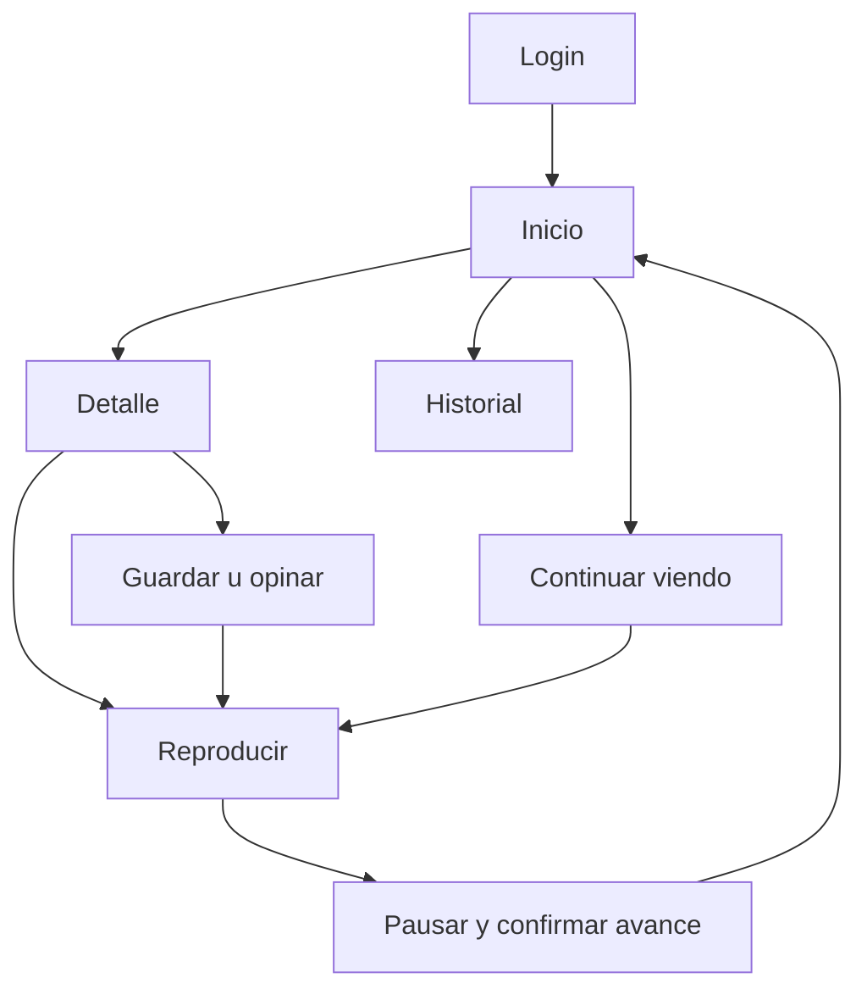
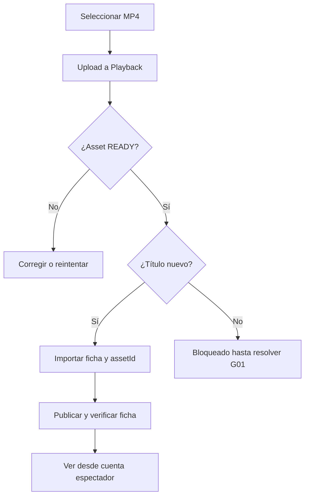

# NÉVARO — Planeamiento integral

Versión 0.9 · 17/10/2026

# NÉVARO — Plan de frontend, UX y marca

**Versión 0.9 · 17 de octubre de 2026 · Planeamiento previo a implementación**

## Dictamen y alcance

La marca y las decisiones de experiencia están listas como propuesta revisable. La integración es **condicional**: no se recibió un repositorio ni los YAML de OpenAPI. No se ejecutó el backend. Por tanto, este paquete no acredita una auditoría de código ni una integración probada.

Se leyó íntegramente `ARQUITECTURA_DATOS_Y_APIS(1).md` (documento técnico del proyecto, 414 líneas, actualizado el 14/10/2026). En adelante, **S1**. Los endpoints que se muestran proceden de S1; no se han inventado como contratos existentes. La instrucción adjunta `Texto pegado(8).txt` se denomina **S0** y define objetivos, no evidencia de implementación.

Evidencia: **D** = documentado en S1, pendiente de código/OpenAPI; **P** = propuesta de diseño o contrato nuevo; **NV** = no verificable con las fuentes disponibles; **V** = contrastado con código, OpenAPI y ejecución. No hay capacidades V en esta entrega.

En el workspace solo estaba S0. Las búsquedas de repositorios conectados por `streaming` y `microservicios` no devolvieron resultados; no demuestran que el repositorio no exista. La búsqueda de documentación sí permitió recuperar S1. No se pidió acceso a cuentas ni se modificó backend.

## Decisiones principales

- Marca provisional: **NÉVARO**, pronunciación NÉ-va-ro. Tagline: «Tu próxima historia empieza aquí». Naming creativo, sin disponibilidad comercial o registral verificada.
- Dirección: sala de cine editorial; fondo tinta, tipografía marfil, señal de reproducción ámbar y apoyo azul. Identidad expresada mediante composición y jerarquía, no con efectos.
- Arquitectura propuesta: Next.js App Router, React, TypeScript, CSS Modules + tokens CSS, TanStack Query, React Hook Form + Zod, Lucide y Radix selectivo. Next actúa como BFF acotado.
- P0: autenticación, catálogo, detalle, player y retomar progreso. Mi Lista y LIKE completan el recorrido de 5 minutos.
- No se incluyen frontend implementado, logo final, algoritmos de recomendación, pago, DRM, transcodificación ni episodios ficticios.

## Cómo leer y usar

| Archivo | Decisión que resuelve |
|---|---|
| CURRENT_BACKEND_CAPABILITIES.md | Capacidades documentadas y validación pendiente |
| 01_PRODUCT_VISION.md | Producto, alcance y prioridades |
| 02_BRAND_GUIDELINES.md | Naming, voz, color, tipografía y logo conceptual |
| 03_DESIGN_TOKENS.md | Valores normativos del diseño |
| 04_DESIGN_SYSTEM.md | Contratos de componentes |
| 05_INFORMATION_ARCHITECTURE.md | Rutas y permisos |
| 06_SCREEN_SPECIFICATIONS.md | Comportamiento de todas las pantallas |
| 07_UX_FLOWS.md | Auth, preferencias, reproducción y publicación |
| 08_FRONTEND_ARCHITECTURE.md | Rendering, estado, seguridad y rendimiento |
| 09_API_INTEGRATION_MATRIX.md | Operaciones documentadas y campos por verificar |
| 10_BACKEND_GAPS.md | Brechas confirmadas por S1 y preguntas abiertas |
| 11_FRONTEND_ROADMAP.md | Secuencia, dependencias y aceptación |
| 12_DEMO_EXPERIENCE.md | Guiones de 3, 5 y 8 minutos |
| 13_IMPLEMENTATION_GUIDE.md | Instrucciones para el agente implementador |
| 14_WIREFRAMES.md | Layouts textuales medidos |
| 15_ACCESSIBILITY.md | Criterios AA y validación manual |
| 16_TEST_STRATEGY.md | Pruebas por riesgo |
| 17_SOURCES_AND_DECISIONS.md | Fuentes, ADR y preguntas de cierre |

Se usa la numeración final solicitada como nombre canónico; no se duplican documentos con los nombres intermedios de S0. `frontend/src/styles/tokens.css` es una especificación conceptual utilizable, no una aplicación.

## Puerta de integración

Antes de implementar conexiones: entregar URL/ZIP del repositorio y rama, revisar AGENTS/README/Compose y los tres OpenAPI, fijar SHA, generar matriz con operationId, DTO, cookie/CSRF, status y ejemplos reales. Resolver G01 (asociación de assets) solo si se quiere reemplazar el video de un título existente. La alternativa documentada es importar un título nuevo con el asset ya cargado. Probar red del navegador hacia MinIO: es una dependencia P0.

## Resumen visual de Home y player

Home: navegación superior → hero moderado con título, sinopsis y acción principal → continuar viendo → películas → series como fichas → Mi Lista. Los carriles de recomendaciones solo aparecen con servicio real habilitado.

Player: barra de regreso/título → video 16:9 centrado → línea de tiempo → reproducción, volumen, tiempo y pantalla completa. Al fallar el guardado, se informa sin interrumpir innecesariamente el video.

Primer paso de Codex tras aprobar diseño: **cerrar la auditoría de contratos y demostrar por HTTP login → sesión → URL reproducible → pausa → nuevo inicio con progreso recuperado**, antes de construir Home. Este paso evita que una interfaz terminada quede bloqueada por integración.


---

# Capacidades actuales: auditoría documental

**Estado D, no V. Fuente S1 §§1–9.** No se inspeccionaron repositorio, YAML ni servicios ejecutándose. «Documentado» no significa probado ni vigente respecto a una rama desconocida.

## Inventario

| Servicio | Persistencia descrita | Acceso local descrito | Responsabilidad |
|---|---|---|---|
| Catalog | MongoDB 8 | 3000 | Ficha, búsqueda, importación y estado editorial |
| Users | PostgreSQL 17 + Drizzle | 3001 | Identidad, refresh rotatorio, Mi Lista y preferencias |
| Playback | MongoDB 8 con replica set + MinIO | 3002; objetos 9000 | Assets MP4, sesiones y progreso consolidado |
| Recommendation | No documentado como implementado | NV | Futuro consumidor de señales |
| Payment | Fuera de MVP | NV | Sin contrato recibido |

Users es **SQL** según S1; no se aplica una suposición anterior de usuarios en MongoDB. Los identificadores públicos son `usr_`, `ttl_`, `ast_` y `ses_` + UUID; no usar `_id` ni PK internas.

| Funcionalidad UI | API necesaria documentada | Servicio | Existe | Pendiente |
|---|---|---|---|---|
| Registro/login | POST auth/register, auth/login | Users | D | DTO, errores, cookies reales |
| Refresh/logout | POST auth/refresh, auth/logout | Users | D | Nombre/path cookie, CSRF y rotación |
| Perfil/clave | GET/PATCH users/me; POST change-password | Users | D | DTO y efectos de revocación |
| Explorar/buscar | GET catalog con q/type/status/genre/year | Catalog | D | Valores enum, paginación y orden |
| Detalle | GET catalog/{tituloId} | Catalog | D | Campos opcionales y estados visibles |
| Mi Lista | GET/POST/DELETE users/me/watchlist | Users | D | Componer referencias con fichas |
| LIKE/DISLIKE | GET/PUT/DELETE users/me/preferences | Users | D | Leer estado por título sin descargar todo |
| Upload MP4 | POST media/assets, ADMIN | Playback | D | Campo multipart y respuesta exacta |
| Sesión y URL | POST playback/sessions | Playback | D | Forma de progreso/URL y vencimiento |
| Pausa/reanudar | POST sessions/{id}/pause y resume | Playback | D | Concurrencia, posición y errores |
| Guardar avance | PATCH sessions/{id}/progress | Playback | D | Límites, orden y tolerancia |
| Renovar/completar | POST refresh-url y complete | Playback | D | Caducidad y semántica exacta |
| Retomar/historial | GET playback/me/continue-watching y history | Playback | D | Persistencia tras logout y paginación |
| Crear título nuevo con asset | POST catalog/bulk | Catalog | D | DTO y llave importKey |
| Asociar asset a título existente | No hay operación según S1 §6 | Catalog | No según S1 | G01 |
| Publicar/retirar | PATCH catalog/{id}/publication-status | Catalog | D | Autorización server-side ausente según S1 |
| Episodios | Colección preparada; sin API según S1 | Catalog/Playback | No según S1 | G03 |
| Recomendaciones | Sin API documentada | Recommendation | Futuro | G04 |
| Popularidad/novedades ordenadas | Orden no especificado en contrato recibido | Catalog | NV | G07; no usar etiquetas engañosas |

Todas las rutas abreviadas de esta tabla llevan `/api/v1/`; las rutas completas están en 09.

## Hallazgos que condicionan UX

1. Películas necesitan duración y playbackReference; series llevan playbackReference=null. No mostrar «Reproducir serie» sin episodios.
2. Catalog PATCH solo toca ficha editorial. No puede resolver la asociación posterior del asset.
3. Estados: REGISTRADO → PUBLICADO → RETIRADO. No hay despublicación reversible documentada; retirar requiere confirmación clara.
4. Mi Lista/preferencias son referencias sin FK distribuida. No eliminar referencias por una caída temporal de Catalog.
5. Playback reemplaza sesiones previas del mismo usuario/título. El player anterior debe detener escrituras si fue sustituido.
6. Continuar viendo excluye finalizados y progreso >=90 % según S1; no reinterpretar el umbral en frontend.
7. JWT RS256, TTL access 900 s y refresh HttpOnly/SameSite Strict descritos. Falta contrato exacto de CSRF.
8. Outbox existe pero sin publicador: no implica recomendaciones funcionando.
9. MP4 H.264/AAC y límite upload de 256 MiB son valores documentados por defecto, deben confirmarse con configuración.
10. Compose separados: no afirmar arranque con un único comando raíz. Playback depende de Catalog, JWKS, replica set y object storage.

## Checklist para convertir D en V

Registrar rama/SHA y leer README raíz/servicios, AGENTS, package manifests, lockfiles, Compose, `.env.example` (sin secretos), routers/controladores, validadores, modelos y YAML completos. Comparar rutas implementadas con OpenAPI. Confirmar CORS, cookie, CSRF, JWT/role, publicationStatus, referencias y paginación. Levantar sin borrar volúmenes y ejecutar flujos con cuentas de prueba. Guardar evidencia redactada con fecha, operación y resultado; nunca JWT ni URLs firmadas. Cada fila cambia de D a V por operación, no por una revisión global.


---

# Visión del producto

## Propósito y propuesta

NÉVARO permite descubrir títulos, guardar lo que interesa y retomar una película sin perder el punto de reproducción. Para el MVP, muestra con claridad cómo identidad, catálogo y reproducción cooperan sin compartir bases de datos.

Audiencia primaria: personas hispanohablantes que navegan desde laptop o móvil y alternan entre explorar y continuar. Audiencia de demostración: docente y compañeros que necesitan ver un recorrido verificable en pocos minutos. Son hipótesis de producto, no resultados de investigación con usuarios.

La personalidad es serena, editorial y precisa. Diferenciación: navegación contenida, progreso visible, señales explícitas de gusto y una identidad cálida sobre tinta azul. No se promete un catálogo comercial completo ni derechos sobre películas ajenas.

## Cinco principios de experiencia

1. **La próxima acción se entiende de un vistazo.** Una sola acción primaria por región; el resto tiene menor jerarquía.
2. **El progreso pertenece a la cuenta.** Retomar conserva contexto entre rutas y sesiones cuando el servicio lo confirme.
3. **Cada promesa tiene respaldo.** Un título sin video se puede explorar y guardar; nunca ofrece un Play que no funcionará.
4. **El espectador decide.** Sin previews automáticos, likes inducidos ni búsqueda invasiva.
5. **Los fallos tienen una salida.** Cada error conserva contexto y ofrece reintentar, volver o iniciar sesión.

## MVP y límites

| Prioridad | Capacidades | Criterio de valor |
|---|---|---|
| P0 | Login/logout/refresh, catálogo y búsqueda básica, detalle, reproducción, pausa, avance, retomar, protección de rutas, recuperación de errores | Recorrido base reproducible sin pérdida de progreso tras confirmación de guardado |
| P1 | Registro, Mi Lista, LIKE/DISLIKE, historial, perfil, upload + importar título nuevo + publicar | Demostrar personalización explícita y operación admin |
| P2 | Filtros avanzados, pantalla central de preferencias, edición editorial, cambio de contraseña, refinamientos de motion | Mejoran uso sin bloquear demo |
| P3 | Recomendaciones reales, episodios, pagos, múltiples perfiles, HLS/DRM, modo claro | Requieren producto/backend adicional |

El flujo admin sube a P0 si la evaluación exige publicación en vivo; no se rebaja el trabajo de reproducción para compensarlo. Recommendations no pasa a P0 por desear una sección atractiva.

## Métricas y validación propuesta

- Usuario encuentra un título y llega al player en <=3 acciones desde Home con título visible.
- Retomar, tras pausa confirmada, comienza a <=2 s del último punto guardado en condiciones nominales.
- 5 de 5 ensayos de demo base completos sin error bloqueante antes de exponer.
- Prueba con tres compañeros: encontrar título, guardarlo y retomarlo sin explicación; registrar tiempo, confusión y errores. No afirmar eficacia estadística.
- Preguntas pendientes: ¿qué campos tiene la importación real?, ¿qué dispositivos se usarán?, ¿en qué red se ejecuta MinIO?, ¿fecha y criterios de evaluación?

Home no necesita landing de marketing en MVP. `/` redirige a Inicio o Login según sesión. Toda decisión técnica posterior debe proteger el recorrido P0.


---

# Manual de marca — NÉVARO

**Marca provisional de proyecto.** Las propuestas siguientes son creación conceptual, no nombres con exclusividad garantizada. Antes de lanzamiento público: búsqueda de coincidencias en productos, dominios y registros de marca. No se ha hecho una revisión comercial exhaustiva.

## Naming

| Nombre | Significado/concepto | Personalidad | Pronunciación | Tagline posible |
|---|---|---|---|---|
| Névaro | Neologismo: novedad, navegación y horizonte narrativo | Editorial, serena | NÉ-va-ro, sencilla | Tu próxima historia empieza aquí |
| Vélumo | Velo de proyección + luz | Cálida, cinematográfica | VÉ-lu-mo | Dale luz a otra historia |
| Trávora | Trama + recorrido | Curiosa, dinámica | TRÁ-vo-ra | Historias que te llevan |
| Réluno | Relato + atmósfera nocturna | Íntima | RÉ-lu-no | Quédate en la historia |
| Lumetra | Luz + metraje | Técnica, precisa | lu-ME-tra | Encuentra tu siguiente escena |
| Nuvoria | Nuevo + memoria | Personal | nu-VO-ria | Siempre hay otra historia |
| Cadévo | Cadencia + movimiento | Fluida | ca-DÉ-vo | Historias a tu ritmo |
| Orvilo | Órbita + hilo narrativo | Exploradora | or-VI-lo | Sigue lo que te mueve |
| Telunia | Tela de proyección + noche | Suave | te-LU-nia | Un espacio para tus historias |
| Virelo | Ver + relato | Directa | vi-RE-lo | Mira dónde empieza |

Top 3: **Névaro**, Vélumo y Trávora. Ganador provisional Névaro: tres sílabas claras, no depende del sufijo «flix», funciona en texto y símbolo. Riesgo: acento en escritura y búsqueda; usar `nevaro` para slug y `NÉVARO` para marca. La aprobación final del usuario no se presupone.

## Esencia

Propósito: abrir espacio para una historia y facilitar volver a ella. Valores: claridad, continuidad, autonomía y cuidado. Posicionamiento: una sala personal de descubrimiento y reproducción, sobria y accesible. Atributos: cinematográfica 5/5, humana 4/5, tecnológica 3/5, lúdica 2/5. Evitar lenguaje grandilocuente y ciencia ficción decorativa.

## Voz y tono

Español neutro cercano, tuteo, frases breves. Mayúsculas solo marca/siglas; botones con verbo cuando representan una acción. No culpar al usuario ni mostrar códigos como mensaje principal.

| Contexto | Texto aprobado | Evitar |
|---|---|---|
| Inicio | ¿Qué historia sigue? | El mejor streaming del universo |
| Mi Lista vacía | Guarda algo para después. Explora el catálogo y encuentra tu próxima historia. | No existen registros |
| Login | Vuelve a tus historias | Autenticación requerida |
| Error de sesión | Tu sesión venció. Inicia sesión para continuar. | Error 401 |
| Error guardado | No pudimos guardar el cambio. Inténtalo otra vez. | Operación fallida |
| Agregar | + Mi Lista → En Mi Lista | Inserción exitosa |
| Upload finalizado | Video cargado. Ahora completa su ficha. | Recurso creado exitosamente |
| Sin video | Este título todavía no tiene un video disponible. | Error de asset |
| Recomendación futura | Porque viste «{título}» | Nuestra IA sabe lo que quieres |
| Reanudar | Continuar desde 12:34 | Resume playback |
| Bienvenida de registro | Tu cuenta está lista. Inicia sesión. | Suponer login automático no documentado |

Secciones canónicas: Inicio, Explorar, Mi Lista, Historial, Perfil. Películas y Series son filtros enlazables de Explorar. «Continuar viendo» es carril y página. «Preferencias» expresa gustos de contenido; idioma pertenece a Perfil. «Recomendados para ti» queda oculto hasta integración real.

## Logo conceptual

Símbolo: dos trazos verticales desplazados que sugieren un fotograma abierto y una N incompleta; el espacio negativo apunta hacia delante sin usar un triángulo Play literal. Retícula 24×24, grosor 3, extremos suaves de radio 1.5. Diseño definitivo pendiente de vectorización y prueba a tamaño pequeño.

Logotipo: NÉVARO en Manrope 700 con espaciado 0.06em, sin deformar glifos. Horizontal: isotipo de 24 y palabra con separación 8; área de respeto de 0.5× altura del isotipo. Isotipo solo para favicon y navegación móvil; a 16 px simplificar trazos. Versiones marfil, tinta y monocromo. Acento ámbar permitido solo sobre tinta y fuera del player inmersivo.

No estirar, rotar, usar sombras, encerrar en botones Play, aplicar degradados, recolorear por póster ni colocar sobre una zona fotográfica sin contraste. Tamaño mínimo propuesto: palabra 88 px de ancho; símbolo 16 px. Nombre/tagline/alt se configuran en `brand.ts`; colores en CSS. Una cadena CSS no sustituye textos semánticos del DOM.

## Paleta funcional

Valores y contrastes calculados en 03. Primary ámbar #F4C46B: acción de reproducción y foco; secondary azul #9BB9E9: información y enlaces; accent salvia #A8C8B3: detalle editorial limitado. La asociación cálida/cinematográfica es una intención de diseño, no una afirmación psicológica universal. El ámbar reserva atención y evita competir con los pósteres; la tinta reduce ruido alrededor del video. No usar primary para todo.

Fondos tinta #0B1017, superficies #131C27 y #1D2938, textos #F5F1E8 y #B5C0CE. Sin modo claro en MVP: duplica QA visual sin aportar al flujo de exposición. No confundir fondo oscuro con contraste automáticamente correcto.

## Tipografía

Manrope para marca, títulos y cuerpo; una familia reduce cargas y mantiene identidad. Fuente open source bajo SIL OFL según su repositorio oficial; conservar licencia al distribuir y alojar WOFF2 localmente. Fallback: `Arial, sans-serif`. Tiempos de player con cifras tabulares y `ui-monospace` si es necesario.

| Rol | Desktop / mobile px | Line-height | Peso |
|---|---|---|---|
| Display XL | 64 / 40 | 1.08 | 700 |
| Display | 48 / 32 | 1.12 | 700 |
| H1 | 36 / 28 | 1.20 | 700 |
| H2 | 28 / 24 | 1.25 | 650 |
| H3 | 22 / 20 | 1.30 | 650 |
| Body L | 18 / 18 | 1.55 | 400 |
| Body | 16 / 16 | 1.50 | 400 |
| Body S | 14 / 14 | 1.50 | 400 |
| Caption | 12 / 12 | 1.50 | 500 |
| Button | 14 / 14 | 1.20 | 650 |

## Iconos, imagen y motion

Lucide, trazo 2, 20 o 24 px; licencia ISC según fuente oficial. No mezclar outline/filled de otras familias. Estado activo añade check/texto o `aria-pressed`, no solo color.

Poster 2:3; backdrop y landscape 16:9; avatar 1:1. `object-fit: cover` con punto focal configurable cuando exista. Nunca estirar. Fallback con superficie, símbolo simple y título real; no imagen de otra película. Sin filtros de color destructivos. En hero, degradado tinta solo como capa de lectura y se prueba con imágenes claras y oscuras. Imágenes con derechos o propias para demo; no generar afirmaciones de licencia de pósteres.

Motion: hover 160 ms, toggle 120 ms, overlay 220 ms, controles player 180 ms, scroll de carril <=240 ms y sin autoavance. Easing `cubic-bezier(.2,.8,.2,1)`. Hover eleva borde/contraste; escala máxima 1.015 sin desplazar vecinos. No autoplay de previews. Reduced motion elimina escala, shimmer y desplazamientos animados. Los estados siguen siendo visibles sin animación.

Fuentes primarias: https://github.com/google/fonts/blob/main/ofl/manrope/OFL.txt ; https://lucide.dev/ . Consultadas 17/10/2026.


---

# Design tokens

Una fuente de valores: `frontend/src/styles/tokens.css`. Las tablas son norma; no añadir valores ad hoc sin actualizar este documento. Los tokens son propuesta, no prueba de accesibilidad de una app completa.

## Color

Contraste calculado con luminancia relativa sRGB y fórmula WCAG; verificar cada combinación real, incluidos overlays.

| Token | HEX | RGB | Uso | Contraste calculado |
|---|---|---|---|---|
| brand-primary | #F4C46B | 244, 196, 107 | CTA, relleno de botón | 11.77:1 frente a #0B1017 |
| brand-secondary | #9BB9E9 | 155, 185, 233 | Enlaces y ayuda | 9.55:1 frente a #0B1017 |
| brand-accent | #A8C8B3 | 168, 200, 179 | Detalle editorial | 10.52:1 frente a #0B1017 |
| background | #0B1017 | 11, 16, 23 | Fondo base | 16.93:1 frente a #F5F1E8 |
| surface-01 | #131C27 | 19, 28, 39 | Contenedores | 15.23:1 frente a #F5F1E8 |
| surface-02 | #1D2938 | 29, 41, 56 | Overlays y paneles | 13.06:1 frente a #F5F1E8 |
| text-primary | #F5F1E8 | 245, 241, 232 | Lectura principal | 16.93:1 frente a #0B1017 |
| text-secondary | #B5C0CE | 181, 192, 206 | Metadata | 10.35:1 frente a #0B1017 |
| border | #66778C | 102, 119, 140 | Límites interactivos | 4.16:1 frente a #0B1017 |
| success | #8FD2AA | 143, 210, 170 | Confirmación + icono | 10.87:1 frente a #0B1017 |
| warning | #F4C46B | 244, 196, 107 | Aviso + texto | 11.77:1 frente a #0B1017 |
| error | #FFA5A5 | 255, 165, 165 | Error + texto | 10.15:1 frente a #0B1017 |
| info | #9BB9E9 | 155, 185, 233 | Información + icono | 9.55:1 frente a #0B1017 |

Combinaciones aprobadas: tinta sobre primary 11.77:1; text-primary sobre surface-02 13.06:1; text-secondary sobre surface-02 7.99:1; border sobre surface-02 3.21:1. No usar blanco sobre ámbar para texto de botones. Bordes decorativos pueden ser más sutiles; los que identifican un input conservan >=3:1. Primary y warning comparten matiz: distinguir con icono y etiqueta.

## Escalas

- Espaciado: 0, 4, 8, 12, 16, 24, 32, 48, 64, 96 px; unidad base 4. Gaps de cards: 16 desktop, 12 mobile.
- Radios: sm 4, md 8, lg 12, xl 16, full 9999 px. Botones/input md; card lg; panel xl; avatar full.
- Sombras: `overlay=0 16px 48px rgb(0 0 0 / .40)`; foco con outline, nunca sombra sola. No sombra en cada póster.
- Z: base 0, sticky 20, dropdown 40, backdrop 60, modal 70, toast 90. Fullscreen usa top layer del navegador; portales del player deben quedar dentro de su raíz.
- Breakpoints: mobile 0–767, tablet 768–1023, laptop 1024–1279, desktop >=1280. CSS mobile first; probar 320 px y zoom.
- Contenido: máximo 1600 px; márgenes 16/32/40/64 respectivamente. Formularios <=440 px; texto <=65ch.
- Tipografía: tabla normativa en 02; display fluido con clamp entre 40 y 64. Texto base 16 px.
- Motion: fast 120, hover 160, controls 180, overlay 220, carousel 240 ms; easing(.2,.8,.2,1). Con reducción: 0 ms y scroll instantáneo.

## Tokens semánticos

`--action-primary-bg` referencia brand-primary; `--action-primary-fg` referencia background. `--focus-ring` referencia brand-primary; `--field-border` referencia border. Los componentes consumen semánticos para facilitar cambio de marca.

El nombre de marca, tagline, rutas y accesibilidad se configuran en un objeto TypeScript conceptual: `brand={ name: 'NÉVARO', slug: 'nevaro', tagline: 'Tu próxima historia empieza aquí' }`. No insertar texto de marca con pseudoelementos CSS.

## Gobernanza

Nombrar por función, no `yellowButton`. Cambiar token antes que sobrescribir veinte componentes. La adaptación de breakpoints va en media queries literales; variables CSS no se usan como condiciones de media query. No incluir modo claro en este set. Toda variación nueva necesita contraste, estado focus y screenshot de referencia durante implementación.


---

# Sistema de diseño

## Reglas comunes de contrato

Todos los componentes: props TypeScript, clase local por CSS Module, tokens semánticos, contenido en español, sin fetch interno en primitives. Estados comunes: idle, hover cuando exista puntero, focus-visible, disabled y pending si hay acción remota. Pending conserva ancho; disabled explica su motivo cuando no es evidente. Área táctil objetivo 44×44 px; no encoger texto para hacer caber una acción.

A11y transversal: nombre accesible, semántica HTML nativa, tabulación natural, foco visible con outline 2 px + offset 3 px. No hover como único acceso. Callbacks expresan intención (`onWatchlistChange`), no la ruta HTTP. Responsive no cambia el significado de la acción. Cada fila siguiente agrega las particularidades y define uso/no uso.

## Primitives

| Componente | Propósito, variantes y props conceptuales | Estados/comportamiento y accesibilidad | Responsive; usar / evitar |
|---|---|---|---|
| Button | Acción; primary/secondary/ghost/danger; size, pending, onClick | button type explícito, texto estable, aria-busy al esperar | 44 px alto; fullWidth en formularios móviles; no para navegación |
| IconButton | Acción compacta; ghost/filled; label, icon, pressed | aria-label obligatorio; tooltip no reemplaza nombre | 44 px; no para CTA cuya intención sea ambigua |
| Input | Texto/email/url; label, value, error, hint | label/id, aria-describedby, autocomplete; error inline | 100% ancho; no placeholder como etiqueta |
| PasswordInput | Clave + revelar; autocomplete, value | toggle con nombre Mostrar/Ocultar, permite pegar | Sin bloquear gestores; no validación secreta solo color |
| SearchInput | Búsqueda; query, onQueryChange, onSubmit | clear con nombre; debounce 300 ms y abort; Enter inmediato | Expandido en búsqueda móvil; no filtrar toda BD local |
| Select | Tipo/género/idioma; options, value | select nativo para opción simple, etiqueta visible | 100% en drawer móvil; no multiselect custom sin necesidad |
| Checkbox | Consentimiento/opción booleana; checked, label | input checkbox nativo; espacio activa; mixed solo si real | Hit area incluye label; no representar LIKE mutuamente exclusivo |
| Avatar | Identidad; src, name, size | Iniciales si falla; imagen decorativa con alt vacío si nombre contiguo | 32–48 px; no asumir soporte upload de avatar |
| Badge | Metadata; neutral/status; label, icon | Texto complementa color; span, no botón | Wrap; no badge que parezca control |
| Tooltip | Ayuda breve; content, trigger | Hover y focus; Escape cierra; no interactivo | En touch información esencial visible; no instrucciones indispensables |
| Spinner | Espera puntual; label, size | role=status solo si necesario; no duplicar live regions | 16–24 px; no página entera |
| Skeleton | Reserva de layout; shape, count | aria-hidden; contenedor aria-busy | Ratio real; sin shimmer con reduced-motion; no falso contenido |
| Divider | Separar regiones; orientation | hr si temático, decorativo aria-hidden | Margen token; no usar para suplir títulos |

## Contenido y streaming

| Componente | Propósito, variantes y props | Estados/comportamiento y accesibilidad | Responsive; usar / evitar |
|---|---|---|---|
| MediaCard | Base visual; title, image, variant, availability | Un enlace principal al detalle y botones hermanos, nunca anidados | Hover/focus equivalentes; no click global con botones dentro |
| PosterCard | Explorar cine; 2:3; title, metadata | Título visible bajo imagen, sin truncar su nombre accesible | Ancho min 128; dos columnas móvil; no progreso sobre póster |
| LandscapeCard | Carril compacto; 16:9; title, info | Detalle primario; imagen y nombre sin doble tab innecesario | Min 240 desktop/260 mobile; no mosaico genérico en todas las secciones |
| MediaRow | Sección horizontal; heading, items, moreHref | Lista semántica, flechas nombradas, scroll-snap proximity; sin roving tab obligatorio | Móvil muestra parte de siguiente card; no autoavance ni atrapamiento de teclado |
| HeroBanner | Destacado editorial; title, backdrop, actions | Sin autoplay; un solo h1; fallback a fondo liso si imagen falla | Moderado 480 px desktop; texto fuera de imagen móvil; no claim «popular» sin datos |
| ContinueWatchingCard | Retomar; title, position, duration, onResume | Imagen 16:9, barra + texto «12:34 de 30:00»; Play accesible | Prioridad primera fila; no porcentaje calculado si duración desconocida |
| ProgressBar | Progreso informativo; value, max, label | progress nativo o role=progressbar, valores finitos/clamp | 4 px visual + descripción; no timeline interactiva |
| RatingBadge | Clasificación por edad; label | «Clasificación por edad: ...»; desconocida se omite | No score comunitario inventado; no confundir con LIKE |
| LikeButton | Señal positiva; value, pending, onChange | aria-pressed; estado neutral/LIKE/DISLIKE compartido; bloqueo por título | En detalle, texto móvil; no rellenar en cada póster |
| DislikeButton | Señal negativa; value, pending, onChange | Misma máquina; click activo borra; cambia desde LIKE por un PUT | Pareja de Like; no dos estados activos |
| WatchlistButton | Guardar; inList, pending, onChange | + Mi Lista / En Mi Lista; optimistic solo con rollback y serialización | En hero/detalle; icon-only en card con label; no mensaje de éxito antes de confirmación remota |
| PlayButton | Entrar o retomar; availability, position, href | Acción semántica: link si ruta, button si reanuda video local; razón cuando no hay video | Primaria de región; no habilitar para serie sin episodios |

Featured = composición de HeroBanner o LandscapeCard grande; Compact = MediaCard horizontal de lista. No crear cinco APIs distintas para la misma ficha.

## Navegación y overlays

| Componente | Propósito y props | Estados y accesibilidad | Responsive; usar / evitar |
|---|---|---|---|
| Navbar | Logo, links, user; currentPath | nav con nombre Principal, aria-current, skip link | 72 px desktop/64 tablet; no sidebar de consumidor |
| MobileBottomNavigation | Inicio/Explorar/Mi Lista/Perfil | nav nombrada, icono + texto, aria-current | 64 px + safe-area; oculta en Watch y auth; no cinco destinos extra |
| ProfileMenu | Perfil/historial/admin/logout; role | Escape, foco devuelto; menú con Radix si usa semántica menu | En mobile destinos en Perfil; rol no es autorización suficiente |
| AdminSidebar | Navegación operativa admin | nav separada y encabezada Administración | Drawer móvil; no sidebar en pantalla de contenido |
| Breadcrumb | Contexto admin anidado | nav etiquetada, último elemento aria-current | Solo si >2 niveles; no Home > título > ver en player |
| Modal | Información breve; open, onClose, title | dialog modal, focus trap, Escape, devolver foco | Máx 640; drawer móvil; no detalle de película como modal en MVP |
| Drawer | Filtros móviles; side, open | Dialog con título; no ocultar botón cerrar | Bottom/fullheight según contenido; no drawer y modal encadenados |
| Dialog | Confirmar retirada/cambio crítico; confirmLabel | Acción descriptiva, foco inicial no destructivo, pending/error inline | Acciones apiladas móvil; no confirmar cada LIKE |
| Toast | Feedback breve; message, action, tone | role=status por defecto, no mover foco; alert solo urgente | Encima de bottom nav; 5 s informativo; error accionable persiste; no única evidencia de fallo de formulario |

## Player

| Componente | Propósito y props | Estados/comportamiento y accesibilidad | Responsive; usar / evitar |
|---|---|---|---|
| VideoPlayer | Media y lifecycle; session, onProgress, onError | Loading/ready/buffering/paused/ended/failed; video playsInline, sin autoplay con sonido | Native controls como fallback; no dependencias pesadas en Home |
| PlayerControls | Agrupar acciones; visible, locked | Persisten con focus, hover o paused; autoocultar tras 3 s solo si playing sin foco | Touch tap muestra; no esconder controles enfocados |
| VolumeControl | mute + rango; volume, muted | Slider nativo con nombre Volumen; teclas; respetar límites iOS | En iOS usar volumen sistema si no permite programático; no control que no tenga efecto |
| Timeline | Seek; current, duration, buffered | input range, aria-valuetext «12 minutos de 30»; actualizar seek al soltar; feedback local durante arrastre | Hit area 44; paso 1 s; no seek antes de metadata |
| FullscreenButton | Pantalla completa; supported, onToggle | label alterna Entrar/Salir; promesa puede fallar y vuelve a inline | Detectar API; fallback native; no bloqueo de orientación obligado |
| PlayPauseButton | Play local; isPlaying, pending | Estado desde eventos reales video; Space con foco local; aria-label | 44–48 px; no disparar resume repetido por buffering |
| ProgressIndicator | Tiempo transcurrido/total; seconds, duration | Cifras tabulares; no live-region cada segundo | Ocultar solo total si estrecho; no ocultar acción esencial |

## Estados de producto

| Componente | Uso y props | Comportamiento/a11y/responsive | Evitar |
|---|---|---|---|
| EmptyState | Colección realmente vacía; title, body, action | Heading contextual + link a Explorar; bloque de ancho moderado | Mostrar vacío si API falló |
| ErrorState | Fallo recuperable; message, retry, requestId | Mensaje humano + reintentar; foco solo ante transición solicitada | Stack traces o secretos |
| LoadingState | Carga regional; kind | Skeleton específico con aria-busy; timeout deriva a error | Spinner global permanente |
| OfflineState | Red desconectada; onRetry | Conserva contenido cacheado, aviso persistente; volver online revalida | Reintentar mutaciones a ciegas |
| UnauthorizedState | Sesión perdida o permiso insuficiente; reason | 401 inicia flujo auth; 403 ofrece volver | Tratar 403 con refresh infinito |
| NotFoundState | Título/ruta inexistente | H1 claro + volver a Explorar; sin bucles | Borrar Mi Lista por un 404 no confirmado |

## Microinteracciones

| Evento | Feedback inmediato | Confirmación y fallo | Tiempo visual |
|---|---|---|---|
| Card hover/focus | Borde y leve elevación | Acciones siguen accesibles sin hover | 160 ms |
| Guardar/quitar | Estado optimista si estado previo completo | Confirmar cache; rollback con reintentar si falla | 120 ms |
| LIKE/DISLIKE | Icono + pressed + texto | Mutaciones por título serializadas, rollback | 120 ms |
| Play | CTA pending y player skeleton | No fingir reproducción antes de loadedmetadata/playing | 180 ms |
| Pause | Video se pausa al instante | Guardado aparte; error no reanuda video | 120 ms |
| Progreso | Timeline local fluida | Sin animación de cada segundo para AT | Lineal local |
| Search | Conserva resultados previos + indicador pequeño | Abort y descartar respuestas antiguas | 300 ms debounce |
| Modal | Entrada por opacidad | Foco al título/primer control y retorno | 220 ms |
| Toast | Opacidad, sin salto de layout | No bloquear click de otras acciones | 180 ms |

## Criterio de aceptación visual

Revisar a 1440, 1100, 820 y 390 px, además de 320 px con texto largo. Todos los estados anteriores deben tener especificación y ejemplo durante implementación. Capturas son evidencia visual, no sustituyen navegación por teclado. No se implementa Storybook antes del recorrido P0; una ruta de catálogo de componentes en desarrollo basta si se necesita.


---

# Arquitectura de información

## Decisión de rutas

URLs sencillas sin `/app`: el layout ya identifica la zona autenticada. Los route groups de Next no cambian URL. `/` redirige según sesión; no landing extra para MVP. Idioma de interfaz español y rutas técnicas inglesas consistentes.

| Ruta propuesta | Acceso | Destino/razón |
|---|---|---|
| /login | Pública | Login; si ya autenticado → /home |
| /register | Pública | Crear cuenta; retorno a login al confirmar |
| /home | USER/ADMIN | Hero + carriles |
| /explore | USER/ADMIN | Tipo/género/año como query params |
| /search?q=... | USER/ADMIN | Resultados compartibles, Enter desde search global |
| /title/[tituloId] | USER/ADMIN | Ficha dedicada |
| /watch/[tituloId] | USER/ADMIN | Reproductor sin navegación global |
| /my-list | USER/ADMIN | Guardados |
| /continue-watching | USER/ADMIN | Ver todos los pendientes |
| /history | USER/ADMIN | Última reproducción por título |
| /profile | USER/ADMIN | Datos e idioma; cambiar contraseña si habilitado |
| /preferences | USER/ADMIN, P2 | Revisar LIKE/DISLIKE |
| /admin | ADMIN | Redirige /admin/content |
| /admin/content | ADMIN | Listado/estado editorial; dashboard integrado |
| /admin/upload | ADMIN | Video → ficha nueva → publicar |
| /admin/content/[tituloId] | ADMIN, P2 | Edición ficha; no asociación asset existente sin G01 |

Películas y Series son `/explore?type=...`; valores API exactos por verificar. No duplicar página y lógica para cada tipo. Continuar e Historial se acceden desde carril/menú, sin saturar navbar.

## Árbol de navegación



## Rutas autenticadas



## Rutas admin



Para Catalog, la autorización de servicio está documentada como ausente: el último paso requiere protección de red/BFF y preferiblemente corrección del servicio. Ocultar enlaces admin no resuelve esto.

## Decisiones UX con trade-offs

| Pregunta | Decisión | Razón | Coste/alternativa descartada |
|---|---|---|---|
| Navbar/sidebar | Superior consumidor, sidebar solo admin | Familiar y deja ancho al contenido | Menos enlaces; Historial pasa al perfil |
| Hero | Moderado, no pantalla completa | Continuar visible antes de mucho scroll | Menos espectáculo estático |
| Cards | Poster en explorar; landscape en progreso; featured en hero | Diferencia descubrir de retomar | Dos composiciones que mantener |
| Detalle | Página dedicada | Enlace estable, back y móvil claros | Un paso de navegación adicional |
| Búsqueda | Página, campo global | URL/teclado/historial coherentes | Menos efecto visual que overlay |
| Bottom nav | Sí, 4 destinos móvil | Acceso con pulgar | Safe-area y espacio reservado |
| Autoplay previews | No | Control del usuario, red y atención | Menos movimiento inicial |
| Light mode | No en MVP | Cierra alcance y QA | Preferencia futura sin resolver |
| LIKE/DISLIKE | Solo detalle, más pantalla de preferencias P2 | Evita cards saturadas | Un paso para opinar |
| Título sin video | Detalle guardable con explicación | No prometer reproducción | Parte del catálogo no reproduce |
| Series sin episodios | Ficha con «Episodios todavía no disponibles» | Colección != API | No demo de reproducción de serie |

El retorno tras login solo admite ruta relativa local de una allowlist; nunca URL arbitraria. Conservar título buscado, no secretos ni URL firmada en parámetros.


---

# Especificaciones de pantallas

**Dependencia documental:** todas las llamadas de servicio se indican mediante operaciones de 09. Los DTO exactos aún no se conocen. La política común es carga regional con skeleton, error regional con reintento y nunca convertir un fallo en lista vacía.

## Rejilla responsive normativa

| Elemento | Desktop >=1280 | Laptop 1024–1279 | Tablet 768–1023 | Móvil <768 |
|---|---|---|---|---|
| Márgenes | 64; max 1600 | 40 | 32 | 16 |
| Navegación | Superior 72 | Superior 72 | Superior 64, menos links | Header 56 + bottom 64/safe-area |
| Posters explorar | 6 columnas | 5 | 4 | 2; 3 solo si ancho/legibilidad lo permiten |
| Landscape en carril | 4 visibles aprox. | 3 | 2 | 1 + fracción siguiente |
| Hero | 480 alto; texto <=560 | 420 | 360 | Imagen 16:9 y texto debajo; sin alto fijo total |
| Detalle | Ficha en dos zonas | Dos zonas | Poster reducido | Columna única |
| Modal | <=640 | <=640 | 80vw máx 640 | Drawer ancho completo |
| Admin | Sidebar 224 + contenido | Sidebar 200 | Menú desplegable | Steps verticales y cards |
| Player | Video con letterbox, controles completos | Igual | Botones 44 | playsInline, controles visibles al tocar |

Counts son objetivos para anchos representativos; a 320 px mantener 2 posters solo si ancho >=128 tras gaps, en otro caso una columna. No overflow horizontal de página; carriles son los únicos contenedores con desplazamiento horizontal intencional.

## 1. Login — /login

Objetivo: recuperar sesión y contexto. Contenido: marca, «Vuelve a tus historias», email, clave, mostrar clave, botón Entrar, link Crear cuenta. Componentes Input/PasswordInput/Button/ErrorState. API U02; U03 para restauración solo si corresponde.

Loading: botón Entrando…, no borrar campos. Empty: formulario inicial sin error. Error: credenciales genéricas sin revelar si existe correo; caída Users permite reintento. Desktop formulario <=440 centrado con fondo editorial discreto; tablet mantiene ancho; mobile márgenes 16 y sin bottom nav. Interacción: Enter envía una sola vez. Edges: pegar contraseña, gestor de contraseñas, 429 con espera orientativa, retorno local validado, cookie bloqueada y sesión ya activa. No «Olvidé mi contraseña» si no hay flujo backend.

## 2. Registro — /register

Objetivo: cuenta USER. Nombre visible, email, contraseña y ayuda de reglas solo cuando se verifiquen. API U01. No selector de rol. Loading submit bloqueado; empty es formulario inicial. Errores por campo si contrato los ofrece y resumen accesible al enviar. Confirmación remite a login, salvo autenticación automática verificada. Desktop/tablet <=440, mobile una columna. Edges: email duplicado, password inválida, timeout con resultado desconocido: sugerir intentar login antes de reenviar sin control.

## 3. Home — /home

Objetivo: elegir o retomar en segundos. Navbar, HeroBanner, MediaRow, ContinueWatchingCard, PosterCard, WatchlistButton. API C01/C02, P08, U08; componer fichas sin N+1 ilimitado.

Orden inicial: hero editorial documentado en configuración por tituloId → Continuar viendo si hay datos → Películas → Series como fichas → Mi Lista si hay datos. Sin referencias válidas para hero: escoger una ficha publicada de la respuesta actual sin atribuir popularidad; no inventar un ranking. Si no hay contenido reproducible, CTA Ver detalles y aviso correspondiente.

Loading: HeroSkeleton + MediaRowSkeleton con alturas reservadas. Empty: catálogo realmente vacío muestra Explorar y explicación; continuar vacío se omite y se ofrece enlace desde Perfil. Error: Catalog deja shell y aviso; Playback caído afecta solo continuar; Users caído deshabilita acciones personales temporalmente sin borrar estado. Desktop hero moderado y primer carril visible a 900 px de alto; laptop reduce padding; tablet dos landscape; mobile hero imagen seguida por texto y botones apilados. Edges: título retirado, imagen faltante, referencias huérfanas, ficha de serie destacada, logout concurrente.

**No mostrar hoy sin respaldo:** «Porque viste», «Recomendados», «Populares» o «Agregados recientemente» con orden asumido. Futuro: descriptor de carril `{kind, heading, items, reason}`; source real desde Recommendation, sin algoritmo local.

## 4. Explorar — /explore

Objetivo: navegar catálogo. Heading, tabs Todos/Películas/Series, filtros y poster grid, paginación explícita. API C01 con status publicado en espacio consumidor. El BFF impide usar query para revelar borradores.

Loading conserva altura; empty «No encontramos títulos con esos filtros», Limpiar filtros. Error conserva filtros. Desktop filtros en fila, tablet wrap, mobile drawer con Aplicar/Limpiar y conteo de filtros; URL es estado canónico. Edges: página fuera de rango, query inválida normalizada, filtros sin diccionario de géneros (solo opciones documentadas), respuesta anterior llega tarde. No descargar catálogo completo para buscar.

## 5. Buscar — /search?q=

Objetivo: encontrar por título. SearchInput, contador si total real, grid y paginación C01 con q. Debounce 300 ms; Enter fuerza búsqueda. Loading mantiene resultados previos con etiqueta Actualizando, no flash vacío. Empty sin query: «Busca una película o serie»; query sin resultados: citar término escapado y cambiar búsqueda. Error conserva término. Desktop campo <=720, tablet amplio, mobile foco solo al abrir desde búsqueda explícita. Edges: texto con acentos, espacios, back/forward, abort, queries largas: límite de contrato, no inventado.

## 6. Detalle — /title/[tituloId]

Objetivo: decidir ver/guardar/opinar. Backdrop + título, año, tipo, edad, duración si película, géneros, sinopsis, reparto, director e idiomas solo si presentes. APIs C02, U08/U11 paginadas para estado personal, P09/P08 si hace falta progreso disponible.

Acciones: Reproducir o Continuar desde mm:ss; Mi Lista; Me gusta/No me gusta. Estado de preferencia desconocido muestra controles pendientes, no neutral falso. Ficha no necesita esperar preferencias para renderizar. Loading DetailSkeleton. Empty no aplica como ficha: 404 es NotFound; serie sin episodios presenta texto específico. Error Catalog con Volver/Reintentar. Desktop backdrop y texto alineados al gutter, metadata secundaria abajo; tablet reduce poster; mobile stack y botones táctiles. Edges: withdrawn impide Play; asset eliminado se comunica tras verificación; sin imagen fallback; sin video no CTA activo; ausencia de director no deja label vacío. No exponer manifestKey/bucket en UI.

## 7. Reproductor — /watch/[tituloId]

Objetivo: reproducción y progreso fiables. Shell mínimo, back a detalle, título, video, controles, indicador discreto de sincronización. APIs P01–P06; consulta detalle C02 si aún no está cargado.

Loading: rectángulo negro 16:9 + texto Preparando video. Buffering solo spinner local pequeño después de espera perceptible; no recrear sesión. Empty: no existe video reproducible → detalle. Error URL expirada: renovar una vez conservando currentTime y estado pausado; fallo definitivo ofrece Reintentar/Volver. No silenciar error de progreso: «No pudimos guardar tu avance», separado del media error.

Desktop admite fullscreen por gesto; tablet toca controles; mobile playsInline, safe-area y fullscreen nativo cuando corresponda. No forzar autoplay; si play() es rechazado, mostrar Reproducir. Edges: metadata tardía, duration NaN, seek antes de ready, desconexión, rango HTTP 206, pestaña duplicada/superseded, 401 vs error del storage, expiración durante pausa, cambio de asset, ended y logout. Máquina completa en 07.

## 8. Mi Lista — /my-list

Objetivo: guardar para después y retirar. U08/U09/U10 + C02 por IDs con concurrencia máxima 4 y cache; sin batch documentado no inventarlo. Grid posters o CompactCard si faltan imágenes. Orden de referencia se conserva.

Loading skeleton; empty «Guarda algo para después» + Explorar. Error Users conserva lo conocido e impide mutaciones sin certeza; Catalog parcial deja referencia identificable con acción quitar si Users funciona. Desktop 6/5 posters, tablet 4, mobile 2 o lista compacta. Interacción quitar optimista conserva espacio hasta resultado, rollback si falla. Edges: retirar último de página, título eliminado, duplicados, respuesta vieja, fallo de hidratación de fichas y dos clicks rápidos.

## 9. Continuar viendo — /continue-watching

Objetivo: retomar pendientes. API P08 + C02. Cards landscape, posición textual y progreso. Loading placeholders 16:9; empty «Todavía no tienes historias pendientes» + Explorar; error Playback Reintentar sin inferir finalización. Desktop/laptop 3 columnas, tablet 2, mobile 1. Click crea nueva sesión y usa posición autoritativa devuelta, no query editable. Edges: >=90% ya no aparece por semántica S1, duración desconocida oculta %, item retirado desactiva Play, avance cambió en otra pestaña revalidar.

## 10. Historial — /history

Objetivo: revisar último consumo por título. P09 + C02; CompactCard, fecha local del usuario, estado y acción detalle/retomar. No describir como registro de todas las sesiones: S1 expone última reproducción por título. Loading filas; empty «Tu historial empieza con tu primera reproducción»; error conserva lista cacheada etiquetada. Desktop tabla/lista editorial, tablet filas compactas, mobile cards. Edges: timestamps ausentes se omiten; título huérfano; no botón Borrar historial, sin endpoint.

## 11. Perfil — /profile

Objetivo: identidad e idioma. U05/U06 y U07 si fase habilitada. Avatar por URL o iniciales; nombre, correo solo lectura si no editable, idioma según valores reales. Guardar explícito; sin avatar upload fingido. Loading ProfileSkeleton; empty perfil inválido deriva a error y no crea otro en cliente. Error inline conserva cambios. Desktop formulario <=640 y panel sesión; tablet misma lógica; mobile una columna y links a Historial/Continuar/Preferencias. Edges: cambios sin guardar avisan al navegar; password revoca sesión, volver a login; idioma no promete audio alternativo.

## 12. Preferencias — /preferences (P2)

Objetivo: revisar/retirar señales. U11/U12/U13 + fichas Catalog. Tabs Me gusta/No me gusta; acciones cambiar o quitar. Loading filas; empty «Cuéntanos qué te gusta desde la ficha de un título»; error no convierte en neutral. Desktop lista en dos zonas, tablet/mobile una columna. Edges: paginación necesaria para encontrar estado por título, referencias eliminadas, sin Recommendation activo: explicar que las señales quedan guardadas, sin prometer cambios automáticos visibles.

## 13. Administración de contenido — /admin/content

Objetivo: ver catálogo y estado, acceso Subir video. Dashboard simple integrado: no inventar métricas de reproducciones/ingresos. C01 admin con filtros reales, C03/C04/C05 donde corresponda. Tabla título/tipo/estado/acciones; conteo solo si total real. Loading filas; empty catálogo inicial con importar/cargar; error protegido evita mostrar datos antiguos como recién publicados.

Desktop sidebar + tabla, tablet columnas esenciales, mobile cards de contenido. Editar ficha y publicar solo con ADMIN validado en servidor. Edges: estado irreversible, conflicto versionado, título retirado, APIs Catalog sin auth, error intermedio no interpreta como publicado. No Delete title sin API documentada.

## 14. Subir video — /admin/upload

Objetivo: MP4 → asset READY → nueva ficha REGISTRADO → PUBLICADO. Stepper de cuatro pasos; P10/P11, C03/C05. Archivo + tamaño, progreso real de bytes si canal lo permite, luego «Validando video» sin porcentaje ficticio, resumen metadata y ficha. AssetId en panel técnico de admin copiable tras éxito; no en consumidor.

Loading en subida con cancelar local y aviso de resultado incierto; empty dropzone + seleccionar con input accesible. Error codec/tamaño muestra regla confirmada; timeout no reintenta POST automáticamente. Desktop archivo/ficha y resumen 2 columnas; tablet ancho completo; mobile pasos verticales, botón pegajoso sin tapar campos. Edges: MP4 contenedor no garantiza códec; ffprobe determina, desconexión después de upload, asset huérfano, import parcial, doble publicar, pérdida de archivo al recargar y 429. Cancelar transferencia no garantiza borrar asset remoto.

No selector «asociar a título existente» habilitado mientras G01 no se resuelva. Camino MVP: título nuevo con importKey nueva; la idempotencia no implica update del asset.

## 15. Crear/editar ficha — dentro de upload o /admin/content/[id]

Objetivo: datos editoriales completos. C03 para nueva ficha con playbackReference; C04 solo ficha existente. Título, sinopsis, año, duración cuando película, tipo, géneros/idiomas IDs válidos, imágenes opcionales. Los campos se ajustan a DTO real, sin inventar catálogo de códigos.

Loading metadata o ficha; empty nueva ficha; errores por campo y resumen. Desktop 2 columnas y preview no interactivo, tablet/mobile 1. Interacción guardar borrador solo si la creación real lo admite; no autosave inventado. Edges: cambiar MOVIE a SERIES no soportado por PATCH editorial, versión concurrente, importKey reutilizada con payload diferente, IDs inexistentes.

## 16. Estado de publicación — diálogo en administración

Objetivo: REGISTRADO → PUBLICADO o PUBLICADO → RETIRADO. C05. Estado actual y destino nombrados; «Publicar título» o «Retirar título». Loading bloquea una mutación; empty no aplica; error conserva diálogo y estado servidor anterior. Dialog desktop/tablet, fullwidth mobile. Edges: repetir mismo estado documentado idempotente; retirar no promete vuelta a PUBLICADO; no ofrecer transición inválida. Verificar existencia del asset como parte del flujo admin antes de publicar aunque Catalog no lo valide.

## Skeletons específicos

HeroSkeleton: bloque 480/420/360 y texto adaptable móvil. MediaRowSkeleton: heading + cards ratio real. MediaCardSkeleton: imagen + dos líneas. DetailSkeleton: backdrop + acciones + metadata. ProfileSkeleton: avatar/campos con alturas fijas. Todos aria-hidden y un único status textual por región; reducir movimiento. Un error regional sustituye solo su skeleton.

## Recuperación común de errores

| Caso | Mensaje | Acción | Fallback |
|---|---|---|---|
| Catalog caído | No pudimos cargar el catálogo. | Reintentar | Shell y contenido cacheado claramente identificado |
| Playback caído | El video no está disponible en este momento. | Reintentar / Volver | Detalle y Mi Lista si servicios responden |
| Users caído | No podemos comprobar tu sesión ahora. | Reintentar | No borrar sesión por un 5xx |
| Video ausente | Este título todavía no tiene video. | Ver otros títulos | Ficha guardable |
| Sesión expirada/401 | Tu sesión venció. Inicia sesión para continuar. | Login con retorno local | Pausar y flush best-effort sin secreto en URL |
| URL expirada | Estamos renovando el acceso al video. | Reintento acotado | Mantener posición y pausa |
| Offline | Parece que estás sin conexión. | Reintentar al volver | Cache de fichas; no fingir sincronización |
| Retirado | Este título ya no está disponible para reproducir. | Explorar | Ficha informativa si política lo permite |
| Asset eliminado | Este video ya no está disponible. | Volver a la ficha | No retry infinito |
| 403 | Tu cuenta no tiene acceso a esta acción. | Volver a Inicio | No refresh repetido |
| 404 | No encontramos ese contenido. | Explorar | No inferir caída global |
| 429 | Hay demasiados intentos. Espera un momento. | Respetar Retry-After si existe | Mantener formulario |
| 500 | Algo no salió como esperábamos. | Reintentar | requestId redactado para soporte |

Los status concretos por operación se verifican con OpenAPI; esta tabla es política de UI, no declaración de respuestas implementadas.


---

# Flujos y máquinas de interacción

## Recorrido principal



## Autenticación y refresh

Decisión propuesta: BFF mantiene credenciales fuera del JavaScript del navegador, con sesión opaca HttpOnly y almacén server-side. En MVP de una instancia puede ser memoria con TTL; un reinicio obliga a login y debe documentarse. Para varias instancias se requiere un almacén compartido y bloqueo por sesión. No prometer persistencia sin él.

1. Navegador manda login al BFF por mismo origen y con controles CSRF propios.
2. BFF llama Users login, retiene access y refresh del Set-Cookie upstream en un cookie jar por sesión. No reenvía todos los headers o cookies indiscriminadamente.
3. Emite cookie de sesión propia opaca, Secure bajo HTTPS, HttpOnly, SameSite adecuado y Path restringido a app según decisión final.
4. Access expira o servicio responde 401: lock por sesión; comprobar si otra solicitud ya renovó. Rotar refresh una sola vez y guardar el nuevo cookie jar atómicamente.
5. Reintentar una lectura una vez. Mutación no se repite si no se garantiza que 401 ocurrió antes de aplicar efecto; usar semántica/idempotencia verificada o informar resultado incierto.
6. Refresh inválido finaliza sesión local y deriva a login. Un fallo de red/5xx no equivale a credencial revocada: ofrece reintento sin destruir sesión.
7. Logout revoca familia con Users y borra credenciales/cache local. Si upstream falla, borrar sesión local e informar que no se confirmó revocación remota; no afirmar logout global exitoso.

**Bloqueo G02:** falta conocer cómo Users valida CSRF en refresh/logout. La solicitud server-to-server debe satisfacer el protocolo real, no deshabilitarlo ni falsificarlo sin revisión. Cerrar esto antes de implementar el BFF. Ver alternativa en 08.

## Mi Lista

Estado desconocido → leer estado completo → fuera/en lista. Mutación por `(userId,tituloId)` serializada. Al click: cancelar refetch, tomar snapshot de cache de detalle y listas, aplicar cambio local, deshabilitar toggle mientras pendiente. Éxito confirma y revalida páginas afectadas; fallo restaura snapshot y conserva intención para Reintentar. Si ya había refetch más nuevo, revalidar en lugar de sobreescribir con snapshot obsoleto. Cambio de usuario limpia todas las queries privadas.

No concluir «fuera de Mi Lista» porque no aparezca en la primera página. Recorrer páginas con límite razonable o implementar consulta específica G06 antes de activar controles en listas grandes. Para MVP acotado se puede traer todas las referencias de la cuenta demo, explícitamente hasta completar paginación.

## LIKE/DISLIKE

Máquina: UNKNOWN, NEUTRAL, LIKE, DISLIKE, PENDING. UNKNOWN no permite elegir hasta recuperar estado o resolver política de actualización segura. Click LIKE desde neutral/dislike → PUT value LIKE; click LIKE desde LIKE → DELETE. DISLIKE simétrico. Mutua exclusión en modelo y UI; un cambio directo usa un PUT, no DELETE+PUT innecesarios. Rollback conserva valor previo y texto de error; no se simula una recomendación nueva.

## Player: entrada y reproducción

Estados locales: loading-session → loading-metadata → ready-paused → playing/paused/buffering → ended; error recuperable/terminal en paralelo al estado de guardado. Los eventos del elemento video son fuente de verdad del estado media.

1. Resolver tituloId y sesión de usuario. Crear sesión con P01 desde acción controlada y una sola solicitud en vuelo. No colocar POST desnudo en un efecto que se duplique por Strict Mode. Usar controlador por navegación; si se requiere idempotency key, debe estar soportada por backend. Abort no garantiza que POST no haya creado una sesión.
2. Adaptar respuesta real a sessionId, URL, vencimiento y avance. Si no entrega avance inicial, G05 impide prometer retomar; usar lectura documentada que realmente proporcione posición, sin inventar endpoint.
3. Asignar src y esperar loadedmetadata. Posición restaurada = clamp(posición autoritativa, 0, duración). Si finalizado, ofrecer Volver a ver desde cero solo tras verificar cómo reinicia el progreso backend.
4. Intentar play solo por intención del usuario. Si navegador lo rechaza, botón visible para iniciar. No emitir resume inicial si el contrato de creación ya activa sesión y resume no corresponde.
5. Cada 10 s de reproducción con avance real: guardar posición absoluta mediante P02. Una solicitud en vuelo por sesión, cola que coalescea el último valor. No usar timeupdate para petición por frame.
6. Al seek confirmado: guardar nueva posición, incluso si es menor que anterior. No usar máximo local que impida retroceder intencionalmente. Ordenar escrituras para que una respuesta tardía no sobrescriba la intención nueva.
7. Al pause del usuario: pausar video inmediatamente, vaciar última escritura y P03 con posición si contrato lo admite. Solo marcar guardado al confirmar. Buffering no llama pause.
8. Reanudar después de pausa: P04; aplicar URL nueva sin reiniciar tiempo ni duplicar play. No crear nueva sesión por cada pause/resume.
9. Timer de renovación basado en expiresAt real, con margen inicial 60 s (ajustable al TTL), no en 900 fijo. Evitar polling cada segundo. Si pausa larga, revalidar antes de play; al volver de pestaña revisar reloj y expiración.
10. Renovación P06: capturar currentTime y paused; cambiar src si hace falta, esperar metadata y restaurar posición/estado. Si URL aún funciona no interrumpir por error temporal de renovación; anunciar recuperación y acotar retries. Un 403 del storage no implica automáticamente refresh de Users.
11. En ended: vaciar cola y P05 complete una sola vez. No completar por salir ni por superar 90% localmente. Revalidar continue/history después de confirmación.
12. Al volver a detalle/Home con navegación controlada: guardar y pausar antes de desmontar, presupuesto de espera 1.5 s; fallo informa «No se confirmó el último avance» y permite volver. Invalidar cache solo con resultado coherente.
13. visibilitychange/pagehide: flush best-effort con keepalive si payload pequeño y canal autenticado lo permite. No garantiza entrega; no depender de sendBeacon con Bearer (no admite headers arbitrarios). Intervalo periódico limita pérdida en cierre abrupto, sin prometer 0 s.
14. Sesión superseded: detener cola/temporizadores, pausar y mostrar «Este título se abrió en otro reproductor». No reintentar hasta recuperar una sesión por acción explícita.

Aceptar progreso con duration desconocida no implica mostrar porcentaje. SessionId no va a analytics de terceros. URL firmada no se persiste en localStorage ni en historial de rutas. No intentar llamar todos los endpoints al desmontar con fetches concurrentes.

## Administración y publicación



Crear título nuevo con bulk de un elemento solo después de validar el esquema exacto. Conservar `importKey` por intento lógico para idempotencia; no regenerarla en cada retry. Error parcial se procesa por elemento, no solo status HTTP. El BFF limita payloads y endpoints según rol. La referencia se muestra lista para copiar si la ficha falla; no borrar asset automáticamente. Propuesta de compensación: ofrecer «Eliminar asset sin asociar» con confirmación y P12, atendiendo conflictos por sesiones activas.

Cambiar a PUBLICADO después de comprobar ficha y asset; reconsultar detalle y confirmar visibilidad por cuenta USER. No exponer estado publicado optimista. Si se retira, explicar que la transición de vuelta no está documentada.

## Preparación de recomendaciones

Carril futuro consume títulos y razón de un contrato a definir. Si servicio no responde, se omite ese carril sin sustituirlo por algoritmo local ni atribuir causalidad. Eventos outbox pendientes no son un pipeline funcionando. Hasta entonces las señales se guardan y la demo describe ese límite.


---

# Arquitectura frontend

## Stack seleccionado

| Capa | Elección | Motivo / límite |
|---|---|---|
| Framework | Next.js App Router + React + TypeScript strict | Layouts, RSC y BFF en mismo proceso; versiones compatibles a fijar tras leer repo |
| Estilos | CSS Modules + custom properties | Control visual explícito; sin dependencia de apariencia prefabricada |
| Estado remoto | TanStack Query | Cache, invalidación y mutations en islas interactivas |
| Formularios | React Hook Form + Zod | Validación de intención y mensajes; validación backend sigue obligatoria |
| Primitives | Radix selectivo | Dialog, tooltip/menu si necesarios; estilo propio |
| Iconos | Lucide | Una familia, imports individuales |
| Video | HTMLVideoElement MP4 nativo | Sin SDK de streaming/HLS antes de que exista pipeline |
| Tests | Vitest, Testing Library, Playwright | Dominio/contratos y flujos según riesgo |
| Estado global | Sin Zustand/Redux inicialmente | Context reducido para sesión sanitizada; player local |

Tailwind es viable, pero CSS Modules facilita este paquete pequeño con tokens y reglas de ratio/controles muy explícitas. No combinar dos sistemas de styling sin motivo. Versiones exactas, Node compatible y lockfile se deciden contra manifests reales; no afirmar que un «latest» futuro está probado.

## BFF frente a acceso directo

| Aspecto | Directo a tres servicios | BFF Next acotado |
|---|---|---|
| Cookies/CORS | Configurar orígenes, credentials y CSRF cuidadosamente | Navegador mismo origen; upstream sigue necesitando protocolo correcto |
| JWT | Access disponible al JS si se usa Bearer desde navegador | Credenciales retenidas server-side |
| Composición | N llamadas en cliente | Agregar fichas con cache y límite de concurrencia |
| Roles Catalog | UI no protege puertos públicos | BFF valida rol; puertos deben quedar en red privada |
| Upload | Menos saltos de bytes | Hay que transmitir sin buffering excesivo y ajustar límites |
| Operación | Menos estado server | Sesión opaca requiere almacén y locks |

**Recomendación:** BFF delgado por costo de integración de auth, composición y protección de escritura Catalog; sin API Gateway adicional. No es un proxy abierto ni una nueva capa de dominio. Los Route Handlers son endpoints públicos y autorizan cada operación. RSC llama adaptadores server-only directamente; no se hace fetch desde servidor hacia su propio BFF.

Condición de salida de arquitectura: comprobar refresh/CSRF de Users (G02), cookie jar, streaming multipart y expiración. Si ese contrato impide BFF, ADR alternativo antes de codificar: llamadas browser→Users con refresh HttpOnly y access solo en memoria, CORS/cookies probados, access no persiste; se reevalúa render personalizado en servidor y Catalog sigue protegido por BFF/red. No mezclar ambos modelos accidentalmente.

Los bytes de reproducción van **navegador→URL firmada MinIO**, no a través de Next. El host firmante debe ser accesible al navegador y coincidir con firma/headers: no reemplazar `minio:9000` por localhost en una URL ya firmada. En proyector/red local, localhost del espectador puede ser otro dispositivo. Preparar endpoint externo correcto al firmar y comprobar Range/206 y seeking. CORS solo cuando la operación lo requiera, con orígenes explícitos; no comodín con credentials.

## Estructura propuesta, no creada como aplicación

| Directorio | Responsabilidad |
|---|---|
| src/app/(public)/login, register | Acceso |
| src/app/(viewer)/home, explore, search, title/[tituloId] | RSC de catálogo y shell |
| src/app/(viewer)/my-list, history, continue-watching, profile, preferences | Datos personales dinámicos |
| src/app/(player)/watch/[tituloId] | Layout inmersivo separado |
| src/app/(admin)/admin/content, upload | Shell ADMIN |
| src/app/api/... | BFF con rutas allowlist explícitas |
| src/components/ui, media, layout, player | Componentes reutilizables por responsabilidad |
| src/features/auth, catalog, watchlist, preferences, playback, admin | Casos de uso, hooks, schema y adaptadores de vista |
| src/lib/api/client | Cliente browser→BFF sin secretos |
| src/lib/api/server | usersClient/catalogClient/playbackClient, marcados server-only |
| src/lib/auth | Cookie jar, sesión y refresh lock |
| src/lib/config | Entorno validado y brand.ts |
| src/styles | Tokens y globals mínimos |
| src/types/generated | DTO generados tras recibir OpenAPI |
| tests/unit, component, e2e, fixtures | Evidencias por riesgo |

RecommendationClient se especifica como puerto futuro; no crear requests a una ruta inventada. No barrels que importen código server-only en bundles cliente.

## Estado y rendering

| Pantalla/dato | Estrategia | Client islands | Cache |
|---|---|---|---|
| Login/register | Shell Server Component | Formulario | Sin cache de respuesta auth |
| Home | Shell y catálogo RSC; datos personales dinámicos | Carril continuar, Mi Lista, toggles | Catálogo compartido solo si filtrado y sanitizado; privado no-store |
| Explorar/search | RSC inicial desde searchParams | Filtros y transición | Por query normalizada; aborto en búsquedas posteriores |
| Detalle | RSC ficha | Estado personal y acciones | Ficha pública/published separada de datos privados |
| Watch | Shell RSC autenticado | Player completo | Sesión/URL no-store, nunca cache persistente |
| Mi Lista/history | Shell RSC + datos bajo demanda | Query de composición | Key incluye userId; se limpia al salir |
| Perfil | Shell RSC y datos sanitizados | Formulario | No-store server; query privada corta |
| Admin | RSC comprueba rol | Upload/editor | No-store; nunca cache común |

No usar `use client` global. Evitar doble fetch: si se prehidrata una query desde servidor, compartir queryKey y timestamp; si no, RSC renderiza shell y la isla consulta una vez. No crear QueryClient global server que comparta cuentas.

Server state: usuario/perfil, catálogo, Mi Lista, preferencias, avance e historial. Client state: apertura de overlays, valores de formulario, volumen, controles y buffering. Filtros persistentes viven en URL; borrador de filtro en drawer local. Auth state: sesión server, UI solo `{userId, displayName, role}` sanitizada; rol cliente no autoriza.

## Cache y concurrencia propuestas

Catálogo staleTime 60 s, gcTime 5 min; Mi Lista/preferencias 30 s con invalidación al mutar; continuar/historial 10 s y revalidar al volver del player. Ajustar tras medir. Deshabilitar refetch por foco mientras reproduce si puede afectar sesión; recuperar auth fuera del estado media. Default de Query considera stale los datos y puede reintentar: configurar explícitamente para evitar ráfagas.

Keys: `['catalog', filtros]`, `['title', tituloId]`, `['watchlist', userId, page]`, `['preference', userId, tituloId]`, `['continue', userId, page]`. No persistir cache privada en disco. Join por tituloId con concurrencia 4, cache por ID y errores por ficha; listas del servidor se mantienen paginadas, no «fetch all» ilimitado.

## API client

Una interfaz por servicio, DTO separados de view models. Error normalizado propuesto: `{kind, status?, code?, message, requestId?, retryAfter?}` sin volcar payload completo. Capturar AbortError separado. Timeout inicial: GET 8 s, auth 10 s, escritura 15 s; upload usa presupuesto hasta 120 s configurable tras ensayo. Cancelar en cliente no revierte servidor.

Retry automático máximo 1 para GET en fallo de red/502/503/504 con backoff y jitter; respetar Retry-After. Ningún retry genérico para login, upload, creación de sesión, importación o mutaciones con resultado incierto. Refresh single-flight separado. No aplicar un segundo retry desde Query si cliente ya reintenta. AbortSignal llega a fetch upstream; no reutilizar señal abortada. Generar tipos desde cada YAML, no generar modelos desde tablas Mongo/SQL. Validación runtime selectiva para URLs/progreso/respuestas críticas.

## Modelos de vista TypeScript conceptuales

No son DTO verificados. Normalización de enums/optional fields queda en adaptador después de inspeccionar YAML.

```ts
type TitleId = string;
type PreferenceValue = 'LIKE' | 'DISLIKE' | null;
interface Profile {
  displayName: string;
  avatarUrl?: string;
  preferredLanguage: string;
}
interface User {
  userId: string;
  email: string;
  role: 'USER' | 'ADMIN';
  profile: Profile;
}
interface CatalogTitle {
  tituloId: TitleId;
  kind: 'movie' | 'series';
  title: string;
  synopsis?: string;
  year?: number;
  durationSeconds?: number;
  genres: string[];
  languages: string[];
  cast: string[];
  director?: string;
  ageRatingLabel?: string;
  posterUrl?: string;
  backdropUrl?: string;
  publication: 'registered' | 'published' | 'withdrawn';
  availability: 'unknown' | 'playable' | 'unavailable' | 'episodes-pending';
}
interface PlaybackProgress {
  tituloId: TitleId;
  positionSeconds: number;
  durationSeconds?: number;
  updatedAt?: string;
  completed: boolean;
}
interface PlaybackSession {
  sessionId: string;
  tituloId: TitleId;
  playbackUrl: string; // solo memoria efímera del player
  expiresAt?: string; // verificar nombre y presencia en respuesta real
  progress: PlaybackProgress;
  state: 'active' | 'paused' | 'completed' | 'failed';
}
interface WatchlistItem {
  tituloId: TitleId;
  addedAt?: string;
  title?: CatalogTitle;
  resolution: 'resolved' | 'unavailable' | 'failed';
}
interface ContentPreference {
  tituloId: TitleId;
  value: PreferenceValue;
  updatedAt?: string;
}
```

No derivar `playable` solamente de tener assetId: el asset puede estar eliminado/inaccesible. Antes de sesión es una expectativa; el inicio de Playback es autoridad final.

## Seguridad

Cookies HttpOnly, Secure en HTTPS, no refresh/access en localStorage. CSRF del BFF con comprobación Origin/Host/Fetch Metadata según despliegue y token si protocolo exige; SameSite es defensa adicional. Users mantiene su protección upstream. No reenviar Origin arbitrario del cliente como validación confiable. Aislar puertos de servicios si se confía en BFF para autorizar Catalog; preferir auth en Catalog también.

CSP con media-src al origen autorizado de objetos e img-src limitado a proveedores reales; no dangerouslySetInnerHTML para sinopsis. Validar URL de imágenes/avatar (http/https y allowlist apropiada); proxy de imagen no puede convertirse en SSRF. Same-origin BFF no es proxy hacia URLs suministradas. Sanitizar errores y logs; límites tamaño/timeout y rate limit por sesión. Evitar caches compartidas de contenido personalizado.

Entorno server-only propuesto: USERS_SERVICE_URL, CATALOG_SERVICE_URL, PLAYBACK_SERVICE_URL, APP_ORIGIN y SESSION_SECRET si se usa mecanismo que lo necesita. `NEXT_PUBLIC_*` solo nombre/flags públicos realmente necesarios; jamás passwords, claves RSA, credenciales MinIO o JWT. Nombres de variables del frontend son propuestas; no afirmar que ya existen en backend. Validar entorno al arrancar sin imprimir valores secretos.

## Performance, SEO y observabilidad

Poster con Next/Image y `sizes` ajustado a rejilla; imágenes bajo fold lazy, solo hero LCP prioritario. Reservar ratios para CLS. No precargar el MP4 ni URLs de sesión desde Home. Prefetch de detalle limitado, nunca iniciar sesión por hover. Player y admin upload en chunks propios; no arrastrarlos a navbar. Paginación explícita antes de virtualización. Memoización solo ante profiler, sin useMemo de cada string.

Objetivos p75 en tráfico real: LCP <=2.5 s, INP <=200 ms, CLS <=0.1. En demo medir laboratorio con dispositivo/red fijados y reportarlo como laboratorio, no p75 real. Presupuesto inicial JS del shell <200 KiB gzip como objetivo de ingeniería a revisar, no garantía. First frame MP4 <=3 s en red local ensayada, medido aparte de LCP.

SEO mínimo: título `{pantalla} · NÉVARO`, description pública genérica, favicon futuro, noindex en zonas privadas/admin; no OpenGraph con datos privados ni URLs firmadas. No landing promocional en fase P0.

Logs estructurados: service/operation/status/durationMs/requestId, sin cuerpos por defecto. Propagar requestId solo si contrato lo permite; si no, correlación local explícita. No tokens, cookies, password, email sin necesidad, URL completa firmada, bucket/objectKey ni payload multipart. ErrorBoundary regional y global con opción de volver. Player registra códigos media sanitizados y tiempo de inicio/renovación; no telemetría adicional que simule historial backend.

Fuentes primarias consultadas: Next BFF https://nextjs.org/docs/app/guides/backend-for-frontend ; auth https://nextjs.org/docs/app/guides/authentication ; Query https://tanstack.com/query/latest/docs/framework/react/guides/important-defaults ; métricas https://web.dev/articles/vitals . Las configuraciones concretas anteriores son decisiones del proyecto.


---

# Matriz de integración UI ↔ backend

**Todas las filas tienen evidencia D (S1 §7); ninguna V.** Son rutas documentadas, no endpoints verificados en código/OpenAPI. Las categorías de error son escenarios de diseño: los códigos exactos, envelopes y cuerpos deben transcribirse desde YAML antes de programar. No asumir 200/201/204/409 porque sean convencionales. En particular los ejemplos de S0 no constituyen evidencia.

Los endpoints BFF propios son propuesta y se definirán después de G02; esta tabla contiene exclusivamente rutas de los servicios descritas en S1. Auth describe servicio upstream. El navegador BFF propuesto usará cookie de sesión, no Bearer visible a JavaScript.

| ID | Pantalla | Componente | Acción | Método | Endpoint documentado | Servicio | Auth | Respuesta documentada / NV | Errores a manejar, status por verificar |
|---|---|---|---|---|---|---|---|---|---|
| U01 | Registro | RegisterForm | Crear cuenta | POST | /api/v1/auth/register | Users | Pública | Usuario y perfil; esquema NV | Validación/duplicado/429 |
| U02 | Login | LoginForm | Entrar | POST | /api/v1/auth/login | Users | Pública | Access JWT + refresh cookie; forma NV | Credenciales/429/5xx |
| U03 | Todas privadas | SessionController | Renovar | POST | /api/v1/auth/refresh | Users | Cookie + CSRF | Access + cookie rotada; nombres NV | Refresh inválido/CSRF/5xx |
| U04 | Perfil/Navbar | LogoutButton | Salir | POST | /api/v1/auth/logout | Users | Cookie opcional + CSRF | Revocación y borrado cookie; status NV | CSRF/red/5xx |
| U05 | Perfil/Layout | ProfileForm | Leer perfil | GET | /api/v1/users/me | Users | Bearer | Usuario/perfil; DTO NV | 401/5xx |
| U06 | Perfil | ProfileForm | Editar perfil | PATCH | /api/v1/users/me | Users | Bearer | Nombre/avatar/idioma; respuesta NV | 401/validación |
| U07 | Perfil | PasswordForm | Cambiar contraseña | POST | /api/v1/users/me/change-password | Users | Bearer | Revoca sesiones; payload NV | 401/validación/clave incorrecta |
| U08 | Mi Lista/Detalle | WatchlistButton | Leer referencias | GET | /api/v1/users/me/watchlist | Users | Bearer | Lista paginada; envelope NV | 401/5xx |
| U09 | Detalle/Home | WatchlistButton | Agregar | POST | /api/v1/users/me/watchlist/{tituloId} | Users | Bearer | Status/cuerpo NV | 401/duplicado/validación |
| U10 | Mi Lista/Detalle | WatchlistButton | Quitar | DELETE | /api/v1/users/me/watchlist/{tituloId} | Users | Bearer | Status/cuerpo NV | 401/ausencia NV |
| U11 | Detalle/Preferencias | PreferenceGroup | Leer señales | GET | /api/v1/users/me/preferences | Users | Bearer | Lista paginada LIKE/DISLIKE; envelope NV | 401/5xx |
| U12 | Detalle | PreferenceGroup | Elegir señal | PUT | /api/v1/users/me/preferences/{tituloId} | Users | Bearer | Valor LIKE/DISLIKE; nombre campo NV | 401/validación |
| U13 | Detalle/Preferencias | PreferenceGroup | Quitar señal | DELETE | /api/v1/users/me/preferences/{tituloId} | Users | Bearer | Status/cuerpo NV | 401/ausencia NV |
| C01 | Home/Explorar/Buscar/Admin | MediaRow/Grid | Listar/filtrar | GET | /api/v1/catalog | Catalog | Sin auth en S1 | Ficha paginada; q/type/status/genre/year | Validación/5xx |
| C02 | Detalle/composición | TitleDetail | Leer ficha | GET | /api/v1/catalog/{tituloId} | Catalog | Sin auth en S1 | Ficha + playbackReference; DTO NV | No encontrado/retirado |
| C03 | Admin nueva ficha | TitleForm | Importar | POST | /api/v1/catalog/bulk | Catalog | Sin auth en S1; BFF ADMIN propuesto | Hasta 500 items por defecto; resultado NV | Validación/conflicto importación/parcial |
| C04 | Admin editar | TitleForm | Editar editorial | PATCH | /api/v1/catalog/{tituloId} | Catalog | Sin auth en S1; BFF ADMIN propuesto | Solo ficha; no playbackReference | Validación/concurrencia/no encontrado |
| C05 | Admin | PublicationDialog | Cambiar estado | PATCH | /api/v1/catalog/{tituloId}/publication-status | Catalog | Sin auth en S1; BFF ADMIN propuesto | Transición editorial; payload NV | Transición inválida/concurrencia |
| P01 | Watch | SessionController | Iniciar sesión | POST | /api/v1/playback/sessions | Playback | Bearer | Request {tituloId}; respuesta URL/sesión, campos NV | 401/403/título no publicado/asset ausente |
| P02 | Watch | ProgressController | Guardar avance | PATCH | /api/v1/playback/sessions/{sessionId}/progress | Playback | Bearer | Request {positionSeconds}; respuesta NV | 401/sesión sustituida/validación |
| P03 | Watch | PlayPauseButton | Pausar | POST | /api/v1/playback/sessions/{sessionId}/pause | Playback | Bearer | Posición opcional; nombre por verificar | 401/estado/sesión sustituida |
| P04 | Watch | PlayPauseButton | Reanudar | POST | /api/v1/playback/sessions/{sessionId}/resume | Playback | Bearer | URL renovada; campos NV | 401/estado/asset ausente |
| P05 | Watch | SessionController | Completar | POST | /api/v1/playback/sessions/{sessionId}/complete | Playback | Bearer | Fija posición final; payload NV | 401/estado/sesión sustituida |
| P06 | Watch | UrlController | Renovar URL | POST | /api/v1/playback/sessions/{sessionId}/refresh-url | Playback | Bearer | URL firmada de sesión abierta; expiración NV | 401/estado/sesión sustituida |
| P08 | Home/Continuar | ContinueWatchingCard | Leer pendientes | GET | /api/v1/playback/me/continue-watching | Playback | Bearer | Progreso paginado, <90% y sin completar | 401/5xx |
| P09 | Historial/Detalle | HistoryList | Leer historial | GET | /api/v1/playback/me/history | Playback | Bearer | Última reproducción por título, paginada | 401/5xx |
| P10 | Admin upload | UploadForm | Subir MP4 | POST | /api/v1/media/assets | Playback | Bearer ADMIN | Multipart, assetId; campo file NV | 401/403/tamaño/codec/429 |
| P11 | Admin upload | AssetSummary | Leer metadata | GET | /api/v1/media/assets/{assetId} | Playback | Bearer ADMIN | Metadata/status; DTO NV | 401/403/no encontrado |
| P12 | Admin recuperación | DeleteAssetDialog | Borrado lógico | DELETE | /api/v1/media/assets/{assetId} | Playback | Bearer ADMIN | Pasa a DELETED, status NV | 401/403/conflicto sesiones abiertas |

## Notas operativas

- S1 especifica `page=1`, `limit=20`, máximo 100 para listas Users; no trasladar esos parámetros a Catalog/Playback sin YAML.
- C01 admite los nombres de filtro indicados; enums exactos y orden no recibidos. El consumidor debe limitar a publicado en servidor.
- No P07 faltante: identificadores reservados para evolución del plan; no se asigna operación inventada para completar una secuencia.
- Operaciones de infraestructura: GET `/api/health` en los tres servicios, GET `/.well-known/jwks.json` en Users. No son funcionalidades de usuario ni se exponen con claves privadas.
- MP4 GET a URL firmada no utiliza Bearer de Users: la propia firma autoriza temporalmente el objeto. No enviar JWT al host de imágenes/MinIO por un interceptor global.

## Registro requerido por operación antes de integrar

`operationId`, archivo YAML y líneas, router/controlador y líneas, SHA, request headers/body/params, success status/body/headers, errores, esquema de paginación, autorización y evidencia de ejecución redactada. Para auth, documentar `Set-Cookie`, Path, SameSite, Secure y CSRF sin copiar valores de tokens.

## Composición sin endpoints ficticios

Mi Lista: U08 → referencias → C02 para cada ID (máximo 4 en paralelo y cache compartida por ID). Historial y continuar igual desde P09/P08. Si falta batch de fichas se considera mejora G06, no se manda GET con ids no documentado. Preferencia por título usa paginación completa acotada en demo o espera G06. No usar solo primera página como estado definitivo.


---

# Brechas backend y puertas de integración

**Alcance:** confirmado por documentación S1 ≠ confirmado por código. No se modifica backend en esta entrega. Las formas de contrato nuevas son **P, propuestas** y nunca deben confundirse con la matriz de APIs documentadas.

| ID | Hallazgo / certeza | Necesidad UI | Prioridad | Responsable | Propuesta y aceptación |
|---|---|---|---|---|---|
| G00 | Repositorio/YAML no accesibles; observado | Integración tipada fiel | P0 | Equipo | Entregar repo/rama/Compose/OpenAPI; registrar SHA y comparar cada operación |
| G01 | S1: PATCH editorial no cambia playbackReference | Asociar/reemplazar video de título existente | P1; P0 si demo exige reemplazo | Catalog con validación Playback | Proponer operación ADMIN PATCH `/api/v1/catalog/{tituloId}/playback-reference` con assetId y versión esperada; verificar READY y concurrencia; esquema final por backend |
| G02 | CSRF/cookie exactos no recibidos | BFF auth/refresh fiable | P0 | Users + frontend | Documentar protocolo real y ejemplo redactado; prueba de rotación concurrente/logout sin desactivar CSRF |
| G03 | S1: colección episodios sin API | Reproducir series | P3 | Catalog/Playback | Proponer listar episodios publicados por serie y sesión por episodeId; contrato nuevo versionado; no convertir episodeId en tituloId |
| G04 | Sin contrato Recommendations; outbox sin worker según S1 | Carriles personalizados | P3 | Recommendation/Playback | Definir consulta y reason, pipeline e idempotencia de consumo; demo solo cuando haya resultados reales |
| G05 | DTO sesión/progreso/expiración no recibido | Retomar y renovar URL | P0 | Playback | Verificar response de P01/P04/P06 con posición autoritativa y vencimiento; extender solo si faltan |
| G06 | No batch o consulta por título en APIs recibidas | Componer listas y estado rápido | P2; P1 con listas grandes | Catalog/Users | Proponer batch acotado de IDs y lectura de preferencia/guardado por título; preservar orden y estados ausentes |
| G07 | Orden temporal/popularidad no especificados | Etiquetas honestas de Home | P2 | Catalog/Analytics | Primero verificar sort real; no llamar «recientes/populares» a orden arbitrario. Popularidad requiere métrica/pipeline |
| G08 | S1: Catalog sin autenticación | Escritura admin protegida | P0 antes de acceso externo | Catalog/infra | Autorizar ADMIN en servicio; mínimo MVP: solo red privada y BFF que valida rol por operación, sin acceso directo que lo eluda |
| G09 | Host firmado/Range/CORS no probado | Video visible desde browser demo | P0 | Playback/infra | Probar URL firmada accesible y seek 206; origen externo de firma correcto, sin editar URL después |
| G10 | No diccionarios/códigos exactos recibidos | Filtros y formularios admin válidos | P1 | Catalog | Leer enums reales y fijarlos con versión o exponer referencias; no adivinar IDs |
| G11 | Upload no lista assets ni upload reanudable según APIs recibidas | Recuperar transferencia/admin | P2 | Playback | Retener assetId confirmado; futura consulta de assets o idempotencia documentada. No auto-retry tras timeout |
| G12 | Cambio de clave revoca sesiones; invalidación interservicio no verificada | Logout/rol/clave coherentes | P1 | Users/Playback | Probar JWT emitido antes/después y qué valida Playback además de firma/TTL; definir ventana de revocación explícita |

## Contrato propuesto G01, sin afirmar existencia

Entrada conceptual: assetId público, manifestKey solo si arquitectura lo exige y `expectedVersion` o If-Match según estándar elegido. Respuesta conceptual: nueva referencia y versión de título. Errores conceptuales: no autorizado, título ausente, asset no READY, conflicto de versión. Status/payload definitivos pertenecen al nuevo OpenAPI, no se fijan por intuición frontend. Auditoría de actor y fecha en servicio. No permitir sustituir asset sin política de sesiones activas.

## Alternativa disponible documentada para G01

Para video de exposición: P10 carga → C03 importa **título nuevo** con importKey y playbackReference → C05 publica → P01 reproduce. No reusar importKey de otro contenido para forzar update: S1 describe fingerprint/idempotencia y no upsert general.

## Qué se puede planear o construir sin resolver todo

Marca, tokens, shell, componentes accesibles y layouts pueden desarrollarse con fixtures etiquetadas al iniciar implementación autorizada. Integración P0 espera G00/G02/G05/G09. No bloquear todo por recomendaciones o episodios. No presentar mocks como backend real en la exposición.


---

# Roadmap ejecutable

## Prioridad y camino crítico

P0: autenticación, lectura de catálogo, detalle, reproducción y progreso/retomar, seguridad mínima y red de medios. P1: registro, Mi Lista, preferencias, historial, perfil y publicación de video nuevo. P2: edición editorial ampliada, filtros avanzados, gestión de gustos, polish extra. P3: episodios, recomendaciones, pagos, modo claro.

Camino crítico: contratos → conectividad y auth → sesión de video real → catálogo/detalle → player final → retomar → ensayo. Adelantar un spike del player reduce el riesgo de descubrir al final un problema de cookies o MinIO. Las fases de UI siguen el orden siguiente, con pruebas desde cada fase, no solo al final.

Estimación orientativa para una persona con backend estable: 18–27 jornadas de desarrollo/QA para P0+P1 seleccionado. Es una hipótesis de planificación, no compromiso; no incluye resolver backend, assets, episodios o Recommendations. Revisar tras cerrar fase 0.

| Fase | Objetivo y entregables | Dependencias | Criterio de aceptación para avanzar |
|---|---|---|---|
| 0 Brand/UX/arquitectura + auditoría | Aprobar plan; revisar repo/SHA/YAML; cerrar G00/02/05/09; spike HTTP reproductor | Repositorio, cuentas demo y red | Matriz V para recorrido base; URL con seek real y progreso recuperado; incertidumbres registradas |
| 1 Foundation | App Router, TS strict, CSS Modules/tokens, entorno, scripts y shell de errores | F0; diseño aprobado | Build/lint/typecheck, sin secretos públicos, tokens aplicados en ejemplo mínimo |
| 2 Auth | Login/registro/logout/refresh, BFF sesión, guards y cache por usuario | F1 + contratos Users | Refresh concurrente sin invalidar familia; logout limpia cache; rol backend; sesión recuperable |
| 3 Layout/navegación | Navbar/bottom nav/admin shell y focus | F2 | Teclado y 4 anchos sin overflow; Watch sin chrome global |
| 4 Catálogo | Home base, Explorar/Search, imágenes y estados | F3 + C01/C02 | Solo publicado consumidor, queries cancelables, empty != error, no carriles ficticios |
| 5 Detalle | Metadata/acciones/availability | F4 | Ficha incompleta, serie sin episodios y retirado se entienden; Play honesto |
| 6 Mi Lista/gustos | Mutaciones y joins, rollback y lectura de estado completa | F5 + Users | Doble click no duplica ni deja LIKE/DISLIKE simultáneos; fallo rollback y paginación correctos |
| 7 Player | Lifecycle, seek, progreso, URL refresh, fullscreen | Spike F0 + F2/F5 | Video real, pausa/reanuda, guarda en orden, sin sesión duplicada, renovación conserva posición |
| 8 Retomar/historial | Carril y páginas con fichas | F7 + P08/P09 | Retoma tras login a <=2 s de guardado confirmado; historial última reproducción por título |
| 9 Admin upload | Multipart real, metadata, ficha nueva e importación/publicación | F2/F4/F7, G08/G10 | ADMIN sube y USER reproduce título nuevo; sin fingir asociación existente; errores parciales visibles |
| 10 Recommendations | Solo cuando servicio/pipeline real exista | G04 cerrado | Carriles con razón respaldada y fallback omitido; si no hay servicio, fase pospuesta sin bloquear MVP |
| 11 Polish/motion | Imagen, microcopy y movimiento medido | P0 estable | Tokens consistentes, reduced-motion, sin afectar INP/CLS; no introducir rediseño de alcance |
| 12 Validación integral | E2E, a11y manual, rendimiento y fallos | Pruebas incrementales previas | Suite crítica pasa, 0 bloqueantes, desviaciones WCAG documentadas, red demo probada |
| 13 Preparar exposición | Seed controlado, 3 guiones y respaldo | F12 | 5 ensayos base seguidos y al menos 2 admin; plan B disponible sin afirmar ejecución en vivo |

## Reparto operativo sugerido

Un responsable de frontend mantiene tokens/UX y revisiones; responsable Users cierra auth/CSRF; Catalog cierra G01/G08/G10; Playback cierra media/expiración/progreso. Son roles de coordinación, no se asume disponibilidad ni se han asignado tareas a personas.

## Recorte si hay poco tiempo

Mantener P0 y guion de 3 minutos. Reusar componentes de detalle para Mi Lista/gustos si se conserva guion 5 min. El guion 8 min depende de upload/publicación probados: si no, presentar recorrido admin preparado explicando su condición. Quitar antes filtros avanzados, pantalla Preferencias y decoraciones; no quitar flush/recuperación de progreso.

## Definition of Done por entrega

Contrato y evidencia actualizados; estados loading/empty/error completos; desktop/tablet/mobile y teclado; ninguna petición dispersa en primitives; auth/roles en servidor; test del riesgo modificado; build/typecheck/lint; textos y tokens consistentes; instrucciones demo actualizadas. Cualquier desviación se registra con responsable y fecha, no se oculta en TODO anónimo.


---

# Experiencia de exposición

## Condiciones reales de demostración

Los guiones siguientes son objetivos de producto, no una demo ya implementada. Requieren verificación de contratos y UI futura. No mostrar recomendaciones que cambian si no existe servicio. No ejecutar subida larga como paso obligado del guion corto.

## Preparación de datos y cuentas

- Crear cuenta USER y ADMIN por procedimiento autorizado del backend; el registro público no otorga ADMIN. Credenciales en gestor local de presentación, no documentación/repositorio ni pantalla.
- Demo USER sin estado previo del título principal; preparar otro título con progreso 35–60% y uno finalizado para enseñar diferencias. No usar 89–91%, porque el umbral de continuar puede confundir.
- Catálogo propuesto: 12 películas y 4 series con metadata/posters permitidos; 3 películas con MP4 propios o libres verificadas. Series como fichas explícitamente sin episodios. Incluir un título sin imagen y otro sin disponibilidad solo para QA, no hero de exposición.
- Hero por tituloId en configuración, con video real. Título de exposición: «Detrás de NÉVARO — Equipo de Arquitectura», clip propio corto de 30–60 s, H.264/AAC y preferiblemente <15 MiB. Metadatos coherentes con duración obtenida.
- Cuenta demo USER y perfil admin separados; usar dos perfiles de navegador o sesión aislada para evitar mezclar cache. Reloj del host correcto para firmas. Autocompletar sin proyectar credenciales.
- Health de servicios, JWKS, replica set, MinIO y bucket verificados; acceder desde la misma máquina/red que el día de clase. Tener backup local del MP4 y guion. No mostrar consola MinIO con secretos.

## Guion de 3 minutos — núcleo P0

| Tiempo | Acción en pantalla | Lo que demuestra |
|---|---|---|
| 0:00–0:20 | Login USER | Identidad y sesión |
| 0:20–0:45 | Home y búsqueda de título principal | Catálogo y navegación |
| 0:45–1:00 | Ficha y metadata | Contrato editorial |
| 1:00–1:35 | Reproducir, avanzar a 00:25 y pausar | Sesión y avance real; esperar guardado |
| 1:35–2:00 | Volver Home y carril Continuar | Estado recuperado de Playback |
| 2:00–2:35 | Retomar desde ~00:25 | Persistencia entre pantallas |
| 2:35–3:00 | Salir del player, mostrar historial si listo y cerrar sesión | Historial P1 opcional; cierre seguro |

No depender de una frase hablada durante video para rellenar latencia; el presentador explica mientras carga la ficha. Si Historial no entra en alcance P0, reservar últimos 25 s para explicar separación de servicios.

## Guion de 5 minutos — experiencia completa del espectador

| Tiempo | Acción | Evidencia |
|---|---|---|
| 0:00–0:25 | Login | Cuenta real |
| 0:25–1:00 | Home, Explorar, ficha | Identidad visual y catálogo |
| 1:00–1:35 | Agregar Mi Lista y LIKE; abrir Mi Lista | Estado persistente, no solo feedback local |
| 1:35–2:25 | Reproducir, seek a 00:35, pausa confirmada | Media y guardado |
| 2:25–3:00 | Home → Continuar | Consolidación de progreso |
| 3:00–3:35 | Retomar y pausar | Mismo punto aproximado |
| 3:35–4:15 | Logout y login de la misma cuenta | Progreso asociado a cuenta, no estado React |
| 4:15–4:40 | Continuar e Historial | Persistencia de backend |
| 4:40–5:00 | Explicar señales de gustos y futuro Recommendation | Alcance honesto, sin carril fingido |

## Guion de 8 minutos — espectador + administración

| Tiempo | Acción | Evidencia |
|---|---|---|
| 0:00–0:30 | Login y Home | Presentación producto |
| 0:30–1:10 | Detalle, Mi Lista y LIKE | APIs Users/Catalog |
| 1:10–2:10 | Reproducir, seek y pausa | Sesión Playback/MinIO |
| 2:10–2:50 | Home, retomar y salir | Progreso consolidado |
| 2:50–3:20 | Historial | Última reproducción por título |
| 3:20–3:45 | Cambiar a sesión ADMIN aislada | RBAC |
| 3:45–4:45 | Upload del clip corto preparado | Transferencia y metadata reales |
| 4:45–5:35 | Completar ficha nueva con assetId devuelto | Asociación por importación soportada |
| 5:35–6:00 | Publicar y verificar estado | Ciclo editorial |
| 6:00–6:35 | Volver USER, refrescar catálogo | Visibilidad nueva |
| 6:35–7:20 | Reproducir video del equipo | Flujo vertical completo |
| 7:20–8:00 | Explicar microservicios y limitaciones actuales | Evidencia técnica sin pantallas sensibles |

Si Recommendation real existe y fue ensayado, sustituir los últimos 40 s por carril con razón. No afirmar que un LIKE modifica sugerencias instantáneamente sin latencia/pipeline comprobado.

## Riesgos y plan B

| Riesgo | Preparación | Recuperación durante demo |
|---|---|---|
| Upload tarda más de 60 s | Archivo pequeño y 2 ensayos en red real | Usar asset precargado identificado como tal, continuar publicación |
| URL inaccesible | Probar hostname firmado y seek desde proyector | Regresar al título de respaldo ya probado; no modificar firma manualmente |
| Users/refresh falla | Ensayar cookie y vida sesión | Re-login; no alternar 10 veces ni exponer tokens |
| Estado contaminado por ensayo | Seed/limpieza por APIs antes de comenzar | Usar cuenta limpia de respaldo, sin borrar BD en vivo |
| No aparece continuar | Progreso muy por debajo 90%, pausa confirmada | Abrir Historial y explicar estado; no insertar datos desde consola |
| Publicación falla | Ficha/importKey y asset READY preparados | Mostrar título nuevo de respaldo y explicar que fue precargado |

No hacer en vivo: cargar el video completo de la exposición aún en curso, generar claves JWT, migrar bases, reiniciar todos los contenedores, borrar volúmenes, añadir episodios sin API, depender de póster externo sin fallback ni abrir `.env`.

## Ensayo y evidencia

Checklist de salida: login correcto, ficha publicada, video con audio, seek real, pause confirmada, retomar tras logout, historial, ADMIN autorizado y USER rechazado, publicación visible, archivo de respaldo y cronómetro. Registrar duración real de cada segmento; si el ensayo supera presupuesto, recortar narración/filtros antes que saltar la confirmación de guardado.


---

# Guía de implementación para Codex

## Contrato de esta entrega

Este paquete es planificación, no autorización para implementar todo ahora. No contiene un frontend ejecutable. Una vez aprobado el diseño y recibida la instrucción de implementar, seguir esta secuencia y las fuentes de verdad del repositorio.

## Orden obligatorio de lectura

00_README → CURRENT_BACKEND_CAPABILITIES → 09_API_INTEGRATION_MATRIX → 10_BACKEND_GAPS → 08_FRONTEND_ARCHITECTURE → 03_DESIGN_TOKENS y tokens.css → 04_DESIGN_SYSTEM → 06_SCREEN_SPECIFICATIONS/07_UX_FLOWS → 11_ROADMAP/16_TEST_STRATEGY. Brand y wireframes definen criterios visuales, no sustituyen contratos.

## Primer trabajo concreto

Obtener repo y rama; leer AGENTS antes de editar. Inspeccionar los tres `docs/openapi.yaml`, README, Compose y entorno de ejemplo, comparar controladores. Añadir SHA y evidencia por fila de 09. Ejecutar un spike de transporte que haga login, cree una sesión, reproduzca MP4 con seek, pause y recupere posición con nueva sesión. No construir Home antes de resolver que ese recorrido es viable.

Puertas: G02 cookie/CSRF, G05 DTO y expiración, G09 red de firma, G08 seguridad Catalog. Registrar decisión BFF final y almacén de sesión. No crear endpoints supuestos para pasar el spike.

## Foundation y convenciones

Next App Router/React/TS strict con versiones compatibles al repo y lockfile. CSS Modules, tokens CSS globales y fuente Manrope local con OFL. Lucide por import individual. Radix solo para semántica compleja. RHF/Zod para formularios; TanStack Query para estado remoto en cliente. No Redux/Zustand de inicio. No generar proyectos duplicados si ya hay frontend.

- Rutas de 05; route groups public/viewer/player/admin, sin duplicar prefijos en URL.
- Feature owns sus queries, schemas y adaptadores; ui/ no hace red.
- Nombres PascalCase componentes, camelCase funciones y DTO con sufijo Dto cuando convenga, archivos según convención del repo.
- Props expresan intención; no pasar tokens Bearer por árboles React.
- Tipos generados por servicio a partir de OpenAPI. View models de 08 son conceptuales; adaptar, no copiar esquemas internos.
- Imports server-only explícitos, variables privadas fuera de NEXT_PUBLIC. Publicar solo datos sanitizados hacia componentes cliente.
- Auth y rol se validan por operación en servidor, nunca solo en middleware/menú. BFF allowlist, no proxy dinámico de URL arbitraria.
- Errores normalizados en capa API; todo estado sensible se particiona por userId y se borra al cambiar cuenta.

## Reglas que no se improvisan

La marca provisional es NÉVARO; cambiar nombre en brand.ts y colores semánticos en tokens, no con find/replace de cada componente. Fondo tinta/ámbar, sin exceso de efectos. Primary para Play y CTA principal, no toda navegación. Home moderado, detalle dedicado, buscar en página, no previews autoplay ni modo claro MVP. Series informativas sin Play mientras no haya episodios.

Separar filtros por URL, estado remoto en Query, UI del player local, credenciales en sesión server. Usar un controlador de player con escrituras ordenadas y single-flight de sesión/renovación. No listeners duplicados ni setInterval que sobreviva al unmount. Pause no depende de respuesta para pausar media; guardado confirmado sí depende de backend.

## API y BFF

Tres adaptadores server-only usersClient/catalogClient/playbackClient; recommendationClient no se activa sin contrato. Browser client solo rutas BFF del mismo origen. Cerrar protocolo refresh/CSRF antes de implementarlo, según 07. No cache privada compartida, no interceptor que adjunte JWT a MinIO.

Para upload, comprobar runtime/proxy body limit y streaming multipart con archivo del tamaño previsto; progreso de bytes y posterior validación son estados distintos. Si no se consigue streaming seguro, decidir arquitectura explícita con backend; no inventar presigned upload API. Asset→título nuevo se crea vía bulk, asociar existente requiere G01.

## Criterios visuales verificables

Usar layouts de 14: Home sin hero de pantalla completa, carril continuar de alta prioridad, información esencial sin hover, acciones con nombre visible en touch. Probar 1440/1100/820/390 y 320 px, textos largos, image error, zoom y teclado. No título de director/idioma vacío ni ratings numéricos inventados. Las imágenes ausentes mantienen ratio y texto legible.

## Propuesta de cortes de trabajo

1. Auditoría/spike y ADR de auth/BFF.
2. Foundation y login con pruebas de seguridad/cookies.
3. Shell + catálogo + detalle sin acciones personales.
4. Player real + avance + retomar, pruebas E2E.
5. Mi Lista/gustos/historial con paginación y rollback.
6. Admin título nuevo + upload/publicar.
7. QA visual/a11y/performance y ensayo.

Cada corte incluye test de riesgo, build, typecheck y lint; no esperar a fase final. Si un contrato falta, abrir gap y dejar UX explícita, no mock silencioso en camino de producción.

## Acceptance final

Recorrido 3 minutos completo y real; guardado confirmado tras pause; re-login retoma; url refresh conserva currentTime; USER no publica ni sube; ADMIN publica nuevo título; cuenta nueva no ve cache ajena; teclado y móvil operables; logs sin credenciales; API matrix con evidencia actual; scripts de arranque y preparación de demo reproducibles sin destrucción de datos.


---

# Wireframes textuales medidos

Los siguientes layouts especifican orden, espacio, jerarquía y comportamiento. Se usan tablas por región en lugar de arte ASCII. No son un prototipo funcional ni un diseño final de píxel. Referencia desktop 1440×900, móvil 390×844; gutter y escala son los tokens de 03.

## Login

| Región de arriba abajo | Desktop | Móvil | Interacción/estado |
|---|---|---|---|
| Marca | Arriba izquierda del formulario; ancho 112 | Mismo bloque, margen superior 48 | Logo enlaza acceso |
| Introducción | H1 36, párrafo 16; gap 12 | H1 28, ancho 100% | «Vuelve a tus historias» |
| Formulario | 440 ancho; campos 48 alto; gap 24 | 358 útil; campos >=48 | Email, clave, mostrar; labels permanentes |
| Error | Entre campos y CTA; sin altura fija arbitraria | Ajusta contenido | Resumen tras submit, errores junto al campo |
| CTA | Entrar, 48 alto full width | Igual | Pending conserva ancho |
| Alternativa | Crear cuenta, margen 24 | Igual | Navegación accesible |

No login ilustrado con texto sobre imagen de bajo contraste ni campos a dos columnas. Empty inicial no muestra alertas; loading no bloquea el gestor de contraseñas.

## Home

| Región | Desktop 1440 | Móvil 390 | Información/acción |
|---|---|---|---|
| Navbar/header | Alto 72, gutter 64; logo, Inicio/Explorar/Mi Lista, buscar, avatar | Alto 56, logo, buscar/avatar | Bottom nav móvil contiene 4 destinos |
| Hero | Alto 480; backdrop a la derecha; texto 560 máximo a la izquierda; padding y lectura tinta | Backdrop 16:9 en ancho útil; texto debajo | Marca editorial discreta, título display, sinopsis <=3 líneas desktop y <=4 mobile |
| Acciones hero | Play primary + Mi Lista secondary; link Más información abajo | Play ancho completo; Mi Lista + detalles después | Si serie/sin video, Ver detalles es primaria |
| Continuar | Heading 28; top margin 32; 4 cards de ~300 si caben | Heading 24; card 286 y fracción siguiente | Imagen 16:9, barra 4, título y 12:34 / duración |
| Películas | Margin top 48; row de posters 2:3 | Row horizontal, poster ~144 | Solo títulos de respuesta publicada |
| Series | Igual, metadata «Serie» | Igual | Acceso a ficha, episodios pendientes explícitos en detalle |
| Mi Lista | Carril solo con datos y servicio disponible | Igual | Enlace Ver todo |
| Futuro Recommendations | No ocupa espacio ni skeleton hoy | No visible | Inserción por descriptor tras integración real |
| Navegación inferior | No existe | Alto 64 + safe-area; padding de contenido equivalente | Nunca cubre última fila |

Primera pantalla a 900 px de alto debe mostrar hero y comienzo de Continuar; ajustar hero si chrome/zoom lo impide. No encerrar Home en tarjetas administrativas. Mantener heading/fila como región semántica para AT.

## Detalle

| Región | Desktop | Móvil | Condiciones |
|---|---|---|---|
| Navbar + volver | Navbar 72; link volver debajo si aporta contexto | Header compacto + volver a resultados | Back conserva filtros/search |
| Ficha principal | Backdrop con lectura; título/metadata a la izquierda; hasta 560 px texto | Imagen arriba, título y metadata debajo | Poster opcional, no competir con backdrop |
| Metadata primaria | Año · duración película · clasificación edad | Wrap sin scroll horizontal | Omitir campo ausente |
| Acción | Play/Continuar, Mi Lista | Botón Play full width, guardar después | No Play habilitado sin disponibilidad |
| Gustos | Dos botones «Me gusta» / «No me gusta» bajo acciones | Siempre visibles sin hover | Mutuamente excluyentes |
| Sinopsis | Ancho <=65ch, sin recortar en página dedicada | Misma lectura | No HTML sin sanitizar |
| Créditos | Reparto, dirección, idiomas, géneros | Lista vertical | Solo datos reales |
| Serie | Estado Episodios todavía no disponibles | Igual | No filas de episodios falsas |

## Watch

| Región | Desktop | Móvil | Comportamiento |
|---|---|---|---|
| Header player | Back 44 y título sobre fondo sólido/legible | Safe-area + back/título abreviado visualmente | Nombre completo accesible |
| Escenario | Fondo negro; video object-fit contain; ocupa área restante sin deformar | Video inline 16:9, permite fullscreen nativo | Sin navbar ni bottom nav |
| Aviso sincronización | Pequeño, fuera de subtítulos/controles | Debajo del video si inline | Solo «Guardando»/error cuando aporta; no toast por cada progreso |
| Timeline | Ancho total útil; zona táctil 44, track visual 4 | 44 de hit area, slider nativo | Arrastrar previsualiza tiempo y guarda al confirmar |
| Controles principales | Play/Pause, -10/+10 opcionales, mute/volume, mm:ss / total | Play/Pause, tiempo y fullscreen; volumen del sistema si necesario | Accesos opcionales solo si probados |
| Fullscreen | Derecha, 44 | Derecho, si soportado | No prometer orientación ni API ausente |
| Buffering/error | Indicador local; error terminal con Reintentar/Volver | Igual, botones apilados | Mantener pausa/posición conocida |

En playing sin interacción, controles se ocultan tras 3 s; si focus o paused, permanecen. Si hay subtítulos reales, reservar espacio y permitir controles nativos; no mostrar selector de pistas inexistentes. Guardar progreso no exige controles de backend para seek/volumen, pues son acciones del elemento video.

## Mi Lista

| Región | Desktop | Móvil | Comportamiento |
|---|---|---|---|
| Título | H1 + conteo solo si real | H1 28 | Mi Lista |
| Colección | 6/5 posters, gap 16 | 2 columnas; gap 12 | Título visible y quitar accesible por foco/touch |
| Item sin ficha | CompactCard con texto No disponible | Igual | No descartar referencia durante error temporal |
| Paginación | Controles al final | Anterior/Siguiente de 44 | Conserva posición/filtros |
| Empty | Bloque <=440, texto + Explorar | Ancho útil | Solo tras lista confirmada vacía |

## Perfil

| Región | Desktop | Móvil | Comportamiento |
|---|---|---|---|
| Identidad | Avatar 64 + nombre/correo | Avatar 48 + stack | Correo no editable sin API |
| Formulario | <=640, nombre, avatar URL si admitido, idioma | Una columna | Guardar explícito, error inline |
| Actividad | Links a Historial, Continuar, Preferencias | Lista táctil con labels | No ajustes de privacidad ficticios |
| Seguridad | Cambiar contraseña P2 y cerrar sesión | Bloques separados | Advertir revocación al cambiar clave |

## Admin Upload

| Región | Desktop | Móvil | Comportamiento |
|---|---|---|---|
| Shell | Sidebar 224 + heading Subir video | Header Admin + menú | Permiso validado en servidor |
| Stepper | Archivo → Validación → Ficha → Publicación | Pasos verticales compactos | Solo avanzar por confirmación real |
| Upload | Dropzone grande + botón Seleccionar | input accesible sin requerir drag | Archivo/tamaño y reglas confirmadas |
| Progreso | Barra transferencia; después estado Validando video | Misma semántica | Sin porcentaje ffprobe inventado |
| Metadata | Nombre, duración, códec, resolución y assetId copiable | Cards compactas | Solo ADMIN y datos sanitizados |
| Ficha nueva | Formulario principal; preview lateral | Una columna; preview al final | Asociar título existente bloqueado por G01 |
| Publicación | Resumen estado y Publicar título | Botón 48 + confirmación clara | No publicar optimista; verificar visibilidad |
| Recuperación | Asset confirmado retenido si falla ficha | Igual | No repetir carga ciegamente |

## Ejemplos con contenido de demo

Usar títulos propios como «Luz de regreso» o «Detrás de NÉVARO» como fixtures claramente etiquetadas hasta importar datos reales. Nunca presentar un póster inventado como salida del backend. Revisar wireframes con sinopsis de 500 caracteres, títulos de 80 caracteres e imágenes rotas.


---

# Accesibilidad — objetivo WCAG 2.2 AA

Es un objetivo de implementación, no certificación. Sin UI ejecutable no se ha probado conformidad. Las limitaciones de contenido multimedia también cuentan: una UI accesible no resuelve automáticamente subtítulos/audio descriptivo del video.

## Criterios de diseño y verificación

| Área | Especificación | Verificación propuesta |
|---|---|---|
| Contraste | Texto normal >=4.5:1; grande >=3:1; UI relevante >=3:1 | Contrastes de 03 y prueba sobre imagen/overlays reales |
| Foco | Outline 2 px + offset 3; nunca oculto por sticky/bottom nav | Tab/Shift+Tab en todos los estados |
| Tamaño objetivo | Proyecto apunta a 44×44; AA 2.5.8 tiene mínimo 24×24 o excepciones/espaciado | Medir iconos y targets, no solo glyph |
| Reflow | 320 CSS px sin scroll horizontal de página | Zoom y viewport; carriles con scroll intencional accesible |
| Formularios | Labels reales, autocomplete, hint/error asociado, permite pegar | Teclado, gestor y lector; submit con errores |
| Autenticación | No puzzles de memoria ni bloquear password manager | Registro/login manual y con autocompletar |
| Semántica | Un h1 por pantalla, landmarks, jerarquía de headings | Inspector/accessibility tree |
| Cards | Link detalle y botones hermanos, sin controles anidados | Teclado y activación independiente |
| Overlays | Título, foco inicial adecuado, trap/return, Escape | Abrir/cerrar con teclado y lector |
| Estados | Cambios con icono/texto y aria-pressed/selected | Simular daltonismo y usar AT |
| Motion | prefers-reduced-motion elimina desplazamientos/shimmer | Emulación de reducción y prueba manual |
| Player | Botones/slider nombrados, tiempos legibles, foco no autooculto | NVDA/VoiceOver y teclado, inline/fullscreen |
| Live regions | Solo cambios relevantes; nunca narrar cada segundo | Escucha durante video y guardado |
| Contenido multimedia | Subtítulos sincronizados para pregrabado con audio significativo; descripción/audio alternativo según contenido y criterio aplicable | Preparar clip demo accesible; registrar brechas si no hay pistas/backend |
| Idioma | html lang=es; metadata y mensajes coherentes | Lector pronuncia correctamente |

WCAG no exige llamar «AA» a un objetivo de 44 px: ese tamaño es decisión del proyecto por usabilidad, superior al mínimo de 2.5.8 cuando este aplica. La tabla de colores no verifica contraste de texto encima de cualquier fotograma. Probar un fondo sólido de lectura si el degradado no basta.

## Teclado del player

Tab alcanza Volver, Play/Pause, volumen cuando esté soportado, timeline y fullscreen en orden DOM. Space alterna solo si foco dentro de la región player y no está en input/texto editable; no secuestrar Space en toda la página. Slider usa flechas nativas y anuncia tiempo humano mediante aria-valuetext. Escape deja fullscreen antes de abrir navegación externa. Atajos adicionales requieren documentación visible y no son P0.

## Medios accesibles: decisión pendiente

El backend recibido describe un MP4, sin API de pistas/subtítulos. No dibujar CC ni selector de idioma de audio vacíos. Para el clip propio de exposición, preparar subtítulos con distribución válida y método de entrega explícito (por ejemplo pista VTT autorizada si el diseño final lo incorpora); si no se puede, registrar la desviación y no declarar conformidad completa. Preferencia de idioma del perfil no garantiza pistas de audio.

## QA manual de salida

Ejecutar login → explorar → detalle → Mi Lista/gustos → watch → pausa → volver → continuar → admin usando teclado. Repetir rutas principales con NVDA/Chrome y VoiceOver/Safari cuando disponibles, fuente al 200%, viewport equivalente de 320, alto contraste del sistema y reduced-motion. axe automático complementa, no sustituye. Cerrar fallos bloqueantes y documentar desviaciones con alcance, responsable y solución prevista.

Fuente normativa: https://www.w3.org/TR/WCAG22/ . Ayuda de contraste: https://www.w3.org/WAI/WCAG22/Understanding/contrast-minimum.html . Consulta 17/10/2026.


---

# Estrategia de validación frontend

Esta entrega contiene un plan de pruebas, no resultados de una aplicación. No hay tests de UI ejecutados porque el frontend no se implementó. Los checks de archivos/contraste del paquete se registran aparte en 18_VALIDATION.md.

## Pirámide por riesgo

| Nivel | Herramienta | Casos con valor | Evitar |
|---|---|---|---|
| Unit | Vitest | Conversión DTO→view model, clamp/format tiempo, cola ordenada de progreso, refresh single-flight, política de retries y redacción de logs | Snapshot de todas las constantes o getters triviales |
| Component | Testing Library + mocks de red | Formularios con errores, estado unknown de preferencia, toggle/rollback, permisos visibles, fallback imagen y loading/error regional | Testear nombre de hook o estructura interna del componente |
| Contrato | Tipos OpenAPI + validación selectiva | Sesión, expiración/progreso, paginación y errores contra ejemplos reales | Dar por existente un endpoint porque el mock responde |
| E2E | Playwright | Recorridos reales con Users/Catalog/Playback/MinIO | Sustituir toda la integración por mocks y llamarla demo real |
| Visual/a11y | Capturas comparables + axe + manual | Anchos 1440/1100/820/390/320, focus, imágenes claras/rotas | Baselines aceptadas sin inspección |

## Casos E2E críticos y oráculos

| Flujo | Preparación | Aserción principal |
|---|---|---|
| Registro | Email único y seed conocido | Cuenta USER, no ADMIN; login funciona |
| Login/refresh | TTL de prueba corto controlado | Navegación sigue autenticada tras expiración; una sola rotación por sesión bajo concurrencia |
| Home/catálogo | Un publicado y uno registrado | Solo publicado aparece en consumidor; sin etiquetas falsas de popularidad |
| Buscar | Títulos conocidos y latencias cruzadas | Resultado de query reciente prevalece, back conserva query |
| Mi Lista | Estado fuera de lista | Agregar, navegar, re-login, sigue guardado; quitar persiste |
| Rollback | Fallar mutación concreta | Estado previo restaurado y error accionable, sin cache de otra cuenta |
| Gustos | Estado LIKE inicial | Cambiar a DISLIKE y luego neutral; solo un estado activo y backend coincide |
| MP4 real | Archivo pequeño H.264/AAC y URL accesible | loadedmetadata + reproducción real + avance currentTime; seek con respuesta Range adecuada |
| Pausa/retomar | Avance a 25 s, pausa confirmada | Home muestra pendiente y nueva sesión arranca a <=2 s del último guardado confirmado |
| Logout/retomar | Guardado confirmado | Tras login misma cuenta retoma; otra cuenta no hereda progreso/cache |
| Expirar URL | TTL corto en entorno de pruebas | Renovación conserva posición y paused; no loop de solicitudes |
| Sesión sustituida | Dos pestañas mismo título | Primera no sobrescribe última y avisa claramente |
| Complete | Dejar terminar MP4 corto | Historial refleja finalizado y Continuar lo excluye según backend |
| Historial | Varias sesiones del mismo título | Se representa última reproducción por título, no sesiones inventadas |
| Admin upload | ADMIN, MP4 válido | Asset READY, ficha nueva importada/publicada y USER la reproduce |
| Denegación | USER intenta API admin directamente | Upload y escrituras Catalog no quedan abiertas por puerto alternativo |
| Fallos parciales | Playback/Catalog/Users caen de forma controlada | Región afectada ofrece salida, resto funcional según dependencia real |

No todas las fallas se fuerzan contra un servicio compartido: usar entorno de pruebas aislado. Mocks sirven para estados UI y timing; la suite de aceptación usa servicios reales. Interceptar errores concretos no prueba semántica backend, debe etiquetarse.

## Estabilidad de pruebas

Seed idempotente con IDs propios y cleanup por APIs documentadas cuando existan. No borrar volúmenes. UI por roles/labels (`getByRole`) y expectativas basadas en eventos, no sleeps de 10 s. Estado autenticado de tests en archivos temporales ignorados y nunca adjuntos a reportes con cookies. Videos de test y traces revisados/redactados antes de compartir. Si no hay cleanup de títulos en API, usar namespace/importKey de prueba y entorno desechable autorizado, no inventar DELETE.

## Performance y seguridad

Medir LCP/INP/CLS según 08 con red/dispositivo consignados; detectar requests duplicadas y peso de chunks. Confirmar MP4 no se descarga desde Home, queries canceladas y lista paginada. Revisar bundles/NEXT_PUBLIC, logs sin secretos, CSRF, cache entre usuarios, acceso directo a Catalog y role tampering. No escaneo ofensivo de sistemas externos.

## Puertas de salida

PR: typecheck, lint, build y pruebas relevantes al cambio. Integración: E2E de login→reproducir→pausa→retomar, roles y regresión de cache. Exposición: 5 ensayos del recorrido base, 2 de upload si se demuestra, QA manual de teclado/móvil. Sin errores bloqueantes abiertos; brechas de accesibilidad multimedia declaradas. Repetir solo pruebas que un cambio posterior pueda afectar.


---

# Fuentes, decisiones y pendientes

## Trazabilidad de evidencia

| ID | Fuente consultada | Uso | Límite |
|---|---|---|---|
| S0 | Texto pegado(8).txt, adjunto de esta solicitud | Requisitos de entregables y restricciones | No acredita implementación |
| S1 | ARQUITECTURA_DATOS_Y_APIS(1).md, 414 líneas, actualizado 14/10/2026; libfile_e645f11c697081918719dbb61c071311 | Rutas y semántica descritas del backend | Fuente secundaria respecto a repo/YAML; no ejecutada |
| S2 | https://nextjs.org/docs/app/guides/backend-for-frontend | Capacidad BFF y responsabilidades de seguridad | Recomendación de proyecto condicional, no código probado |
| S3 | https://nextjs.org/docs/app/guides/authentication | Autorización cerca de acceso a datos | Detalles finales dependen de Users |
| S4 | https://tanstack.com/query/latest/docs/framework/react/guides/important-defaults | Necesidad de configurar staleTime/retries explícitos | Tiempos elegidos son presupuesto del proyecto |
| S5 | https://www.w3.org/TR/WCAG22/ | Objetivo WCAG 2.2 AA | No conformidad certificada |
| S6 | https://github.com/google/fonts/blob/main/ofl/manrope/OFL.txt | Licencia de tipografía Manrope | Conservar licencia en futura distribución |
| S7 | https://lucide.dev/ | Familia iconográfica y licencia ISC | Logo propio todavía conceptual |
| S8 | https://web.dev/articles/vitals | Objetivos LCP/INP/CLS | Medidas reales aún no disponibles |

Consultas web realizadas 17/10/2026, únicamente fuentes primarias para decisiones técnicas. No se copian artículos ni se derivan endpoints del proyecto desde fuentes web. Colores/medidas/naming son propuesta original del plan.

## Registro abreviado ADR

| ADR | Decisión propuesta | Causa | Reconsiderar cuando |
|---|---|---|---|
| 01 | BFF Next delgado + sesión opaca | Cookies, composición y autorización | G02 impida protocolo correcto o se requiera escalado sin store |
| 02 | Dark first, sin light MVP | Foco cinematográfico y QA acotado | Uso frecuente diurno y requerimientos reales |
| 03 | CSS Modules + tokens | Identidad propia con dependencias mínimas | Repo ya tenga sistema consistente distinto |
| 04 | MP4 nativo | Playback documenta MP4 firmado | Backend entregue manifiestos HLS/DASH reales |
| 05 | Página de detalle, no modal | Deep link/back y móvil | Investigación revele coste de navegación relevante |
| 06 | Series como fichas | No hay API episodios en S1 | G03 cerrado |
| 07 | Sin rankings/recomendaciones simuladas | Datos no disponibles | Contrato y pipeline reales |
| 08 | Admin crea título nuevo para clip | Falta asociación de asset a existente | G01 resuelto |

## Preguntas para cerrar integración, sin bloquear diseño

1. URL del repo o ZIP completo y rama/commit a auditar.
2. ¿El despliegue de demo será solo laptop o accesible por red a otros dispositivos?
3. Nombre/path y mecanismo CSRF de refresh/logout; DTO real de sesión/URL/progreso.
4. ¿El curso exige reemplazar video de un título existente o basta publicar uno nuevo?
5. ¿Fecha de exposición y si upload/recomendaciones son obligatorios en rúbrica?

La aprobación creativa puede ajustar marca/tono sin rehacer contratos. La aprobación de diseño no equivale a validación backend. Una vez recibido repo, actualizar los documentos que cambien con evidencia por operación, preservando la distinción entre documentado y probado.


---

# Validación de la entrega

17/10/2026. Estas comprobaciones corresponden al paquete documental, no a una aplicación ejecutada.

| Comprobación | Resultado |
|---|---|
| Documentos obligatorios 01–13 | PASS |
| Opcionales 14–16 y matriz de capacidades | PASS |
| Tokens conceptuales CSS | PASS |
| Sin aplicación React generada | PASS |
| Fences Markdown cerradas | PASS |
| Evidencia limitada explícita | PASS |
| Guiones de 3, 5 y 8 minutos | PASS |
| Sin endpoints ejemplo erróneos de S0 | PASS |

Se calcularon contrastes sRGB de paleta en el generador y se documentaron pares concretos en 03. Revisión editorial cruzada: referencias de operaciones, gaps, estado de series, nueva ficha por bulk, alcance de recomendaciones, permisos Catalog y promesas de progreso. No se ejecutaron build, tests React, E2E, backend ni auditoría de código porque no se recibieron repositorio/OpenAPI. La versión es 0.9 por esta dependencia.
