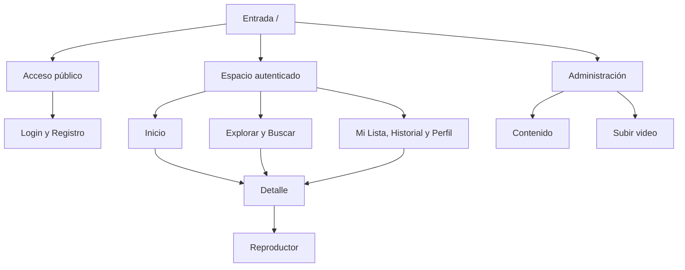
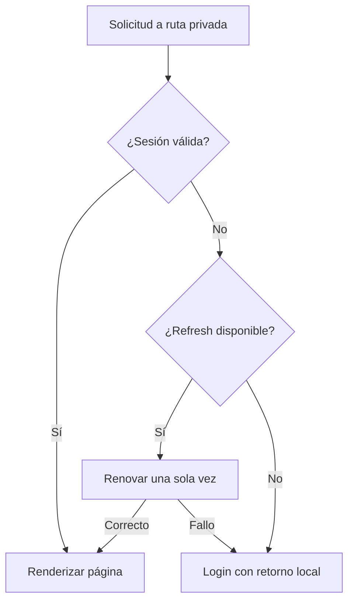
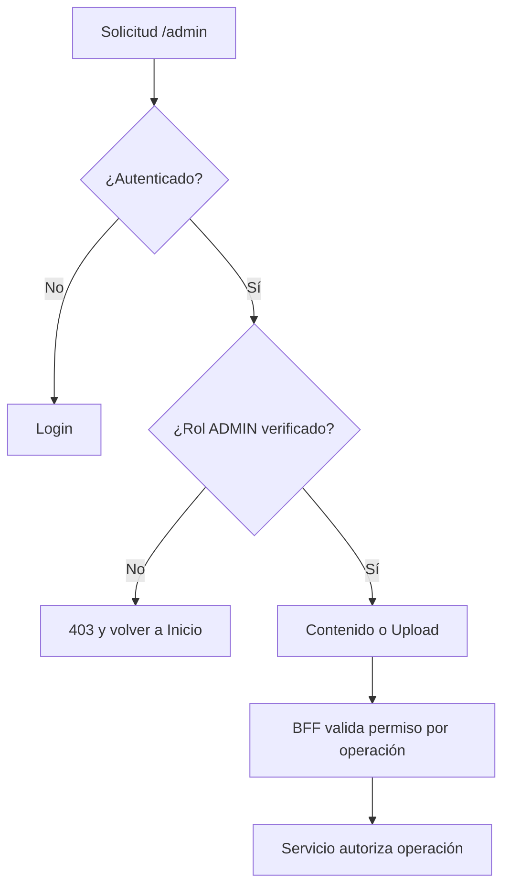

# Arquitectura de información

## Decisión de rutas

URLs sencillas sin `/app`: el layout ya identifica la zona autenticada. Los route groups de Next no cambian URL. `/` redirige según sesión; no landing extra para MVP. Idioma de interfaz español y rutas técnicas inglesas consistentes.

| Ruta propuesta | Acceso | Destino/razón |
|---|---|---|
| /login | Pública | Login; si ya autenticado → /home |
| /register | Pública | Crear cuenta; retorno a login al confirmar |
| /home | USER/ADMIN | Hero + carriles |
| /explore | USER/ADMIN | Tipo/género/año como query params |
| /search?q=... | USER/ADMIN | Resultados compartibles, Enter desde search global |
| /title/[tituloId] | USER/ADMIN | Ficha dedicada |
| /watch/[tituloId] | USER/ADMIN | Reproductor sin navegación global |
| /my-list | USER/ADMIN | Guardados |
| /continue-watching | USER/ADMIN | Ver todos los pendientes |
| /history | USER/ADMIN | Última reproducción por título |
| /profile | USER/ADMIN | Datos e idioma; cambiar contraseña si habilitado |
| /preferences | USER/ADMIN, P2 | Revisar LIKE/DISLIKE |
| /admin | ADMIN | Redirige /admin/content |
| /admin/content | ADMIN | Listado/estado editorial; dashboard integrado |
| /admin/upload | ADMIN | Video → ficha nueva → publicar |
| /admin/content/[tituloId] | ADMIN, P2 | Edición ficha; no asociación asset existente sin G01 |

Películas y Series son `/explore?type=...`; valores API exactos por verificar. No duplicar página y lógica para cada tipo. Continuar e Historial se acceden desde carril/menú, sin saturar navbar.

## Árbol de navegación

## Rutas autenticadas

## Rutas admin

Para Catalog, la autorización de servicio está documentada como ausente: el último paso requiere protección de red/BFF y preferiblemente corrección del servicio. Ocultar enlaces admin no resuelve esto.

## Decisiones UX con trade-offs

| Pregunta | Decisión | Razón | Coste/alternativa descartada |
|---|---|---|---|
| Navbar/sidebar | Superior consumidor, sidebar solo admin | Familiar y deja ancho al contenido | Menos enlaces; Historial pasa al perfil |
| Hero | Moderado, no pantalla completa | Continuar visible antes de mucho scroll | Menos espectáculo estático |
| Cards | Poster en explorar; landscape en progreso; featured en hero | Diferencia descubrir de retomar | Dos composiciones que mantener |
| Detalle | Página dedicada | Enlace estable, back y móvil claros | Un paso de navegación adicional |
| Búsqueda | Página, campo global | URL/teclado/historial coherentes | Menos efecto visual que overlay |
| Bottom nav | Sí, 4 destinos móvil | Acceso con pulgar | Safe-area y espacio reservado |
| Autoplay previews | No | Control del usuario, red y atención | Menos movimiento inicial |
| Light mode | No en MVP | Cierra alcance y QA | Preferencia futura sin resolver |
| LIKE/DISLIKE | Solo detalle, más pantalla de preferencias P2 | Evita cards saturadas | Un paso para opinar |
| Título sin video | Detalle guardable con explicación | No prometer reproducción | Parte del catálogo no reproduce |
| Series sin episodios | Ficha con «Episodios todavía no disponibles» | Colección != API | No demo de reproducción de serie |

El retorno tras login solo admite ruta relativa local de una allowlist; nunca URL arbitraria. Conservar título buscado, no secretos ni URL firmada en parámetros.
