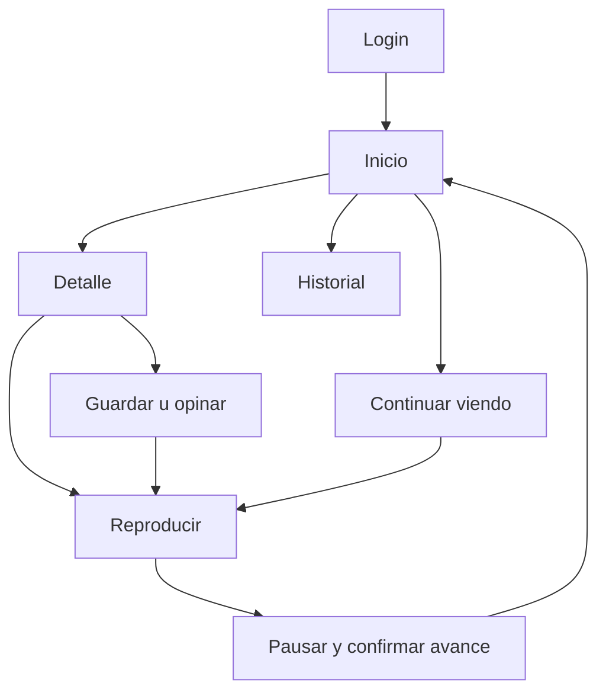
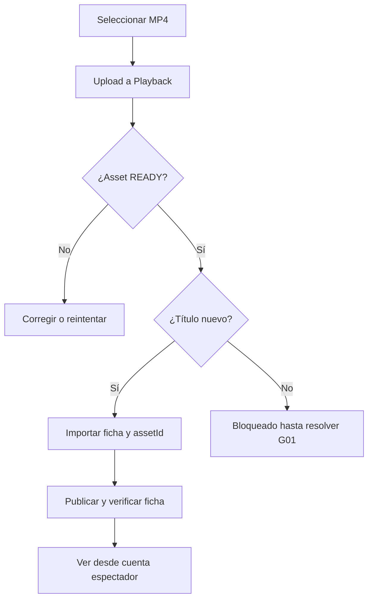

# Flujos y máquinas de interacción

## Recorrido principal

## Autenticación y refresh

Decisión propuesta: BFF mantiene credenciales fuera del JavaScript del navegador, con sesión opaca HttpOnly y almacén server-side. En MVP de una instancia puede ser memoria con TTL; un reinicio obliga a login y debe documentarse. Para varias instancias se requiere un almacén compartido y bloqueo por sesión. No prometer persistencia sin él.

1. Navegador manda login al BFF por mismo origen y con controles CSRF propios.
2. BFF llama Users login, retiene access y refresh del Set-Cookie upstream en un cookie jar por sesión. No reenvía todos los headers o cookies indiscriminadamente.
3. Emite cookie de sesión propia opaca, Secure bajo HTTPS, HttpOnly, SameSite adecuado y Path restringido a app según decisión final.
4. Access expira o servicio responde 401: lock por sesión; comprobar si otra solicitud ya renovó. Rotar refresh una sola vez y guardar el nuevo cookie jar atómicamente.
5. Reintentar una lectura una vez. Mutación no se repite si no se garantiza que 401 ocurrió antes de aplicar efecto; usar semántica/idempotencia verificada o informar resultado incierto.
6. Refresh inválido finaliza sesión local y deriva a login. Un fallo de red/5xx no equivale a credencial revocada: ofrece reintento sin destruir sesión.
7. Logout revoca familia con Users y borra credenciales/cache local. Si upstream falla, borrar sesión local e informar que no se confirmó revocación remota; no afirmar logout global exitoso.

**Bloqueo G02:** falta conocer cómo Users valida CSRF en refresh/logout. La solicitud server-to-server debe satisfacer el protocolo real, no deshabilitarlo ni falsificarlo sin revisión. Cerrar esto antes de implementar el BFF. Ver alternativa en 08.

## Mi Lista

Estado desconocido → leer estado completo → fuera/en lista. Mutación por `(userId,tituloId)` serializada. Al click: cancelar refetch, tomar snapshot de cache de detalle y listas, aplicar cambio local, deshabilitar toggle mientras pendiente. Éxito confirma y revalida páginas afectadas; fallo restaura snapshot y conserva intención para Reintentar. Si ya había refetch más nuevo, revalidar en lugar de sobreescribir con snapshot obsoleto. Cambio de usuario limpia todas las queries privadas.

No concluir «fuera de Mi Lista» porque no aparezca en la primera página. Recorrer páginas con límite razonable o implementar consulta específica G06 antes de activar controles en listas grandes. Para MVP acotado se puede traer todas las referencias de la cuenta demo, explícitamente hasta completar paginación.

## LIKE/DISLIKE

Máquina: UNKNOWN, NEUTRAL, LIKE, DISLIKE, PENDING. UNKNOWN no permite elegir hasta recuperar estado o resolver política de actualización segura. Click LIKE desde neutral/dislike → PUT value LIKE; click LIKE desde LIKE → DELETE. DISLIKE simétrico. Mutua exclusión en modelo y UI; un cambio directo usa un PUT, no DELETE+PUT innecesarios. Rollback conserva valor previo y texto de error; no se simula una recomendación nueva.

## Player: entrada y reproducción

Estados locales: loading-session → loading-metadata → ready-paused → playing/paused/buffering → ended; error recuperable/terminal en paralelo al estado de guardado. Los eventos del elemento video son fuente de verdad del estado media.

1. Resolver tituloId y sesión de usuario. Crear sesión con P01 desde acción controlada y una sola solicitud en vuelo. No colocar POST desnudo en un efecto que se duplique por Strict Mode. Usar controlador por navegación; si se requiere idempotency key, debe estar soportada por backend. Abort no garantiza que POST no haya creado una sesión.
2. Adaptar respuesta real a sessionId, URL, vencimiento y avance. Si no entrega avance inicial, G05 impide prometer retomar; usar lectura documentada que realmente proporcione posición, sin inventar endpoint.
3. Asignar src y esperar loadedmetadata. Posición restaurada = clamp(posición autoritativa, 0, duración). Si finalizado, ofrecer Volver a ver desde cero solo tras verificar cómo reinicia el progreso backend.
4. Intentar play solo por intención del usuario. Si navegador lo rechaza, botón visible para iniciar. No emitir resume inicial si el contrato de creación ya activa sesión y resume no corresponde.
5. Cada 10 s de reproducción con avance real: guardar posición absoluta mediante P02. Una solicitud en vuelo por sesión, cola que coalescea el último valor. No usar timeupdate para petición por frame.
6. Al seek confirmado: guardar nueva posición, incluso si es menor que anterior. No usar máximo local que impida retroceder intencionalmente. Ordenar escrituras para que una respuesta tardía no sobrescriba la intención nueva.
7. Al pause del usuario: pausar video inmediatamente, vaciar última escritura y P03 con posición si contrato lo admite. Solo marcar guardado al confirmar. Buffering no llama pause.
8. Reanudar después de pausa: P04; aplicar URL nueva sin reiniciar tiempo ni duplicar play. No crear nueva sesión por cada pause/resume.
9. Timer de renovación basado en expiresAt real, con margen inicial 60 s (ajustable al TTL), no en 900 fijo. Evitar polling cada segundo. Si pausa larga, revalidar antes de play; al volver de pestaña revisar reloj y expiración.
10. Renovación P06: capturar currentTime y paused; cambiar src si hace falta, esperar metadata y restaurar posición/estado. Si URL aún funciona no interrumpir por error temporal de renovación; anunciar recuperación y acotar retries. Un 403 del storage no implica automáticamente refresh de Users.
11. En ended: vaciar cola y P05 complete una sola vez. No completar por salir ni por superar 90% localmente. Revalidar continue/history después de confirmación.
12. Al volver a detalle/Home con navegación controlada: guardar y pausar antes de desmontar, presupuesto de espera 1.5 s; fallo informa «No se confirmó el último avance» y permite volver. Invalidar cache solo con resultado coherente.
13. visibilitychange/pagehide: flush best-effort con keepalive si payload pequeño y canal autenticado lo permite. No garantiza entrega; no depender de sendBeacon con Bearer (no admite headers arbitrarios). Intervalo periódico limita pérdida en cierre abrupto, sin prometer 0 s.
14. Sesión superseded: detener cola/temporizadores, pausar y mostrar «Este título se abrió en otro reproductor». No reintentar hasta recuperar una sesión por acción explícita.

Aceptar progreso con duration desconocida no implica mostrar porcentaje. SessionId no va a analytics de terceros. URL firmada no se persiste en localStorage ni en historial de rutas. No intentar llamar todos los endpoints al desmontar con fetches concurrentes.

## Administración y publicación

Crear título nuevo con bulk de un elemento solo después de validar el esquema exacto. Conservar `importKey` por intento lógico para idempotencia; no regenerarla en cada retry. Error parcial se procesa por elemento, no solo status HTTP. El BFF limita payloads y endpoints según rol. La referencia se muestra lista para copiar si la ficha falla; no borrar asset automáticamente. Propuesta de compensación: ofrecer «Eliminar asset sin asociar» con confirmación y P12, atendiendo conflictos por sesiones activas.

Cambiar a PUBLICADO después de comprobar ficha y asset; reconsultar detalle y confirmar visibilidad por cuenta USER. No exponer estado publicado optimista. Si se retira, explicar que la transición de vuelta no está documentada.

## Preparación de recomendaciones

Carril futuro consume títulos y razón de un contrato a definir. Si servicio no responde, se omite ese carril sin sustituirlo por algoritmo local ni atribuir causalidad. Eventos outbox pendientes no son un pipeline funcionando. Hasta entonces las señales se guardan y la demo describe ese límite.
