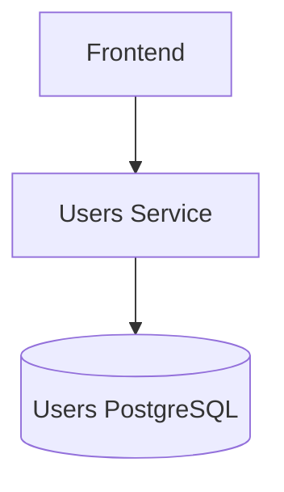
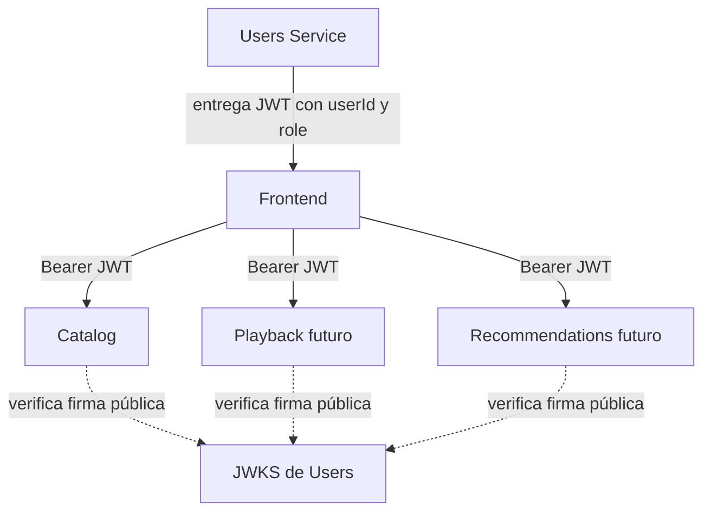
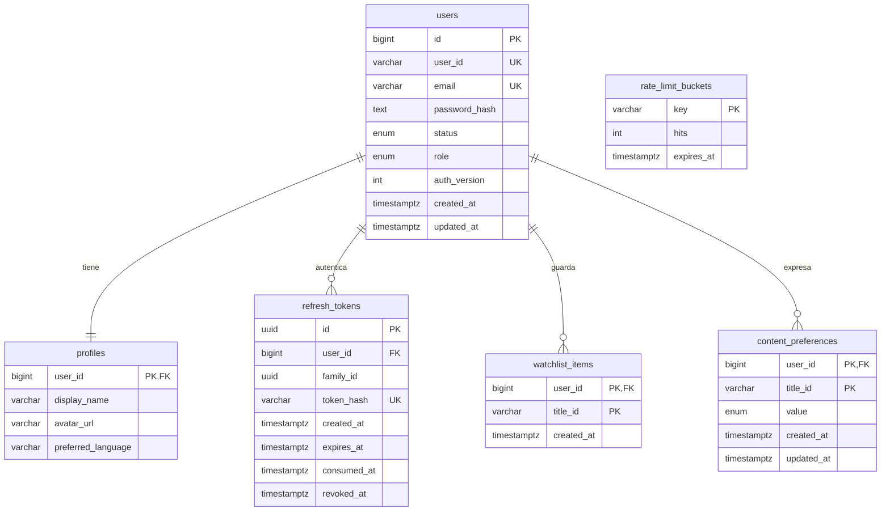

# Arquitectura de Users Service

## Responsabilidad y propiedad de datos

Users es dueño de usuarios, credenciales, perfil, estado, roles, sesiones de autenticación, Mi Lista y preferencias explícitas LIKE/DISLIKE. Cada instancia usa exclusivamente Users PostgreSQL. No accede a Catalog MongoDB ni almacena fichas, posters, géneros, segundos reproducidos, sesiones de reproducción, recomendaciones calculadas o pagos.

**Ningún otro servicio consulta directamente Users PostgreSQL.** El diagrama describe la integración futura; esta entrega no modifica Catálogo ni implementa Playback o Recommendations. El frontend enriquece los `tituloId` consultando la API de Catálogo.

## PostgreSQL y elección de ORM

La unicidad de email, relaciones internas, creación de usuario/perfil y revocación/rotación de sesiones necesitan restricciones y transacciones coordinadas. PostgreSQL expresa estas garantías con índices únicos, claves foráneas, CHECK, enums y bloqueos de fila.

| Opción  | Evaluación para este proyecto                                                                                           |
| ------- | ----------------------------------------------------------------------------------------------------------------------- |
| Prisma  | Modelo declarativo y cliente generado; sería válido para CRUD y relaciones.                                             |
| Drizzle | Esquema TypeScript cercano a SQL, migraciones SQL revisables y acceso explícito a transacciones, `FOR UPDATE` y UPSERT. |

Se elige **Drizzle + node-postgres** para mantener visibles las operaciones de concurrencia del MVP y evitar un cliente generado adicional. Las consultas del ORM y los fragmentos `sql` interpolados usan parámetros, nunca concatenan datos de entrada. La arquitectura depende de puertos propios y permite sustituir el ORM. Véanse [transacciones Drizzle](https://orm.drizzle.team/docs/transactions) y [migraciones Drizzle](https://orm.drizzle.team/docs/migrations).

## Dominio y dependencias

`Usuario` es el agregado raíz. Contiene identidad externa, email normalizado, hash, estado, rol, perfil, versión de autenticación y fechas. `PerfilUsuario` se representa como un valor `Profile` validado, inmutable y sin identidad pública. La tabla `profiles` implementa la relación 1:1 mediante PK/FK compartida; no implica un agregado independiente ni un repositorio de perfiles.

Los valores Email, contraseña, perfil y TituloId tienen validadores puros de dominio. La contraseña en texto plano solo atraviesa el caso de uso y el puerto de hashing; no forma parte del estado persistido. Las fechas devueltas por el agregado son copias.

`domain` no importa Next, PostgreSQL, Drizzle, Zod ni JOSE. `application` contiene 13 casos de uso e interfaces para hashing/tokens, reloj e IDs. Los repositorios se definen en dominio. Infraestructura implementa los cuatro repositorios y la criptografía; el bootstrap conecta las dependencias. HTTP usa Zod, valida cuerpos y traduce errores, sin lógica de sesión en `route.ts`.

Se usa **UUID v4 con prefijo `usr_`** como UserId externo: puede generarse sin consultar PostgreSQL, no depende de secuencias internas y es coherente con `ttl_UUIDv4` de Catalog. El bigint interno optimiza relaciones locales y nunca se expone en DTO/JWT.

Watchlist y ContentPreference se gestionan mediante repositorios propios para evitar cargar colecciones potencialmente grandes dentro del agregado Usuario. Solo tienen relación interna con el usuario y una referencia externa opaca a Catálogo.

## Modelo PostgreSQL

Enums: `user_status` ACTIVE/INACTIVE, `user_role` USER/ADMIN y `preference_value` LIKE/DISLIKE. En Watchlist y Preferences la PK compuesta impone también UNIQUE `(user_id,title_id)` sin añadir un ID artificial. No existe FK hacia Catálogo.

Índices: identidad y email únicos; hash refresh único; refresh por usuario, familia y caducidad; listados por usuario/fecha/título; expiración de contadores. Las PK cubren perfil y operaciones sobre una referencia. Todos los hijos usan FK internas con `ON DELETE CASCADE`; esta versión no expone borrado de cuenta.

La migración inicial `drizzle/0000_busy_carlie_cooper.sql` crea las seis tablas, los tres enums y restricciones. Drizzle registra el historial en su esquema de migraciones. `db:migrate` adquiere un advisory lock sobre una conexión antes de aplicar migraciones; repetirlo no recrea tablas. No se usa `push` ni sincronización destructiva en runtime.

## Registro, login y hashing

El registro normaliza email con trim/lowercase, valida entradas estrictas, asigna USER/ACTIVE y hashea antes de abrir la transacción. Usuario y perfil se insertan juntos; si falla el perfil se revierte el usuario. La restricción UNIQUE resuelve también registros concurrentes.

Contraseñas de 12–128 caracteres Unicode, sin NUL; no se recortan ni se transforman. Se usa **Argon2id**, 19456 KiB de memoria, 2 iteraciones, paralelismo 1 y sal aleatoria por hash. Estos parámetros corresponden al mínimo indicado en [OWASP Password Storage](https://cheatsheetseries.owasp.org/cheatsheets/Password_Storage_Cheat_Sheet.html); deberán medirse para el hardware y tráfico de un despliegue real.

Login devuelve el mismo `INVALID_CREDENTIALS` para contraseña incorrecta, email inexistente o cuenta inactiva. Un email inexistente ejecuta verificación Argon2 sobre un hash dummy para reducir diferencias evidentes de trabajo; no se promete tiempo idéntico de red/BD. El registro sí informa EMAIL_ALREADY_EXISTS por requisito del contrato.

## JWT y autorización entre servicios

Access token RS256 con `sub=userId`, `userId`, `role`, `ver`, `iss`, `aud`, `iat`, `exp` y `jti`. Vida predeterminada 900 segundos, configurable entre 60 y 1800. No incluye email, perfil, hashes ni referencias multimedia. El consumidor verifica firma, algoritmo permitido, issuer, audience, vencimiento y claims; un token válido identifica al usuario, pero cada servicio aplica sus propios permisos.

Users firma con clave privada PKCS8. `/.well-known/jwks.json` publica exclusivamente la clave pública y `kid`. Los demás servicios no reciben el secreto privado. Se comprueba que el par configurado coincide. El consumidor debe fijar una URL JWKS de confianza y no seguir `jku` arbitrarios del token.

La versión inicial usa una sola clave activa. Para una rotación sin invalidar accesos vigentes se extenderá JWKS con claves anteriores, se empezará a firmar con un nuevo `kid` y se mantendrá la anterior al menos durante el TTL máximo más tolerancia de reloj/caché. No se afirma que esa rotación múltiple esté implementada.

Todos los endpoints `me` extraen identidad del Bearer, nunca de un `userId` en body/query. Los casos de uso comprueban ACTIVE, rol y authVersion contra **su propia** base. Se incluye guard de rol para futuras operaciones ADMIN; no se añaden endpoints administrativos ni se aceptan roles en registro/perfil.

## Refresh, logout y cambio de contraseña

Refresh es un secreto aleatorio de 256 bits, codificado base64url. Se guarda exclusivamente SHA-256, apropiado para un token con alta entropía generado por servidor; no se aplica ese hash rápido a contraseñas. Una familia representa una sesión iniciada por login. Cada rotación consume el token anterior y agrega otro registro con la misma familia y la misma caducidad absoluta.

Para coordinar login, refresh, logout y password change se bloquea primero la fila del usuario. En refresh, el token se relee después del bloqueo. Si está consumido/revocado se revoca la familia completa y **se confirma esa revocación antes de devolver 401**. Dos refresh simultáneos con el mismo token provocan detección de reutilización; el cliente debe hacer una única renovación en vuelo. Esta estrategia sigue el principio de rotación y detección de replay de [RFC 9700 §4.14](https://www.rfc-editor.org/rfc/rfc9700.html#section-4.14).

Un refresh desconocido, vencido, revocado o perteneciente a usuario inactivo se rechaza. El historial no se elimina mientras la familia pueda seguir vigente. `db:cleanup` elimina tokens con caducidad de más de un día y contadores vencidos; se puede programar como tarea de operación.

Logout revoca la familia correspondiente, incluso si recibe el token anterior a una rotación reciente, y borra la cookie. No invalida access tokens ya emitidos: pueden durar hasta su `exp`; el frontend debe descartarlos al salir.

ChangePassword exige la contraseña actual, compara también el hash esperado al escribir, reemplaza el hash, incrementa authVersion y revoca **todas** las sesiones en una transacción. Users rechaza inmediatamente access tokens de versiones anteriores. Un servicio externo que solo verifica JWT seguirá aceptándolos hasta expirar; revocación inmediata distribuida necesitará eventos o introspección en una evolución posterior.

## Cookies, CSRF y despliegue web

El refresh solo viaja mediante `users_refresh`, cookie **HttpOnly, SameSite=Strict, Path=/api/v1/auth**, sin Domain. Usa Secure cuando `APP_ENV=production`, y ese modo exige APP_ORIGIN HTTPS. El modo development admite HTTP local aunque Next se compile en producción para Docker. Access tokens se devuelven en JSON y se recomienda conservarlos en memoria del frontend.

Las escrituras rechazan Origin diferente a APP_ORIGIN y `Sec-Fetch-Site: cross-site`. Refresh/logout exigen un Origin coincidente o `X-CSRF-Protection: 1` cuando no se envía Origin, útil para clientes CLI. No se habilita CORS entre orígenes por defecto. El frontend previsto debe compartir origen mediante reverse proxy; si se cambia esta topología se deberá definir una allowlist explícita y revisar cookies/CSRF.

## Rate limiting y protección de entradas

`rate_limit_buckets` es infraestructura, no una tabla del agregado. Un UPSERT atómico cuenta intentos por endpoint global y, en login/register, por hash de email normalizado. ChangePassword cuenta por usuario autenticado. Ventana predeterminada 900 s, login 10/email, registro 5/email, 200 solicitudes globales por endpoint de autenticación. Exceder responde 429 con Retry-After.

Se comparte entre procesos/réplicas; no confía en X-Forwarded-For. La capa Next no dispone aquí de una identidad de IP confiable, por lo que el límite global protege también contra cuentas aleatorias. Existe un trade-off de disponibilidad: un tercero puede agotar la cuota de una cuenta o el límite global. Un despliegue público necesitará controles de borde con IP autenticada por proxy y dimensionamiento de Argon2. No se añade Redis para este MVP.

Zod rechaza claves desconocidas, roles/estado editables, IDs malformados y queries repetidas. Cuerpos JSON tienen un límite real de bytes. Las consultas parametrizadas y listas cerradas evitan operadores/SQL recibidos del cliente. Listados usan page/limit, máximo 100 y offset 10000; conteo y página separados no son una instantánea transaccional.

## Watchlist, preferencias y evolución

POST Watchlist devuelve 409 si ya existe; DELETE es idempotente. PUT Preferences crea o actualiza LIKE/DISLIKE, conserva createdAt y no altera updatedAt al repetir el mismo valor. Toda operación se restringe al usuario autenticado.

Se valida la forma de TituloId, sin llamada síncrona a Catalog. Esto evita que una caída de Catálogo bloquee las escrituras de Users y mantiene bajo acoplamiento. A cambio, puede almacenarse una referencia a un título inexistente o retirado. El frontend manejará 404/estado al enriquecerla; una futura reconciliación podrá consumir eventos de Catálogo. No hay copia de metadata ni joins entre bases.

Recommendations podrá consumir señales a través de un contrato autorizado o eventos futuros. La API actual `me/preferences` solo permite al usuario leer sus señales; no es un acceso administrativo masivo ni un algoritmo de recomendaciones. Playback será dueño exclusivo de sesiones y progreso.

## Logs, operación y límites del MVP

Logs JSON por petición con requestId, plantilla de endpoint, método, statusCode y durationMs. No se registran bodies, email, Authorization, cookies, claves ni DATABASE_URL. Errores desconocidos se sanitizan sin stack. Health comprueba PostgreSQL y claves, devolviendo 503 ante indisponibilidad.

Imagen multi-stage y usuario node no root, PostgreSQL separado con healthcheck y volumen propio. Migraciones se ejecutan antes de la API. Secretos se inyectan en runtime; el build no necesita base ni claves. El seed solo se permite en development, usa contraseña proporcionada/generada y no sobrescribe cuentas existentes.

No se implementan verificación de email, recuperación de contraseña, MFA, administración de roles, rotación multi-clave, eventos, frontend ni borrado de cuentas. No son requisitos de esta fase. Pruebas separadas de dominio/aplicación, PostgreSQL real aislado y HTTP sobre la imagen Docker verifican el alcance actual.
